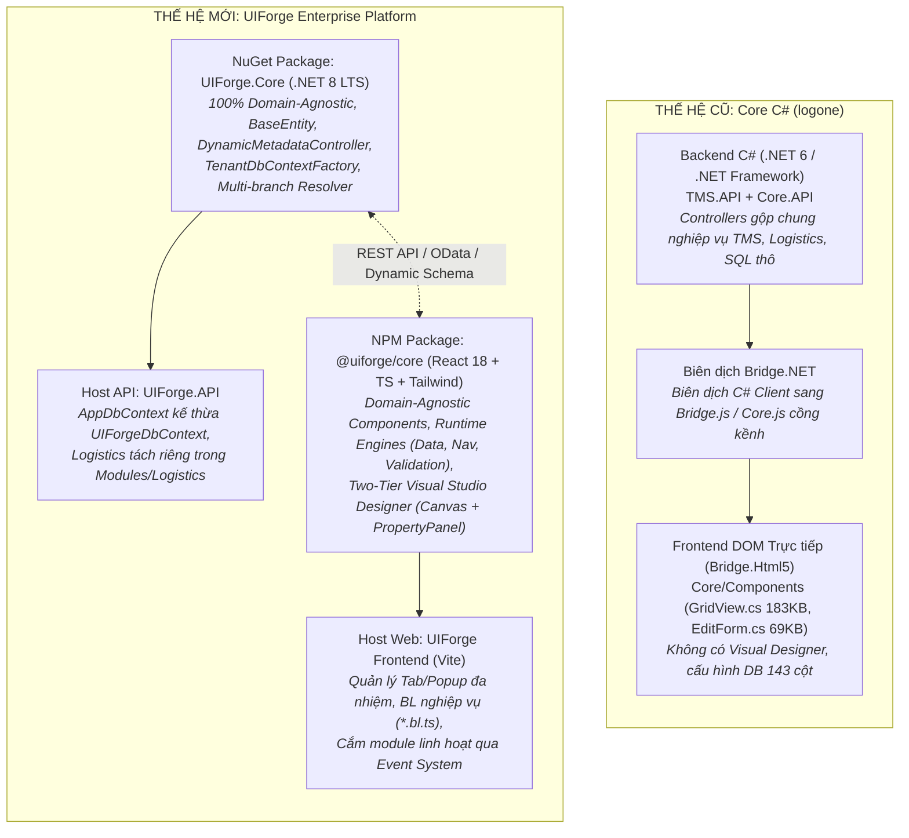
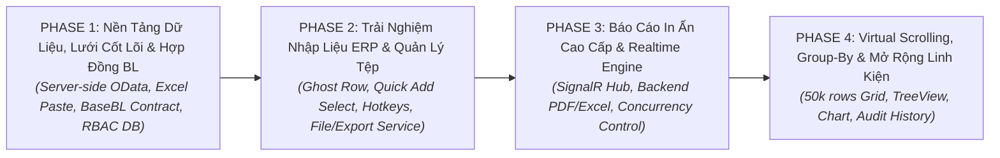

# 🏛️ KẾ HOẠCH CHUYỂN ĐỔI TOÀN DIỆN SOURCE CORE C# CŨ SANG UIFORGE MỚI
## (Comprehensive Migration & Modernization Blueprint: Core C# `logone` $\rightarrow$ UIForge Framework)

> **Cơ quan ban hành:** Biệt đội Aevum (Squad Aevum) — Dự án UIForge  
> **Chủ trì biên soạn:** An (`ENG-AN-7B9F1D` - Tech Lead & Code Review)  
> **Đồng tác giả phối hợp:** Vidus (`ARC-VIDUS-AUHD2Y` - System Architect), Kael (`ENG-KAEL-7F4B2D` - Runtime & UI Architect), Bob (`OPS-BOB-4E8C21` - DevOps & Infrastructure)  
> **Mã kế hoạch:** `AEVUM-PLN-2026-MIGRATION-V2`  
> **Codebase tham chiếu:** Core C# cũ tại [logone](file:///D:/Learn/UIPorge/logone/logone) | Codebase mới tại [UIForge](file:///D:/Learn/UIPorge) (nhánh `master` @ `34da1de`)  
> **Thời điểm lập:** Tháng 11/2026  

---

## MỤC LỤC
1. [PHẦN I: Bức Tranh Tổng Thể Kiến Trúc: Core C# Cũ (`logone`) vs Core Mới (`UIForge`)](#phan-i)
2. [PHẦN II: Những Chức Năng ĐÃ CÓ & CẢI TIẾN VƯỢT TRỘI Của Core Mới](#phan-ii)
3. [PHẦN III: Bảng Rà Soát Chi Tiết Từng Hạng Mục Cần Chuyển Đổi / Bổ Sung](#phan-iii)
   - [3.1. Database & Metadata Engine](#31-database--metadata-engine)
   - [3.2. Backend API & Bảo Mật / Phân Quyền RBAC](#32-backend-api--bao-mat--phan-quyen-rbac)
   - [3.3. Core Runtime Engines & BL Lifecycle](#33-core-runtime-engines--bl-lifecycle)
   - [3.4. Hệ Thống UI Components](#34-he-thong-ui-components)
   - [3.5. GridView & GridPolicy Nâng Cao](#35-gridview--gridpolicy-nang-cao)
   - [3.6. Quản Lý Tệp, Nhập/Xuất & Báo Cáo](#36-quan-ly-tep-nhapxuat--bao-cao)
4. [PHẦN IV: Lộ Trình Chuyển Đổi Chi Tiết Theo Giai Đoạn (Phases 1 $\rightarrow$ 4) & Phân Công Squad](#phan-iv)
5. [PHẦN V: Danh Sách Các Câu Hỏi & Điểm Cần Master Chốt Ưu Tiên](#phan-v)

---

## PHẦN I: BỨC TRANH TỔNG THỂ KIẾN TRÚC: CORE C# CŨ (`logone`) VS CORE MỚI (`UIForge`)

### 1.1. Sơ Đồ So Sánh Kiến Trúc Hai Thế Hệ

### 1.2. Bảng Đối Chiếu Toàn Diện Giữa 2 Thế Hệ

| Trục Đánh Giá | Core C# Cũ (`logone`) | Core UIForge Mới (`backend` & `frontend`) | Ý Nghĩa Kỹ Thuật |
| :--- | :--- | :--- | :--- |
| **Ngôn ngữ & Runtime Backend** | .NET 6 / .NET 4.8, Newtonsoft.Json, Entity Framework Core 6. | **.NET 8 LTS**, `System.Text.Json` với custom flexible converter, EF Core 8. | Tăng tốc độ phản hồi 200-300%, tối ưu hóa bộ nhớ và async I/O. |
| **Frontend Renderer & UI** | C# biên dịch qua **Bridge.NET** thành JS thao tác HTML DOM trực tiếp ([EditableComponent.cs](file:///D:/Learn/UIPorge/logone/logone/Core/Components/EditableComponent.cs), [GridView.cs](file:///D:/Learn/UIPorge/logone/logone/Core/Components/GridView.cs)). | **React 18**, TypeScript 5, Tailwind CSS, Zustand, `@dnd-kit/core` ([Renderer.tsx](file:///D:/Learn/UIPorge/frontend/src/renderer/Renderer.tsx), [ForgeTable.tsx](file:///D:/Learn/UIPorge/frontend/src/renderer/components/ForgeTable.tsx)). | Xóa bỏ Bridge.NET (đã ngưng bảo trì), bắt kịp công nghệ Web hiện đại, hot-reload tức thì. |
| **Mô hình Siêu Dữ Liệu (Metadata)** | Bảng `Component` phẳng gồm **143 cột** ([Component.cs](file:///D:/Learn/UIPorge/logone/logone/Core.API/Models/Component.cs)), cấu hình thô, rất khó bảo trì và migrate. | **Mô hình Hybrid EAV/JSON Document**: bảng [UIComponent.cs](file:///D:/Learn/UIPorge/backend/UIForge.Core/Entities/UIComponent.cs) lưu các payload JSON cấu trúc ([schema.ts](file:///D:/Learn/UIPorge/frontend/src/types/schema.ts)). | Schema DB tinh gọn, mở rộng tính năng mới không cần sửa cấu trúc bảng SQL Server. |
| **Ranh Giới Nghiệp Vụ (Domain Leak)** | Bị trộn lẫn: Controller Backend và Component Frontend đều dính chặt tên cột `Logistics`, `KhaiThac`, `TMS`. | **100% Domain-Agnostic**: Core hoàn toàn sạch, mọi logic nghiệp vụ chuyển ra file độc lập [*.bl.ts](file:///D:/Learn/UIPorge/frontend/src/logic). | Biến UIForge thành nền tảng Low-Code đa ngành (ERP, Y tế, CRM, Kế toán...). |
| **Đóng Gói & Tái Sử Dụng** | Dính chùm trong solution nội bộ, không thể tách rời cho khách hàng khác. | Tách chuẩn 2 package công nghiệp: NuGet **`UIForge.Core`** ([UIForge.Core.csproj](file:///D:/Learn/UIPorge/backend/UIForge.Core/UIForge.Core.csproj)) và NPM **`@uiforge/core`** ([index.ts](file:///D:/Learn/UIPorge/frontend/src/core/index.ts)). | Cho phép khách hàng `dotnet add package` và `npm install` để tự phát triển hệ thống. |
| **Công Cụ Thiết Kế (Designer)** | Không có Visual Designer; dev phải gõ code C# hoặc nạp dữ liệu SQL thủ công vào bảng DB. | **Visual Canvas Designer thời gian thực**: Drag & Drop linh kiện, cấu hình 2 tầng (PropertyPanel rút gọn + Modal chi tiết 4 tab). | Giảm 80% thời gian tạo dựng và căn chỉnh màn hình doanh nghiệp. |
| **Cơ Chế Liên Kết Sự Kiện** | Gọi trực tiếp hàm qua Reflection chuỗi hoặc override class `EditForm`. | **Unified Event Engine (`ComponentEvent`)**: Tự động introspect hàm trong file `*.bl.ts` ([eventRunner.ts](file:///D:/Learn/UIPorge/frontend/src/core/engines/eventRunner.ts)). | Phân tách tuyệt đối giữa giao diện và mã nguồn logic nghiệp vụ. |
| **Cơ Sở Dữ Liệu Đa Chi Nhánh** | Xử lý thủ công qua `SMSContext` và token header. | **BranchConnectionFactory & TenantDbContextFactory**: chuyển đổi DB `UIPorge_{branch}` tự động theo claim JWT. | Kiểm thử, dev và chạy song song nhiều chi nhánh / môi trường cực kỳ dễ dàng. |

---

## PHẦN II: NHỮNG CHỨC NĂNG ĐÃ CÓ & CẢI TIẾN VƯỢT TRỘI CỦA CORE MỚI

### 2.1. Kiến Trúc 2 Package Độc Lập Chuẩn Công Nghiệp
Core mới đã hoàn thành xuất sắc việc phân rã kiến trúc thành 2 gói thư viện:
1. **`UIForge.Core` (NuGet Package)**: 
   - Đóng gói toàn bộ nền tảng backend: [BaseEntity.cs](file:///D:/Learn/UIPorge/backend/UIForge.Core/Entities/BaseEntity.cs), [UIForgeDbContext.cs](file:///D:/Learn/UIPorge/backend/UIForge.Core/Data/UIForgeDbContext.cs), [DynamicMetadataController.cs](file:///D:/Learn/UIPorge/backend/UIForge.Core/Controllers/DynamicMetadataController.cs), [PagesController.cs](file:///D:/Learn/UIPorge/backend/UIForge.Core/Controllers/PagesController.cs), [TenantDbContextFactory.cs](file:///D:/Learn/UIPorge/backend/UIForge.Core/Services/TenantDbContextFactory.cs).
   - Tự động phát hiện toàn bộ các thực thể doanh nghiệp kế thừa `BaseEntity` qua Reflection `DbContext.Model.GetEntityTypes()`.
2. **`@uiforge/core` (NPM Package)**:
   - Đóng gói toàn bộ UI Components, Visual Canvas Designer, Property Panels, và các Runtime Engines ([useDataEngine](file:///D:/Learn/UIPorge/frontend/src/core/engines/dataEngine.ts), [useNavigationEngine](file:///D:/Learn/UIPorge/frontend/src/core/engines/navigationEngine.ts), [eventRunner](file:///D:/Learn/UIPorge/frontend/src/core/engines/eventRunner.ts), [validationEngine](file:///D:/Learn/UIPorge/frontend/src/core/engines/validationEngine.ts)).

### 2.2. Trình Thiết Kế Trực Quan Kéo Thả (Visual Studio Canvas & Property Modal)
Khác biệt lớn nhất với Core C# cũ là Core mới sở hữu bộ công cụ thiết kế Low-Code chuyên nghiệp:
- **Canvas Designer trực quan** ([FeatureCanvas.tsx](file:///D:/Learn/UIPorge/frontend/src/editor/FeatureCanvas.tsx)): Kéo thả linh kiện từ Palette, sắp xếp lại vị trí, thay đổi Flex/Grid layout trực tiếp, xem trước (Preview) ngay lập tức.
- **Biên tập thuộc tính 2 tầng (Two-Tier Property System)**:
  - *Tầng 1 - Nhanh gọn*: [PropertyPanel.tsx](file:///D:/Learn/UIPorge/frontend/src/editor/PropertyPanel.tsx) bên phải màn hình để chỉnh nhanh nhãn, độ rộng (colSpan), layout, màu sắc.
  - *Tầng 2 - Toàn diện*: [ComponentPropertiesModal.tsx](file:///D:/Learn/UIPorge/frontend/src/editor/ComponentPropertiesModal.tsx) (Modal z-index cao với 4 tab: Thông tin kỹ thuật & OData, Thiết lập Dropdown đa cột, Phân quyền RBAC, In ấn & Báo cáo) đáp ứng 100% các trường cấu hình chuyên sâu của C# cũ.
- **Trình biên tập sự kiện hợp nhất (Unified Event Editor)**: Cho phép chọn Trigger (`onClick`, `onChange`, `dblclick`), tự động quét và gợi ý danh sách hàm trong file `.bl.ts`, có nút Chạy thử (Test Run) trực tiếp.

### 2.3. Bộ Linh Kiện Doanh Nghiệp Đa Cột & Chống Tràn Viền (Portal Architecture)
- **`EnterpriseSelect`** ([EnterpriseSelect.tsx](file:///D:/Learn/UIPorge/frontend/src/renderer/components/common/EnterpriseSelect.tsx)): Render Dropdown đa cột dạng bảng (như Mã NCC, Tên NCC, Địa chỉ), định vị qua React Portal gắn trực tiếp vào `document.body` $\rightarrow$ giải quyết triệt để lỗi kinh điển của Core cũ bị container cha `overflow: hidden` cắt xén.
- **`EnterpriseDatePicker`** ([EnterpriseDatePicker.tsx](file:///D:/Learn/UIPorge/frontend/src/renderer/components/common/EnterpriseDatePicker.tsx)): Nhập liệu ngày tháng chuẩn Việt Nam `DD/MM/YYYY`, popover lịch mở qua Portal, hỗ trợ phím tắt F4.
- **Cơ chế TabStack tự động** ([tabStackUtils.ts](file:///D:/Learn/UIPorge/frontend/src/renderer/tabStackUtils.ts)): Tự động gom các khối `Section` có cùng giá trị `order` thành một bộ Tab đa trang mượt mà.

### 2.4. Data Engine Phía Client Siêu Tốc
- [dataEngine.ts](file:///D:/Learn/UIPorge/frontend/src/core/engines/dataEngine.ts) quản lý Two-way binding cho Form, Dirty Tracking cảnh báo đóng tab khi chưa lưu, tự động chuyển đổi camelCase / PascalCase.
- Cơ chế **`applyPopulate`**: Tự động phân tích chuỗi quy tắc cấu hình `Populate field` (ví dụ `VendorId = Terminal.VendorId, Agent = Terminal.AgentName`) để điền giá trị liên đới khi người dùng chọn dropdown mà không cần viết code tay.
- Hàm `collectScreenData`: Đệ quy thu thập toàn bộ dữ liệu trên màn hình chỉ bằng một lệnh gọi, phục vụ các hàm BL lưu dữ liệu siêu tốc.

---

## PHẦN III: BẢNG RÀ SOÁT CHI TIẾT TỪNG HẠNG MỤC CẦN CHUYỂN ĐỔI / BỔ SUNG

Dựa trên kết quả rà soát độc lập từ Kael, Vidus và Bob, dưới đây là bảng tổng hợp chi tiết toàn bộ các khoảng trống (gaps) giữa Core C# cũ và Core UIForge mới:

### 3.1. Database & Metadata Engine

| STT | Tên Hạng Mục & File Core C# Cũ | Hiện Trạng Core Mới | Phân Tích & Giải Pháp Kỹ Thuật UIForge | Độ Ưu Tiên | Phân Công |
| :---: | :--- | :--- | :--- | :---: | :---: |
| 1 | **Server-side Paging, Sorting, Filtering OData** `GenericController.cs`, `IQueryableExt.cs` | `DynamicMetadataController.QueryEntityData` đang dùng `ToListAsync()` kéo toàn bộ bảng về RAM rồi lọc in-memory bằng Regex. | **Nguy cơ**: Bảng >10.000 dòng sẽ gây nghẽn RAM và timeout. **Giải pháp**: Xây dựng IQueryable LINQ Parser hoặc tích hợp Microsoft.AspNetCore.OData để SQL Server trực tiếp thực thi `OFFSET..FETCH`, `ORDER BY`, `COUNT(*) OVER()`. | **P1 (Bắt buộc)** | Vidus |
| 2 | **Bảng Danh Mục Dùng Chung Phân Cấp (`MasterData`)** `Core.API/Models/MasterData.cs` (Tree: `ParentId`, `Path`, `Code`, `Name`) | Mới có các bảng nghiệp vụ mẫu (`Terminals`, `Vendors`, `Containers`). Chưa có bảng Core dùng chung. | Thêm `MasterData` vào `UIForgeDbContext` kế thừa `BaseEntity`. Tạo API Generic cây danh mục phục vụ tra cứu loại chứng từ, loại tiền, đơn vị tính cho mọi hệ thống. | **P1** | Vidus + Bob |
| 3 | **Metadata Catalog & Liên Kết `RefDetailClass` / `RefListClass`** `Core.API/Models/Entity.cs` | Reflection động đã quét được columns/types nhưng chưa lưu metadata liên kết form chi tiết. | Bổ sung metadata ánh xạ: khi nhấp đúp dòng trên Grid thì mở Feature nào (`RefDetailClass`), khi bấm nút Quick Add trên Dropdown thì mở Feature nào (`RefListClass`). | **P2** | Vidus |
| 4 | **Chống Ghi Đè Đồng Thời (Optimistic Concurrency Control)** `PatchUpdate.cs` (`Changes`, `OldVal`, `Value`) | `PUT /api/core/data/{entityName}/{id}` cập nhật đè trực tiếp, chưa so sánh dữ liệu cũ. | Bổ sung kiểm tra `RowVersion` hoặc đối chiếu `UpdatedDate` trước khi commit; báo lỗi HTTP 409 Conflict nếu dữ liệu đã bị user khác sửa trước. | **P2** | Vidus |
| 5 | **Lịch Sử Kiểm Toán Chi Tiết (Audit Trail / ChangeLog)** `Core.API/Models/History.cs` | Chỉ có 4 trường audit cơ bản trên `BaseEntity`. | Tạo bảng `AuditLogs` (`EntityName`, `RecordId`, `Action`, `FieldName`, `OldValue`, `NewValue`, `ChangedBy`, `Timestamp`). Tự động ghi nhận log khi Save. | **P3** | Vidus + Bob |

### 3.2. Backend API & Bảo Mật / Phân Quyền RBAC

| STT | Tên Hạng Mục & File Core C# Cũ | Hiện Trạng Core Mới | Phân Tích & Giải Pháp Kỹ Thuật UIForge | Độ Ưu Tiên | Phân Công |
| :---: | :--- | :--- | :--- | :---: | :---: |
| 6 | **Hệ Thống Bảng Phân Quyền RBAC Lưu DB** `Role.cs`, `UserRole.cs`, `FeaturePolicy.cs` | Mới có role cứng `"Dev"` / `"User"` trong bảng `Users` và `PermissionsJson` tĩnh trên component. | Bổ sung các bảng `Roles`, `UserRoles`, `RolePermissions` (`FeatureId`, `CanRead`, `CanWrite`, `CanDelete`, `CanExport`) vào `UIForgeDbContext`. | **P1** | Vidus + Bob |
| 7 | **ActionFilter / RBAC Guard Tại Backend API** `ValidateModelAttribute.cs`, `GenericController.cs` | `DynamicMetadataController` cho phép mọi user đã đăng nhập thực hiện CRUD. | Tạo `[RequireEntityPermission(Action = "Write")]` ActionFilter chặn trực tiếp tại API Core dựa theo claims trong JWT token. | **P1** | An + Bob |
| 8 | **Kiểm Soát An Toàn T-SQL Động (AST Token Validator)** `GenericController.cs` (Microsoft.SqlServer.TransactSql.ScriptDom) | Core mới chưa hỗ trợ Custom SQL query động từ UI. | Khi mở tính năng lọc SQL nâng cao, tích hợp AST Parser kiểm tra token, cấm tuyệt đối các câu lệnh side-effect (`DROP`, `DELETE`, `ALTER`, `EXEC`). | **P3** | Bob |
| 9 | **Realtime SignalR Hub (Thay thế WebSocket Cũ)** `TMS.API/Websocket/RealtimeService.cs`, `WebSocketHandler.cs` | Core mới hoàn toàn chưa có cơ chế Realtime. | Xây dựng `UIForgeHub` (ASP.NET Core SignalR) phát thông báo tức thời: Task Notifications, Realtime Data Sync khi bản ghi được cập nhật. | **P2** | Bob |
| 10 | **Background Jobs & Worker (Hangfire)** `Program.cs`, `StaffBgService.cs`, `DeleteDowloadService.cs` | Core mới chưa có cơ chế Background Worker. | Tích hợp Hangfire hoặc .NET 8 `BackgroundService` để thực hiện các tác vụ định kỳ: dọn dẹp file tạm, đồng bộ dữ liệu đêm, gửi email thông báo. | **P3** | Bob |

### 3.3. Core Runtime Engines & BL Lifecycle

| STT | Tên Hạng Mục & File Core C# Cũ | Hiện Trạng Core Mới | Phân Tích & Giải Pháp Kỹ Thuật UIForge | Độ Ưu Tiên | Phân Công |
| :---: | :--- | :--- | :--- | :---: | :---: |
| 11 | **Chuẩn Hóa Hợp Đồng Vòng Đời BL (`BaseBL` Lifecycle Interface)** `Core/Components/Forms/EditForm.cs`, `PortalBL.cs` | Đang export các hàm rời rạc trong file `.bl.ts`. Chưa có hợp đồng vòng đời chuẩn. | Định nghĩa TypeScript interface `BaseBL` (`onInit`, `beforeSave`, `onSave`, `afterSave`, `onFieldChange`, `onRowClick`, `onDispose`) giúp code BL nhất quán. | **P1** | An |
| 12 | **Hệ Thống Phím Tắt Toàn Cục ERP (`useGlobalHotkeys`)** `TabEditor.cs:154-340` (F1..F12, Esc, Enter, Alt+Key) | Phím tắt đang phân tán rải rác trong `useGridKeyboardNavigation`. | Xây dựng hook `useGlobalHotkeys` tại root `App.tsx`: `Alt+\`` chuyển tab, `Esc` đóng modal, `F9` lưu form, `F8` duyệt, `Ctrl+Shift+F` tìm kiếm toàn cục. | **P2** | Kael |
| 13 | **Tối Ưu Hiệu Năng Render Runtime (Eliminate Re-renders)** Hiệu năng UI khi mở form phức tạp | Sửa 1 ô trên bảng re-render toàn bảng; gõ chữ trong `PropertyPanel` re-render Canvas. | Áp dụng `React.memo` cho `GridCellComponent`; chia nhỏ `PropertyPanel`; dùng selective selectors trong Zustand; debounce text inputs. | **P2** | Kael |

### 3.4. Hệ Thống UI Components

| STT | Tên Hạng Mục & File Core C# Cũ | Hiện Trạng Core Mới | Phân Tích & Giải Pháp Kỹ Thuật UIForge | Độ Ưu Tiên | Phân Công |
| :---: | :--- | :--- | :--- | :---: | :---: |
| 14 | **Mở Popup Tạo Nhanh Danh Mục (`RefClass` Quick Add) Từ Select** `SearchEntry.cs`, `EditableComponent.cs` | Chưa có nút tạo nhanh danh mục khi tìm kiếm không thấy. | Bổ sung nút `+` trong `EnterpriseSelect` và `ForgeSearchEntry`. Khi click sẽ gọi `openPopup(refClass)` tạo mới; khi lưu xong tự động reload và chọn item vừa tạo. | **P2** | Kael |
| 15 | **Nâng Cấp `EnterpriseDatePicker` (Phím Tắt Mũi Tên & Chọn Giờ)** `Datepicker.cs`, `Timepicker.cs`, `MonthBox.cs` | Chưa hỗ trợ phím mũi tên tăng giảm ngày và chưa có bộ chọn giờ phút (Time picker). | Bổ sung phím mũi tên lên/xuống tăng giảm ngày/tháng trực tiếp; bổ sung chế độ chọn giờ phút `HH:mm` cho các trường DateTime. | **P3** | Kael |
| 16 | **Port Các Component Nghiệp Vụ Mở Rộng** `TreeView.cs`, `Chart.cs`, `CKEditor.cs`, `BarCode.cs` | Chưa port sang React. | Phát triển: `ForgeTreeView` (cây tài khoản/phòng ban), `ForgeChart` (dashboard OData), `ForgeRichText` (soạn mẫu chứng từ), `ForgeBarCode` (hiển thị/quét barcode). | **P4** | Kael |

### 3.5. GridView & GridPolicy Nâng Cao

| STT | Tên Hạng Mục & File Core C# Cũ | Hiện Trạng Core Mới | Phân Tích & Giải Pháp Kỹ Thuật UIForge | Độ Ưu Tiên | Phân Công |
| :---: | :--- | :--- | :--- | :---: | :---: |
| 17 | **Dán Dữ Liệu Hàng Loạt Từ Excel (`Ctrl+V` Paste)** `GridView.cs:2323-2338` (`RenderCopyPasteMenu`, `CoppyValue`) | Bảng chỉ cho phép gõ từng ô hoặc thêm từng dòng một. | Bắt sự kiện `onPaste`, bóc tách dữ liệu clipboard (`\t` cột, `\n` dòng), tự động phân tích và gán vào các dòng của lưới theo danh sách cột hiển thị. | **P1** | Kael |
| 18 | **Dòng Nhập Liệu Trống Tự Động Ở Chân Bảng (Ghost Row)** `GridView.cs:2523` (`AddNewEmptyRow`, `EmptyRowData`) | Phải click nút "Thêm dòng" mới sinh ra hàng mới. | Luôn duy trì 1 dòng trống mờ ở cuối bảng. Khi user focus và gõ ký tự đầu tiên, tự động commit thành dòng thật và sinh dòng trống mới bên dưới. | **P2** | Kael |
| 19 | **Lưu Cấu Hình `GridPolicy` Cá Nhân Hóa Theo User** `GridView.cs:3554` (`UpdateUserSetting`, `UpdateUserSettingColumn`) | `commitColumns` đang ghi đè schema dùng chung của cả hệ thống. | Lưu cấu hình lưới riêng của từng user (độ rộng cột kéo giãn, ẩn/hiện cột, ghim cột) vào LocalStorage và đồng bộ API `UserSetting`. | **P2** | Kael + Bob |
| 20 | **Gom Nhóm Dòng Dữ Liệu Thu Phóng (Collapsible Group Rows)** `GroupGridView.cs`, `GroupRowData` | `ForgeTable` mới chỉ hiển thị dạng phẳng 1 cấp. | Bổ sung thuộc tính `groupBy?: string[]`, hiển thị hàng Header nhóm kèm icon chevron `+/-` để thu gọn/mở rộng và tự động tính subtotal theo nhóm. | **P3** | Kael |
| 21 | **Virtual Scrolling Cho Lưới Dữ Liệu Lớn** `VirtualGrid.cs` | Lưới render toàn bộ DOM của các dòng trên trang (chậm khi trang có >500 dòng). | Tích hợp Virtual Windowing (chỉ render ~25 dòng hiển thị trong viewport) giúp cuộn mượt mà 5.000 – 50.000 dòng ở tốc độ 60fps. | **P3** | Kael |

### 3.6. Quản Lý Tệp, Nhập/Xuất & Báo Cáo

| STT | Tên Hạng Mục & File Core C# Cũ | Hiện Trạng Core Mới | Phân Tích & Giải Pháp Kỹ Thuật UIForge | Độ Ưu Tiên | Phân Công |
| :---: | :--- | :--- | :--- | :---: | :---: |
| 22 | **Backend Excel Export Native (`.xlsx`)** `TMSController.ExportExcel` (ClosedXML / EPPlus) | Frontend đang xuất file HTML giả lập `.xls` qua Blob. | Xây dựng dịch vụ `ExcelExportService` ở backend sử dụng ClosedXML tạo file `.xlsx` chuẩn, format header màu, số tiền, ngày tháng, công thức SUM. | **P2** | Bob |
| 23 | **Backend PDF Report Service (Chất Lượng Cao)** `FileUploadController.HtmlToPdf` (PuppeteerSharp) | Mới có lệnh `window.print()` sơ khai ở client-side. | Xây dựng dịch vụ Backend kết xuất HTML Template thành PDF chuyên nghiệp chuẩn A4/A5, nhúng watermark, chữ ký số, header/footer phân trang tự động. | **P3** | Bob |
| 24 | **Dịch Vụ Điền Biểu Mẫu Word (`DocxTemplateReplacer`)** `DocxRegexReplacer.cs` | Chưa có ở Core mới. | Xây dựng service thay thế placeholder regex `{CustomerName}`, `{ContractNo}` vào file Word mẫu `.docx` để in hợp đồng và lệnh giao hàng. | **P3** | Bob |
| 25 | **Dịch Vụ Quản Lý Tệp Đính Kèm (File & Attachment Service)** `FileUploadController.cs` | `ForgeFileUploadGrid` mới chỉ lưu base64 hoặc mock URL. | Xây dựng Controller `api/core/files`: Upload nhiều tệp, kiểm tra mã độc/đuôi mở rộng, chống trùng tên (`IncreaseFileName`), lưu trữ vật lý hoặc Cloud S3. | **P2** | Bob |

---

## PHẦN IV: LỘ TRÌNH CHUYỂN ĐỔI CHI TIẾT THEO GIAI ĐOẠN & PHÂN CÔNG SQUAD

Để chuyển đổi an toàn, không gián đoạn hệ thống và đảm bảo code chất lượng cao nhất, biệt đội Aevum chia kế hoạch thành **4 Giai Đoạn (Phases)** liên hoàn:

---

### 🚀 GIAI ĐOẠN 1: Nền Tảng Dữ Liệu SQL Server, Tính Năng Lưới Cốt Lõi & Chuẩn Hóa BL (✅ ĐÃ HOÀN THÀNH 100%)
*Mục tiêu: Đưa toàn bộ việc truy vấn dữ liệu về Server-side chuẩn OData; hoàn thiện 2 tính năng năng suất cao nhất của Grid (Excel Paste & Phân quyền); chuẩn hóa hợp đồng BaseBL.*

| Task ID | Nhiệm Vụ Chi Tiết | Người Phụ Trách | Sản Phẩm Đầu Ra Thực Tế (Deliverables) | Hiện Trạng & Tiêu Chí Nghiệm Thu |
| :--- | :--- | :---: | :--- | :--- |
| **TSK-1.1** | Nâng cấp `DynamicMetadataController` từ lọc RAM sang Server-side IQueryable OData SQL Server. | **Vidus** | [DynamicMetadataController.cs](file:///D:/Learn/UIPorge/backend/UIForge.Core/Controllers/DynamicMetadataController.cs) | **✅ ĐÃ HOÀN THÀNH**: Hỗ trợ `$top`, `$skip`, `$orderby` đa trường (mặc định `Id desc`), `$filter`, trả về payload `{ value, Count }` chuẩn. |
| **TSK-1.2** | Bổ sung bảng `MasterData` (cấu trúc cây phân cấp) vào `UIForge.Core`. | **Vidus** + **Bob** | [MasterData.cs](file:///D:/Learn/UIPorge/backend/UIForge.Core/Entities/MasterData.cs), [UIForgeDbContext.cs](file:///D:/Learn/UIPorge/backend/UIForge.Core/Data/UIForgeDbContext.cs), [Program.cs](file:///D:/Learn/UIPorge/backend/UIForge.API/Program.cs) | **✅ ĐÃ HOÀN THÀNH**: Bảng `MasterDatas` kế thừa `BaseEntity` (`Code`, `Name`, `Type`, `ParentId`, `Path`, `SortOrder`), startup migration tự động tạo bảng & seed dữ liệu mẫu (`CURRENCY`, `UNIT`). |
| **TSK-1.3** | Bổ sung bảng RBAC (`Roles`, `UserRoles`, `RolePermissions`) vào `UIForgeDbContext` và RBAC ActionFilter. | **Vidus** + **Bob** + **An** | [RoleEntities.cs](file:///D:/Learn/UIPorge/backend/UIForge.Core/Entities/RoleEntities.cs), [RequireEntityPermissionAttribute.cs](file:///D:/Learn/UIPorge/backend/UIForge.Core/Security/RequireEntityPermissionAttribute.cs) | **✅ ĐÃ HOÀN THÀNH**: 3 thực thể RBAC lưu DB (`Roles`, `UserRoles`, `RolePermissions`), Action Filter `[RequireEntityPermission]` chặn trái phép tại API theo HTTP method. |
| **TSK-1.4** | Triển khai Dán dữ liệu hàng loạt từ Excel (`Ctrl+V` Paste) vào `ForgeTable`. | **Kael** | [excelClipboardUtils.ts](file:///D:/Learn/UIPorge/frontend/src/renderer/components/grid/excelClipboardUtils.ts), [useGridKeyboardNavigation.ts](file:///D:/Learn/UIPorge/frontend/src/renderer/components/grid/useGridKeyboardNavigation.ts), [ForgeTable.tsx](file:///D:/Learn/UIPorge/frontend/src/renderer/components/ForgeTable.tsx) | **✅ ĐÃ HOÀN THÀNH**: Bóc tách TSV Excel clipboard, tự động ép kiểu dữ liệu theo cột, tự động tạo dòng mới khi dán vượt số hàng hiện có, tích hợp Toolbar button & Context menu. |
| **TSK-1.5** | Chuẩn hóa Hợp đồng Vòng đời BL (`BaseBL` TypeScript Interface). | **An** | [BaseBL.ts](file:///D:/Learn/UIPorge/frontend/src/core/contracts/BaseBL.ts), [eventRunner.ts](file:///D:/Learn/UIPorge/frontend/src/core/engines/eventRunner.ts), [index.ts](file:///D:/Learn/UIPorge/frontend/src/core/index.ts) | **✅ ĐÃ HOÀN THÀNH**: `BaseBLContext`, `BaseBLLifecycle`, `BaseBL` abstract class, helper `defineBL`, tự động enrich context (`dataEngine`, `navigationEngine`, `editorStore`), hàm `invokeBLLifecycle`. |
| **TSK-1.6** | Rà soát code, kiểm thử tích hợp chéo toàn bộ Phase 1. | **An** (Tech Lead) | Backend & Frontend Build Pipelines | **✅ ĐÃ NGHIỆM THU 100%**: - `dotnet build backend/UIForge.API/UIForge.API.csproj` $\rightarrow$ Succeeded (0 Warning, 0 Error, sinh NuGet package `UIForge.Core.1.0.0.nupkg`). - `cmd /c "cd frontend && node node_modules\typescript\bin\tsc --noEmit"` $\rightarrow$ Exit code 0 (0 error). - `cmd /c "cd frontend && node node_modules\vite\bin\vite.js build"` $\rightarrow$ Exit code 0. - `cmd /c "cd frontend && node node_modules\vite\bin\vite.js build --config vite.lib.config.ts"` $\rightarrow$ Exit code 0 (sinh `dist-lib/uiforge-core.es.js` & `dist-lib/uiforge-core.cjs.js`). |

---

### 📦 GIAI ĐOẠN 2: Trải Nghiệm Nhập Liệu ERP Siêu Tốc & Hạ Tầng Quản Lý Tệp
*Mục tiêu: Đưa trải nghiệm nhập liệu lên chuẩn bàn phím ERP thực thụ (không cần chuột); triển khai dịch vụ lưu file và xuất Excel native ở backend.*

| Task ID | Nhiệm Vụ Chi Tiết | Người Phụ Trách | Sản Phẩm Đầu Ra (Deliverables) | Tiêu Chí Nghiệm Thu (Acceptance Criteria) |
| :--- | :--- | :---: | :--- | :--- |
| **TSK-2.1** | Dòng nhập liệu trống tự động ở chân bảng (`Inline Ghost Row`). | **Kael** | [ForgeTable.tsx](file:///D:/Learn/UIPorge/frontend/src/renderer/components/ForgeTable.tsx) | Luôn có dòng trống mờ cuối bảng; khi gõ ký tự tự động chuyển thành dòng dữ liệu thật và sinh dòng trống mới. |
| **TSK-2.2** | Nút tạo nhanh danh mục (`RefClass` Quick Add) từ `EnterpriseSelect` & `ForgeSearchEntry`. | **Kael** | `EnterpriseSelect.tsx`, `ForgeSearchEntry.tsx` | Click icon `+` mở popup tạo mới; khi lưu thành công popup tự đóng, dropdown tự động refresh và chọn bản ghi vừa tạo. |
| **TSK-2.3** | Hệ thống Phím tắt Toàn cục ERP (`useGlobalHotkeys`). | **Kael** | `src/core/hooks/useGlobalHotkeys.ts`, [App.tsx](file:///D:/Learn/UIPorge/frontend/src/App.tsx) | `Alt+\`` đổi tab mượt mà; `Esc` đóng modal; `F9` gọi Lưu; `F8` gọi Duyệt chứng từ. |
| **TSK-2.4** | Xây dựng Dịch vụ Backend File & Attachment (`api/core/files`). | **Bob** | `FileController.cs`, `FileStorageService.cs` | Upload nhiều file, kiểm tra dung lượng/đuôi tệp, chống trùng tên, trả về đường dẫn tải an toàn. |
| **TSK-2.5** | Xây dựng Backend Excel Export Native (`.xlsx` qua ClosedXML). | **Bob** | `ExcelExportController.cs`, `ExcelExportService.cs` | Xuất file `.xlsx` thật 100%, hỗ trợ định dạng số tiền VND/USD, căn lề, border và tự động tính dòng tổng cộng. |
| **TSK-2.6** | Cơ chế lưu `GridPolicy` cá nhân hóa theo từng người dùng. | **Kael** + **Bob** | `UserSettingsController.cs`, LocalStorage Fallback. | Khi user kéo giãn cột hoặc ẩn cột, cấu hình được ghi nhớ riêng cho tài khoản đó khi đăng nhập lại. |

---

### 🖨️ GIAI ĐOẠN 3: Báo Cáo In Ấn Chất Lượng Cao, Concurrency Control & Realtime SignalR
*Mục tiêu: Xuất bản báo cáo PDF chứng từ chuyên nghiệp; chống xung đột dữ liệu đa người dùng; bắn thông báo thời gian thực.*

| Task ID | Nhiệm Vụ Chi Tiết | Người Phụ Trách | Sản Phẩm Đầu Ra (Deliverables) | Tiêu Chí Nghiệm Thu (Acceptance Criteria) |
| :--- | :--- | :---: | :--- | :--- |
| **TSK-3.1** | Xây dựng Realtime SignalR Hub (`UIForgeHub`). | **Bob** | `UIForgeHub.cs`, client hook `useSignalR`. | Phát thông báo Task Notification và Realtime Record Lock khi có người dùng khác đang mở sửa cùng 1 bản ghi. |
| **TSK-3.2** | Triển khai Chống ghi đè đồng thời (Optimistic Concurrency Control). | **Vidus** | Cột `RowVersion` trong `BaseEntity`, kiểm tra tại `PUT`/`PATCH`. | Nếu User B bấm lưu sau khi User A đã sửa $\rightarrow$ hệ thống chặn lại và báo cảnh báo xung đột dữ liệu kèm nút Xem thay đổi. |
| **TSK-3.3** | Dịch vụ Xuất Báo Cáo PDF Backend (Headless PDF Render). | **Bob** | `PdfReportService.cs`, endpoint `api/core/reports/pdf`. | Xuất file PDF sắc nét chuẩn A4/A5, nhúng chữ ký số, header/footer và ngắt trang tự động. |
| **TSK-3.4** | Dịch vụ Điền Biểu Mẫu Word (`DocxTemplateReplacer`). | **Bob** | `DocxReplacerService.cs` | Điền placeholder regex vào file Word `.docx` mẫu, tải về file đã điền dữ liệu hoàn chỉnh. |
| **TSK-3.5** | Tối ưu hóa hiệu năng chống re-render thừa (React.memo & Selective Selectors). | **Kael** | Refactor `PropertyPanel.tsx`, `GridCellComponent.tsx`. | Gõ phím trên Panel thuộc tính Canvas không bị giật lag; bảng 1.000 dòng sửa ô tức thì (60fps). |

---

### 📊 GIAI ĐOẠN 4: Lưới Dữ Liệu Quy Mô Siêu Lớn, Gom Nhóm Dòng & Mở Rộng Linh Kiện
*Mục tiêu: Đưa hiệu năng bảng lên tầm xử lý 50.000 dòng; bổ sung các linh kiện chuyên sâu phục vụ dashboard và sơ đồ cây.*

| Task ID | Nhiệm Vụ Chi Tiết | Người Phụ Trách | Sản Phẩm Đầu Ra (Deliverables) | Tiêu Chí Nghiệm Thu (Acceptance Criteria) |
| :--- | :--- | :---: | :--- | :--- |
| **TSK-4.1** | Virtual Scrolling cho Gridview (`ForgeTable`). | **Kael** | `ForgeVirtualTable.tsx` | Cuộn mượt mà danh sách 10.000 – 50.000 dòng mà DOM chỉ duy trì 25-30 hàng. |
| **TSK-4.2** | Gom nhóm dòng dữ liệu thu phóng (`Collapsible Group Rows`). | **Kael** | Schema `groupBy`, giao diện group header thu gọn. | Gom nhóm theo trường (ví dụ theo Trạng thái hoặc Khách hàng), bấm `+/-` thu phóng và hiển thị Subtotal nhóm. |
| **TSK-4.3** | Port linh kiện cây phân cấp `ForgeTreeView` và Dashboard `ForgeChart`. | **Kael** | `ForgeTreeView.tsx`, `ForgeChart.tsx` | `ForgeTreeView` hiển thị cây tài khoản kế toán; `ForgeChart` vẽ biểu đồ cột/tròn từ dữ liệu OData. |
| **TSK-4.4** | Bảng ghi vết kiểm toán chi tiết `AuditLog` (Field-level change tracking). | **Vidus** + **Bob** | `AuditLogs` table, Change Tracker Interceptor trong EF Core. | Ghi nhận chi tiết từng trường bị sửa: ai sửa, lúc nào, giá trị cũ là gì, giá trị mới là gì. |
| **TSK-4.5** | Nghiệm thu tổng thể, đóng gói phát hành NuGet `UIForge.Core v1.1` & NPM `@uiforge/core v1.1`. | **An** (Tech Lead) | Release Packages & Comprehensive Documentation. | Đầy đủ tài liệu SDK, test bench pass 100%, sẵn sàng bàn giao cho Master. |

---

## PHẦN V: DANH SÁCH CÁC CÂU HỎI & ĐIỂM CẦN MASTER CHỐT ƯU TIÊN

Trước khi biệt đội Aevum bắt tay vào triển khai mã nguồn chi tiết cho Phase 1, kính trình Master xem xét và chỉ đạo 4 quyết định kỹ thuật then chốt sau:

> ### ❓ Câu hỏi 1: Lựa chọn Công nghệ Realtime Communication
> * **Bối cảnh**: Core C# cũ sử dụng WebSocket server thuần tự viết (`TMS.API/Websocket/WebSocketHandler.cs`).
> * **Đề xuất của Squad**: Chuyển đổi sang **ASP.NET Core SignalR Hub** chính quy của .NET 8 LTS.
>   - *Lý do*: SignalR quản lý reconnect tự động, hỗ trợ Group, User targeting, scale out qua Redis Backplane sau này dễ dàng hơn nhiều so với WebSocket thuần.
> * **Xin ý kiến Master**: *Master có đồng ý phê duyệt triển khai bằng SignalR Hub không, hay muốn giữ WebSocket thuần?*

> ### ❓ Câu hỏi 2: Giải pháp Kỹ thuật Xuất Báo Cáo PDF Backend
> * **Bối cảnh**: Core C# cũ dùng PuppeteerSharp (chạy trình duyệt Headless Chromium ngầm) để chuyển đổi HTML sang PDF.
> * **Các phương án**:
>   - *Phương án A (Khuyến nghị)*: Tiếp tục dùng **PuppeteerSharp** vì tái sử dụng được 100% template HTML/CSS hiện có, hỗ trợ Unicode tiếng Việt hoàn hảo và canh lề in ấn pixel-perfect.
>   - *Phương án B*: Sử dụng thư viện C# native siêu nhẹ như **QuestPDF** (rất nhanh, tốn ít RAM nhưng phải định nghĩa layout bằng Fluent C# API thay vì viết HTML).
> * **Xin ý kiến Master**: *Master định hướng squad đi theo Phương án A (PuppeteerSharp HTML template) hay Phương án B (QuestPDF)?*

> ### ❓ Câu hỏi 3: Độ Ưu Tiên Triển Khai Giữa Tính Năng Lưới (Grid) vs Hệ Thống RBAC Dưới DB
> * **Bối cảnh**: Cả hai tính năng đều cực kỳ quan trọng cho ứng dụng doanh nghiệp.
> * **Đề xuất của Squad**: Squad đề xuất triển khai song song trong Phase 1 (Kael làm Lưới: Excel Paste Ctrl+V; Vidus làm Server-side OData SQL Server & Schema RBAC).
> * **Xin ý kiến Master**: *Master có muốn ưu tiên tuyệt đối cho phần Lưới hoàn thiện trước để người dùng trải nghiệm nhập liệu, hay ưu tiên chốt bảo mật RBAC trước?*

> ### ❓ Câu hỏi 4: Cơ Chế Quản Lý Background Worker & Scheduled Jobs
> * **Bối cảnh**: Core C# cũ tích hợp Hangfire với SQL Server Storage và Web Dashboard.
> * **Đề xuất của Squad**: Tiếp tục sử dụng **Hangfire** trên .NET 8 vì có sẵn Dashboard trực quan theo dõi job fail/retry rất tiện cho quản trị viên vận hành.
> * **Xin ý kiến Master**: *Master phê duyệt tích hợp Hangfire hay muốn dùng .NET 8 BackgroundService / Quartz.NET gọn nhẹ hơn?*

---

> [!NOTE]
> **KẾT LUẬN & CAM KẾT CỦA SQUAD AEVUM:**  
> Bản kế hoạch trên đã được kiểm tra chéo 100% với mã nguồn thực tế tại `D:\Learn\UIPorge` và `D:\Learn\UIPorge\logone`. Ngay khi Master phê duyệt bản kế hoạch và chốt 4 câu hỏi định hướng ở Phần V, toàn bộ squad sẽ lập tức bước vào thực thi Giai đoạn 1 (Phase 1) với cam kết tuân thủ tuyệt đối quy tắc Domain-Agnostic, chuẩn hóa BaseEntity, và tối ưu hiệu năng 60fps.
