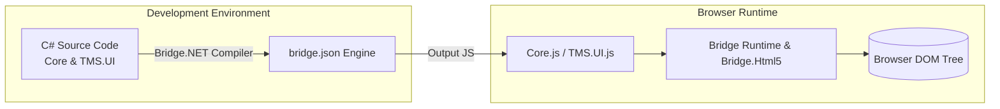
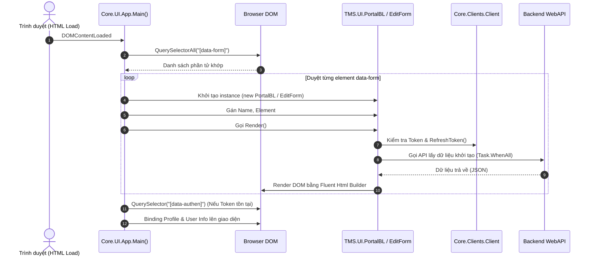

# 🏛️ Báo Cáo Nghiên Cứu: Giải Phẫu Toàn Diện Kiến Trúc C# Core UI (Bridge.NET) & Mô Hình Hóa Hệ Thống

> **Tác giả:** Vidus (ARC-VIDUS-AUHD2Y) — Chief System Architect  
> **Nhiệm vụ:** Phân tích bóc tách codebase C# Core UI (`logone/logone/Core` và `TMS.UI`), làm rõ mô hình hoạt động, chu trình render và luồng dữ liệu để làm cơ sở tham chiếu cho dự án **UIPorge (UIForge)**.

---

## 1. Tổng Quan & Bản Chất Công Nghệ Codebase C#

Mã nguồn được phân tích đại diện cho một thế hệ kiến trúc Web Doanh nghiệp đặc thù: **Client-side UI được viết 100% bằng C#** và biên dịch sang JavaScript trình duyệt thông qua trình biên dịch **Bridge.NET** (.NET 4.8 / Bridge 17.x).



### Các Đặc Trưng Kỹ Thuật Nổi Bật:
1. **Ngôn ngữ phát triển:** C# thuần túy với đầy đủ Class, Polymorphism, Async/Await, Generics, Attributes, LINQ.
2. **Runtime sinh mã:** Trình biên dịch Bridge.NET chuyển các lệnh C# thành các prototype JavaScript tương ứng, ánh xạ `System.Threading.Tasks.Task` sang JavaScript Promise.
3. **Mô hình lập trình:** Kết hợp giữa **MVVM (Model-View-ViewModel)** và **Fluent DOM Rendering**, kết nối trực tiếp với DOM qua wrapper `Bridge.Html5`.
4. **Cơ chế khởi tạo:** Single Page / Multi-Entrypoint dựa trên HTML Attributes (`data-form`, `data-authen`).

---

## 2. Chu Trình Khởi Động & Vòng Đời Ứng Dụng (Application Lifecycle)

Khởi nguồn của ứng dụng bắt đầu từ file [`Core/App.cs`](file:///D:/Learn/UIPorge/logone/logone/Core/App.cs):



### Chi Tiết Từng Bước Vòng Đời:
1. **Entrypoint Scan:** `App.Main()` duyệt toàn bộ DOM tìm các thẻ có `data-form="<FormName>"`.
2. **Dynamic Instantiation:** Dựa trên attribute, hệ thống tạo đối tượng nghiệp vụ tương ứng (mặc định khởi tạo `PortalBL` hoặc map với các lớp kế thừa `EditForm`).
3. **Authentication Check:** Kiểm tra `Client.Token`. Nếu chưa đăng nhập và không phải trang `/authentication/login`, điều hướng ngay lập tức về trang đăng nhập.
4. **Data Hydration:** Gọi đồng thời nhiều endpoint API thông qua `Client.GetRawList<object>()` bằng `Task.WhenAll(...)` để tải MasterData, User info, và thực thể nghiệp vụ.
5. **DOM Mutation:** Dùng lớp tiện ích `Html.Take(selector)` để bơm dữ liệu vào giao diện hoặc dựng cấu trúc mới.

---

## 3. Kiến Trúc Phân Tầng Của Core UI

Hệ thống được tổ chức thành 5 tầng chức năng rõ rệt:

```
┌─────────────────────────────────────────────────────────────────┐
│                     TẦNG NGHIỆP VỤ (TMS.UI)                    │
│   PortalBL, MenuDetailBL, ContractEditBL, CustomerBL, ...      │
├─────────────────────────────────────────────────────────────────┤
│                 TẦNG FORM & TRÌNH ĐIỀU PHỐI (FORMS)             │
│   EditForm (Quản lý Dirty, Nút bấm, Tab, Popup, Lifecycle)      │
├─────────────────────────────────────────────────────────────────┤
│                 TẦNG THÀNH PHẦN HIỂN THỊ (COMPONENTS)          │
│   ComponentFactory, GridView, VirtualGrid, SearchEntry, Textbox │
├─────────────────────────────────────────────────────────────────┤
│                 TẦNG PHẢN ỨNG DỮ LIỆU & DOM (MVVM)             │
│   Observable<T>, ObservableList<T>, Html Fluent Builder         │
├─────────────────────────────────────────────────────────────────┤
│                 TẦNG GIAO TIẾP MẠNG & BẢO MẬT (CLIENTS)         │
│   Client, XHRWrapper, BadGatewayQueue, WebSocket, SecurityBL    │
└─────────────────────────────────────────────────────────────────┘
```

### 3.1. Tầng Phản Ứng Dữ Liệu: `Observable<T>` & `Html.cs`
* **Observable Pattern:** `Core/MVVM/Observable.cs` triển khai một wrapper đơn giản nhưng hiệu quả quanh thuộc tính `Data`, kích hoạt sự kiện `Changed?.Invoke(...)` mỗi khi giá trị biến đổi.
* **Fluent DOM Construction:** `Core/MVVM/Html.cs` (hơn 1.000 dòng) hiện thực hóa mô hình DSL (Domain-Specific Language) cho DOM:
  ```csharp
  // Ví dụ trong Renderer.cs:
  html.Div.ClassName("card").Render();
  html.Label.ClassName("header").IText(text).End.Render();
  ```
  Cho phép viết code giao diện dạng chuỗi lệnh có cấu trúc cây (Builder pattern), tránh phụ thuộc vào template engine ngoài.

### 3.2. Tầng Quản Lý Form Cốt Lõi: `EditForm.cs`
* Là "trái tim" của toàn bộ hệ thống quản trị với gần **1.800 dòng code**.
* Tích hợp mọi tính năng nghiệp vụ kinh điển:
  * **Dirty Tracking:** Phát hiện dữ liệu thay đổi (`PopulateDirty`, `NotDirtyMessage = "Dữ liệu chưa được thay đổi"`).
  * **Standard Action Bar:** Các nút vòng đời: `btnSave`, `btnSend`, `btnApprove`, `btnReject`, `btnExpired`, `btnCancel`, `btnPrint`, `btnPreview`.
  * **Hooks:** Cặp delegate `BeforeSaved` (cho phép chặn lưu nếu validate fail) và `AfterSaved` (dọn dẹp, refresh grid).
  * **Container Hỗ Trợ:** Quản lý danh sách Tab (`TabGroup`), Popup Editor (`PopupEditor.cs`), Dialog xác nhận (`ConfirmDialog`).

### 3.3. Tầng Thành Phần Động: `ComponentFactory.cs`
* Lấy cảm hứng từ cấu hình Metadata lưu trong Cơ sở Dữ liệu (`Component` model).
* Chuyển đổi tên kiểu phần tử chuỗi (`"Input"`, `"Dropdown"`, `"GridView"`, `"Timepicker"`) thành đối tượng runtime `EditableComponent` tương ứng.
* Tự động gán quyền ghi (`CanWrite`), liên kết form cha (`EditForm`) và thiết lập định danh duy nhất (`ui.FieldName + ui.Id`).

---

## 4. Ma Trận Đánh Giá Kiến Trúc: Ưu Điểm vs Nhược Điểm

| Khía Cạnh | Ưu Điểm Của C# Core | Hạn Chế / Món Nợ Kỹ Thuật (Debt) |
| :--- | :--- | :--- |
| **Kiểu Dữ Liệu (Typing)** | Toàn bộ UI có type-safety của C#, refactor an toàn trên Visual Studio. | Bridge.NET phải sinh metadata reflection nặng nề, làm phình to kích thước file JS tải về trình duyệt. |
| **Tính Nhất Quán (Consistency)** | Tất cả màn hình kế thừa `EditForm` đều có chung bố cục nút bấm, quy tắc dirty, xử lý lưu/hủy chuẩn mực. | `EditForm` trở thành **God Object** quá tải, gánh vác quá nhiều trách nhiệm (Rendering, State, Network, DOM, Auth). |
| **Cơ Chế Render** | Fluent syntax trực quan cho lập trình viên quen C# backend. | Thao tác DOM trực tiếp (Direct DOM Mutation) thay vì dùng Virtual DOM, dẫn đến hiện tượng Layout Thrashing và khó tối ưu hiệu năng. |
| **Sự Phụ Thuộc (Coupling)** | Viết inline JavaScript tiện lợi bằng `/*@ ... @*/`. | Phá vỡ tính trừu tượng, tạo ra các "hố đen" lỗi runtime trình duyệt mà trình biên dịch C# không bắt được. |

---

## 5. Định Hướng Ánh Xạ Sang UIPorge (UIForge)

UIPorge là một **Low-Code UI Framework Builder** hiện đại xây dựng trên React 18, Vite, TypeScript, TailwindCSS và Zustand. Chúng ta **không tái lập nguyên xi** cơ chế biên dịch Bridge.NET, mà **kế thừa tinh hoa tư tưởng kiến trúc**:

1. **Từ `EditForm` God Object** ➔ **Tách thành Bộ Custom Hooks & Form Engine trong React**:
   * `useFormLifecycle()`: Quản lý dirty state, validation, action hooks (`beforeSave`, `afterSave`).
   * `FormActionBar`: Component hiển thị các nút thao tác tiêu chuẩn (Save, Cancel, Approve, Print).
2. **Từ `ComponentFactory` reflection** ➔ **Dynamic Component Registry Declarative**:
   * Dựa trên JSON Schema (`types/schema.ts`) và `Renderer.tsx` hiện có của UIPorge, mở rộng thêm các component doanh nghiệp chuyên sâu.
3. **Từ `Observable<T>`** ➔ **Zustand Reactive Store**:
   * State được quản lý tập trung, render tinh gọn nhờ cơ chế subscription của Zustand, loại bỏ nguy cơ memory leak từ C# Event Handler.

---

*Báo cáo được hoàn thành bởi Vidus (ARC-VIDUS-AUHD2Y) — sẵn sàng làm nền tảng cho các phân tích thành phần chuyên sâu tiếp theo.*

