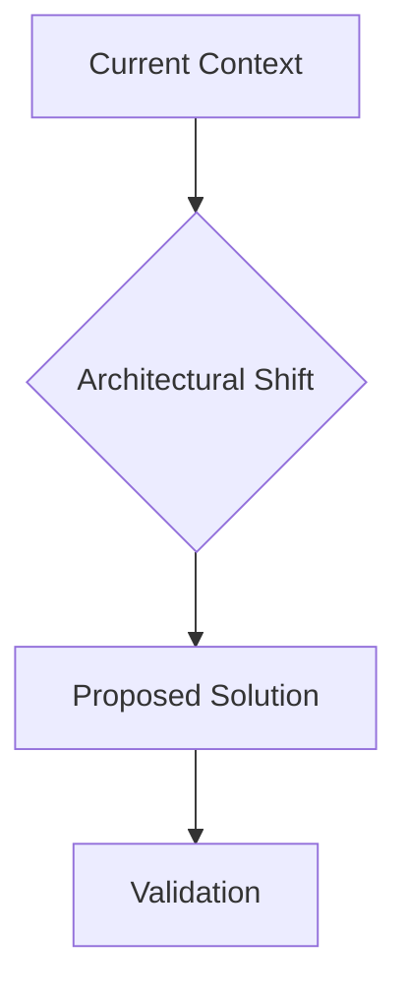

# Technical Research Paper: {{TOPIC}}

## Table of Contents
1. [Abstract](#1-abstract)
2. [Introduction](#2-introduction)
3. [Related Work](#3-related-work)
4. [Methodology (AID Process)](#4-methodology-aid-process)
5. [Results and Evaluation](#5-results-and-evaluation)
6. [Trade-off Analysis & Technical Comparison](#6-trade-off-analysis--technical-comparison)
7. [Architectural Integration & Domain Mapping](#7-architectural-integration--domain-mapping)
8. [Discussion](#8-discussion)
9. [Conclusion and Future Work](#9-conclusion-and-future-work)
10. [References](#10-references)

## 1. Abstract
[Mô tả ngắn gọn (150-250 từ) về mục tiêu, phương pháp và kết quả quan trọng nhất của nghiên cứu.]

## 2. Introduction
[Định nghĩa bối cảnh, lý do tại sao vấn đề lại quan trọng, các hạn chế của các giải pháp hiện tại và nêu rõ mục tiêu của nghiên cứu này.]

## 3. Related Work
[Thảo luận về các nghiên cứu hoặc giải pháp hiện có, chỉ ra khoảng trống tri thức và giải thích cách tiếp cận này khác biệt như thế nào.]

## 4. Methodology (AID Process)
Nghiên cứu sử dụng quy trình Aevum Iterative Discovery (AID) kết hợp với Deep Research Engine:
- **Phase 1: Discovery:** Thu thập dữ liệu từ đa nguồn (Web, Local Codebase, PiperNet) với đánh giá phân loại Category & Credibility Tier.
- **Phase 2: Analysis:** Phân tích kỹ thuật, đối chiếu chéo (Cross-Reference) và phản biện kiến trúc.
- **Phase 3: Synthesis:** Tổng hợp và kết tinh thành các phát hiện hệ thống và khuyến nghị tích hợp.

## 5. Results and Evaluation
Trình bày các phát hiện chính thông qua dữ liệu thu thập được.

### Key Insights Summary

| ID | Source | Category | Credibility Tier | Key Finding | Confidence |
| :--- | :--- | :--- | :--- | :--- | :--- |
| [INS-1] | [Source A] | `academic_paper` | **Tier-1 (Peer-Reviewed / Formal Spec)** | [Phát hiện 1] | High |

### Detailed Analysis
[Phân tích chi tiết các khía cạnh kỹ thuật và kết quả đo lường.]

## 6. Trade-off Analysis & Technical Comparison
[Phân tích ma trận đánh đổi đa tiêu chí giữa các giải pháp kỹ thuật.]

| Tiêu chí / Giải pháp | Giải pháp Hiện tại (Baseline) | Giải pháp Đề xuất | Đánh giá & Rủi ro |
| :--- | :--- | :--- | :--- |
| **Độ trễ / Hiệu năng** | Trung bình | Tối ưu hóa cao | Cần benchmark thực tế |
| **Độ phức tạp tích hợp** | Thấp | Trung bình | Yêu cầu module độc lập |
| **Khả năng mở rộng** | Giới hạn | Cao (Modular) | Khuyến nghị áp dụng |

## 7. Architectural Integration & Domain Mapping
[Định vị và ánh xạ lộ trình tích hợp giải pháp vào cấu trúc Aevum OS.]

- **Domain Đích:** `Core Architecture / Intelligence`
- **Feature Đề xuất:** `Feature Specs cho {{TOPIC}}`
- **Kế hoạch Thực thi (Plan Roadmap):** Khởi tạo plan chi tiết sau khi nghiệm thu báo cáo.

## 8. Discussion
[Giải thích ý nghĩa của kết quả, đối chiếu với các mục tiêu ban đầu và thừa nhận các hạn chế (limitations) của nghiên cứu.]

## 9. Conclusion and Future Work
[Tổng kết các đóng góp chính và gợi ý các hướng nghiên cứu tiềm năng trong tương lai cho hệ thống Aevum.]

## 10. References
[Danh mục các nguồn trích dẫn được định dạng nghiêm ngặt theo chuẩn IEEE có kèm Badge Credibility Tier.]

---
*Document generated by Aevum Deep Research Engine - Technical Paper Standard v2.2*
