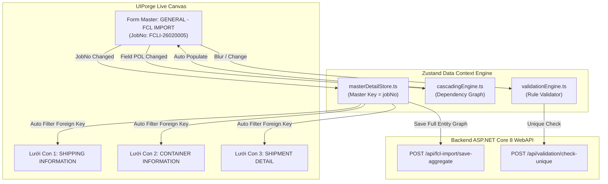

# 🔗 Báo Cáo Kỹ Thuật & Kế Hoạch Triển Khai Giai Đoạn 4: Data Binding, Cascading & Validation Engine

> **Người lập:** Zenith (`ENG-ZENITH-9A2E4F`) & An (`ENG-AN-7B9F1D`)  
> **Dự án:** UIPorge Visual Web Application Framework  
> **Căn cứ nghiệp vụ:** Ảnh 1 (Validation Core cũ), Ảnh 4 (Màn hình FCL Import với 3 bảng quan hệ) và mã nguồn `Component.cs`, `EntityRef.cs`, `Validation.cs` tại `Core` & `Core.API`

---

## 1. Mục Tiêu & Yêu Cầu Nghiệp Vụ Cốt Lõi

1. **Master-Detail Relationship Engine (Form Chính $\leftrightarrow$ 3 Lưới Dữ Liệu Con)**:
   - Trong màn hình nghiệp vụ logistics chuẩn (Ảnh 4):
     - Form chính: `GENERAL - FCL IMPORT` (mang `Job No: FCLI-26020005`).
     - 3 bảng con phụ thuộc:
       1. `SHIPPING INFORMATION` (chứa các chặng tàu POL, POD, ETD, ETA, Vessel, Voy).
       2. `CONTAINER INFORMATION` (chứa Size 40HC, Container No, Seal No, Package, CBM, VGM).
       3. `SHIPMENT DETAIL` (chứa HBL No, Customer, Salesman, Sales Support, Document No...).
   - Cơ chế: Khi chọn hoặc tải 1 Job No, toàn bộ 3 lưới con tự động lọc dữ liệu (`foreignKey: "jobNo"` hoặc `"masterId"`). Khi bấm **Lưu Dữ Liệu**, hệ thống gửi gói dữ liệu hợp nhất (Master Record + 3 Child Arrays) xuống Backend API trong một Transaction duy nhất.

2. **Cascading Dropdowns & Auto-Populate Engine**:
   - Kế thừa các trường `CascadeField` và `PopulateField` trong `Component.cs`:
     - Khi người dùng chọn Cảng Bốc `POL = 'CNSGH'` (Shanghai), dropdown Cảng Dỡ `POD` tự động lọc danh sách tuyến khả dụng (`TIEN SA TERMINAL / VNDTS`, `CAT LAI / VNSGN`).
     - Khi chọn Hãng Tàu `S.Lines = 'SITC'`, tự động điền `Vendor = 'VFRAC-IT VIETNAM'` và `Agent = 'SHANGHAI TRANSLEAD'`.

3. **Enterprise Validation Rules Engine**:
   - Kế thừa cấu trúc Validation JSON từ C# Core (Ảnh 1):
     ```json
     [
       { "Rule": "required", "Message": "{0} is mandatory" },
       { "Rule": "pattern", "Value": "^[A-Z]{4}[0-9]{7}$", "Message": "Invalid Container No format" },
       { "Rule": "unique", "ApiEndpoint": "/api/validate/unique-container", "Message": "Container No already exists" }
     ]
     ```
   - Xây dựng giao diện thiết lập quy tắc trong tab `Validation` của `PropertyPanel.tsx`.
   - Bộ đánh giá thời gian thực (`validationEngine.ts`) kiểm tra ngay khi gõ (`onChange`) và trước khi gửi dữ liệu (`beforeSubmit`), hiển thị viền đỏ và thông báo lỗi rõ ràng.

---

## 2. Thiết Kế Kiến Trúc Module



---

## 3. Cây File Dự Kiến Tạo Mới & Nâng Cấp

| File Đường Dẫn | Trạng Thái | Nhiệm Vụ |
| :--- | :---: | :--- |
| `frontend/src/logic/masterDetailStore.ts` | Tạo mới | Quản lý mối quan hệ khóa ngoại 1-N giữa Master Form và Child Grids |
| `frontend/src/logic/cascadingEngine.ts` | Tạo mới | Động cơ xử lý tự động điền (populate) và lọc phụ thuộc (cascading) |
| `frontend/src/logic/validationEngine.ts` | Tạo mới | Đánh giá quy tắc kiểm tra (required, pattern, min/max, unique API) |
| `frontend/src/editor/panels/ValidationTabPanel.tsx` | Tạo mới | Tab cấu hình quy tắc kiểm tra trực quan cho từng component |
| `frontend/src/types/schema.ts` | Cập nhật | Bổ sung schema `MasterDetailRelation`, `CascadeRule`, `ValidationRule` |
| `backend/UIForge.API/Controllers/ValidationController.cs` | Tạo mới | Endpoint kiểm tra trùng lặp mã (JobNo, ContainerNo, SealNo) |

---

## 4. Kế Hoạch Kiểm Thử & Nghiệm Thu (Acceptance Criteria)

1. **Kiểm thử Master-Detail**:
   - Khi chuyển giữa các Job No khác nhau trên form chính ➔ 3 bảng dưới chân form tự động đổi sang danh sách container và chứng từ của Job tương ứng.
   - Thêm 1 dòng container mới trong bảng `CONTAINER INFORMATION` ➔ Dòng mới tự động gắn `jobNo = FCLI-26020005`.
2. **Kiểm thử Cascading Dropdown**:
   - Thay đổi hãng tàu `S.Lines` từ `SITC` sang `WHL` ➔ Trường `Vendor` tự động chuyển sang `WAN HAI LINES VIETNAM`.
3. **Kiểm thử Validation**:
   - Bỏ trống ô `Job No.*` và bấm Lưu ➔ Ô đổi viền đỏ và hiển thị `Job No is required`.
   - Nhập sai định dạng Container No (ví dụ `12345`) ➔ Báo lỗi `Container No format must be 4 letters + 7 digits`.

