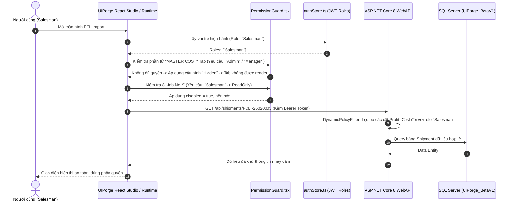

# 🛡️ Báo Cáo Kỹ Thuật & Kế Hoạch Triển Khai Giai Đoạn 5: Dynamic RBAC & Security Policy

> **Người lập:** Alice (`SEC-ALICE-5F1A8E`) & An (`ENG-AN-7B9F1D`)  
> **Dự án:** UIPorge Visual Web Application Framework  
> **Căn cứ nghiệp vụ:** Mã nguồn `RolePolicy.cs`, `SecurityBL.cs`, `PolicyEditorBL.cs` tại `Core` & `Core.API`

---

## 1. Mục Tiêu & Yêu Cầu Nghiệp Vụ Cốt Lõi

1. **Phân Quyền Mịn Cấp Độ Phần Tử & Trường Dữ Liệu (Field-Level RBAC)**:
   - Trong ứng dụng logistics doanh nghiệp lớn (như màn hình FCL Import):
     - **Admin / Manager**: Toàn quyền xem, sửa, phê duyệt chi phí (`PROFIT`, `MASTER COST`), xóa bản ghi.
     - **Salesman / Dispatcher**: Được sửa thông tin vận chuyển (`SHIPPING INFORMATION`, `CONTAINER INFORMATION`), nhưng các trường nhạy cảm như giá vốn (`Cost`), lợi nhuận (`Profit`) bị **Ẩn (Hidden)** hoặc **Khóa (Disabled)**.
     - **Customer / Partner**: Chỉ xem được tiến độ tàu (`ETA`, `ATA`, `Vessel`, `Voy`) ở chế độ **Chỉ Đọc (ReadOnly)**, hoàn toàn không thấy các nút tác vụ nội bộ (`E-Manifest`, `Accounting Sync`, `Lưu Dữ Liệu`).

2. **Giao Diện Cấu Hình Trực Quan Trong Studio**:
   - Tích hợp tab **Quyền Hạn** trong `PropertyPanel.tsx`:
     - Chọn các vai trò có quyền truy cập: `[x] Admin  [x] Dispatcher  [ ] Sales  [ ] Customer`.
     - Chế độ khi không đủ quyền: **Ẩn phần tử (Hide)** hoặc **Khóa chỉ đọc (Disable/ReadOnly)**.
     - Chế độ Design Mode: Nhà thiết kế luôn nhìn thấy phần tử kèm huy hiệu `🔒 RBAC` để dễ dàng cấu hình.

3. **Bảo Mật Kép (Dual Defense: Frontend Guard + Backend Policy Enforcement)**:
   - **Frontend**: Component `PermissionGuard.tsx` tự động kiểm tra đối chiếu JWT Role Claims của người dùng đang đăng nhập với cấu hình của component.
   - **Backend**: Middleware ASP.NET Core 8 kiểm tra quyền cấp độ Field (`DynamicPolicyFilterAttribute`) trước khi serialize JSON trả về cho client, ngăn chặn triệt để hành vi can thiệp DevTools trên trình duyệt để đọc dữ liệu nhạy cảm.

---

## 2. Thiết Kế Kiến Trúc Bảo Mật

---

## 3. Cây File Dự Kiến Tạo Mới & Nâng Cấp

| File Đường Dẫn | Trạng Thái | Nhiệm Vụ |
| :--- | :---: | :--- |
| `frontend/src/renderer/PermissionGuard.tsx` | Nâng cấp | Hỗ trợ đa vai trò, chế độ xem trước (Preview) và biểu tượng khóa ở Design Mode |
| `frontend/src/editor/panels/PermissionsTabPanel.tsx` | Tạo mới | Giao diện cấu hình trực quan AllowedRoles, ReadOnlyRoles, DenyAction |
| `frontend/src/types/schema.ts` | Cập nhật | Chuẩn hóa `ComponentPermissionConfig` (allowedRoles, readOnlyRoles, denyAction) |
| `backend/UIForge.API/Security/DynamicPolicyFilter.cs` | Tạo mới | ActionFilter ASP.NET Core 8 lọc dữ liệu theo Claim vai trò người dùng |
| `backend/UIForge.API/Models/Entities/RolePolicy.cs` | Tạo mới | Thực thể CSDL lưu trữ chính sách phân quyền vai trò kế thừa C# Core |

---

## 4. Kế Hoạch Kiểm Thử & Nghiệm Thu (Acceptance Criteria)

1. **Kiểm thử trên Studio (Design Mode)**:
   - Chọn component `Tab MASTER COST` ➔ Chọn quyền `Admin, Manager`.
   - Component hiển thị huy hiệu `🔒 RBAC: [Admin, Manager]`, vẫn cho phép kéo thả và sửa bình thường.
2. **Kiểm thử trên Chế Độ Xem Thử (Preview / Runtime)**:
   - Chuyển vai trò giả lập sang `Salesman`:
     - Tab `MASTER COST` biến mất hoàn toàn.
     - Ô `Job No` hiển thị nhưng bị khóa mờ (`disabled`).
   - Chuyển vai trò giả lập sang `Admin`:
     - Tất cả các tab và ô nhập liệu mở khóa toàn quyền sửa đổi.
3. **Kiểm thử Backend Security**:
   - Gửi request với token `Salesman` lên endpoint lấy dữ liệu chi phí ➔ API trả về mã `403 Forbidden` hoặc dữ liệu chi phí bị làm mờ rỗng.

