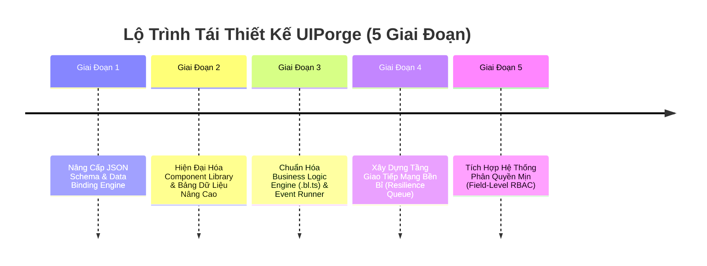

# 🚀 Kế Hoạch Hành Động Toàn Diện: Lộ Trình Từng Bước Tái Thiết Kế & Nâng Cấp Hệ Thống UIPorge

> **Tác giả:** An (ENG-AN-7B9F1D) — Squad Lead & AI Companion  
> **Nhiệm vụ:** Tổng hợp toàn bộ các phát hiện và phân tích từ Vidus, Kael, Zenith, Alice để xây dựng bản kế hoạch triển khai từng bước (Phase-by-Phase Execution Blueprint) cho dự án **UIPorge (UIForge)**.

---

## 1. Mục Tiêu Chiến Lược Của Lộ Trình

Chuyển hóa UIPorge từ phiên bản Skeleton cơ bản thành một **Nền tảng Low-Code UI Builder cấp Doanh nghiệp**, chắt lọc những ưu điểm tinh túy của C# Core (Form lifecycle, Grid dữ liệu lớn, Business Logic độc lập, Network Resilience) nhưng chạy trên nền tảng công nghệ siêu tốc: **React 18 + TypeScript + Zustand + TailwindCSS + ASP.NET Core 8 WebAPI**.

---

## 2. Chi Tiết Từng Giai Đoạn Triển Khai (Step-by-Step Blueprint)

### 📌 Giai Đoạn 1: Nâng Cấp JSON Schema & Data Binding Specification
* **🎯 Mục tiêu:** Cung cấp khả năng định nghĩa nguồn dữ liệu, quy tắc ràng buộc (validation) và binding 2 chiều cho từng component trên cây giao diện, tương tự `Component.cs` của C#.
* **📂 Các file tác động:**
  * `frontend/src/types/schema.ts`: Bổ sung interface `DataBindingConfig`, `ValidationConfig`, `ComponentPermissionConfig`.
  * `backend/UIForge.API/Models/Entities/UIComponent.cs`: Lưu trữ các trường JSON cấu hình mở rộng.
* **🔨 Nhiệm vụ cụ thể:**
  1. Thêm thuộc tính `dataBinding` vào `ComponentNode` (liên kết với Entity name, Field name).
  2. Thêm thuộc tính `validation` (required, min, max, pattern, errorMessage).
  3. Cập nhật `ComponentTreeMapper.cs` trên Backend để tuần tự hóa mượt mà các thuộc tính mới này.
* **✅ Tiêu chí nghiệm thu:** Lưu và tải thành công một cây component có chứa cấu hình Data Binding lên cơ sở dữ liệu SQL Server.

---

### 📌 Giai Đoạn 2: Hiện Đại Hóa Component Library & Bảng Dữ Liệu Nâng Cao
* **🎯 Mục tiêu:** Kế thừa sức mạnh của `GridView.cs` (4.000 dòng code C#) và `EditForm.cs`, xây dựng các component doanh nghiệp mạnh mẽ cho UIPorge.
* **📂 Các file tác động:**
  * `frontend/src/renderer/components/ForgeTable.tsx` ➔ Nâng cấp thành `ForgeAdvancedGrid.tsx`.
  * `frontend/src/renderer/components/ForgeFormContainer.tsx` (Tạo mới): Kế thừa `EditForm.cs`.
  * `frontend/src/renderer/Renderer.tsx`: Cập nhật bảng Dispatcher Component.
  * `frontend/src/editor/PropertyPanel.tsx`: Bổ sung cấu hình thuộc tính nâng cao cho Grid và Form.
* **🔨 Nhiệm vụ cụ thể:**
  1. Triển khai tính năng **Cột cố định (Sticky/Frozen Columns)** và **Dòng tổng kết (Summary Row)** trên bảng dữ liệu bằng Tailwind CSS.
  2. Xây dựng Form Container hỗ trợ thanh nút bấm tiêu chuẩn (`Save`, `Cancel`, `Print`, `Approve`) và cơ chế phát hiện sửa đổi (**Dirty Tracking**).
  3. Bổ sung các Component văn phòng còn thiếu: `DatePicker`, `Select / Autocomplete`, `Modal Popup`.
* **✅ Tiêu chí nghiệm thu:** Render được bảng dữ liệu 100 dòng với cột mã khách hàng cố định bên trái và dòng tính tổng doanh thu dưới chân bảng.

---

### 📌 Giai Đoạn 3: Chuẩn Hóa Business Logic Engine (`.bl.ts`) & Event Runner
* **🎯 Mục tiêu:** Chuyển đổi tư tưởng `*BL.cs` (ví dụ `CustomerBL.cs`, `PortalBL.cs`) sang các module TypeScript thuần túy, tách rời hoàn toàn giữa Giao diện và Nghiệp vụ.
* **📂 Các file tác động:**
  * `frontend/src/logic/eventRunner.ts`: Điều phối sự kiện người dùng (`onClick`, `onChange`) đến hàm BL tương ứng.
  * `frontend/src/logic/blRegistry.ts`: Đăng ký và quét tự động các hàm có sẵn trong file `.bl.ts`.
  * `frontend/src/editor/PropertyPanel.tsx`: Cho phép chọn hàm BL từ dropdown khi cấu hình Event.
* **🔨 Nhiệm vụ cụ thể:**
  1. Hoàn thiện hàm `runEventAction` để truyền đầy đủ `FormContext` (dữ liệu form, trạng thái component, API client) vào hàm BL.
  2. Viết tài liệu hướng dẫn mẫu cấu trúc file `.bl.ts` chuẩn (gồm các hàm `beforeSave`, `afterSave`, `onFieldChange`).
* **✅ Tiêu chí nghiệm thu:** Bấm nút trên giao diện Live Preview kích hoạt được hàm tính toán trong `customerManagement.bl.ts` và tự động cập nhật kết quả lên ô TextBox khác.

---

### 📌 Giai Đoạn 4: Xây Dựng Tầng Giao Tiếp Mạng Bền Bỉ (Resilience Queue)
* **🎯 Mục tiêu:** Kế thừa phát minh đắt giá `BadGatewayQueue.cs` của C# Core, bảo vệ dữ liệu người dùng không bao giờ bị mất khi gặp sự cố mạng hoặc server bảo trì 502.
* **📂 Các file tác động:**
  * `frontend/src/api/resilienceClient.ts` (Tạo mới): HTTP client bọc quanh Axios.
  * `frontend/src/api/pagesApi.ts` & `authApi.ts`: Chuyển sang sử dụng client mới.
* **🔨 Nhiệm vụ cụ thể:**
  1. Tự động giữ lại các request POST/PUT/DELETE trong hàng đợi khi nhận mã lỗi 502/503 hoặc mất kết nối mạng.
  2. Hiển thị thông báo thân thiện: *"Hệ thống đang đồng bộ dữ liệu, vui lòng không tắt trình duyệt"*.
  3. Tự động phát lại (Replay) toàn bộ các lệnh khi kết nối phục hồi thành công.
* **✅ Tiêu chí nghiệm thu:** Thử ngắt mạng tạm thời khi bấm Lưu trang, bật lại mạng sau 5 giây ➔ Dữ liệu tự động được gửi lên server thành công mà không cần người dùng bấm lại.

---

### 📌 Giai Đoạn 5: Tích Hợp Hệ Thống Phân Quyền Mịn (Field-Level RBAC)
* **🎯 Mục tiêu:** Kế thừa `PolicyEditorBL.cs` và `SecurityBL.cs`, phân quyền đến từng nút bấm, từng trường dữ liệu cho các vai trò khác nhau.
* **📂 Các file tác động:**
  * `frontend/src/renderer/PermissionGuard.tsx` (Tạo mới).
  * `frontend/src/renderer/Renderer.tsx`: Bọc các component nhạy cảm qua Guard.
  * `backend/UIForge.API/Controllers/`: Bổ sung kiểm tra quyền phía máy chủ.
* **🔨 Nhiệm vụ cụ thể:**
  1. Cho phép gán `allowedRoles` trên từng Component trong Property Panel.
  2. Người dùng thuộc vai trò `Viewer` sẽ tự động thấy ô nhập liệu chuyển sang trạng thái chỉ đọc (Disabled / Read-only) hoặc bị ẩn đi tùy cấu hình.
* **✅ Tiêu chí nghiệm thu:** Đăng nhập với tài khoản nhân viên không thấy nút "Duyệt đơn hàng", đăng nhập với tài khoản Quản trị viên thấy đầy đủ.

---

## 3. Ma Trận Phân Bổ Nguồn Lực Biệt Đội Aevum

| Giai Đoạn | Agent Chủ Trì | Agent Phối Hợp | Thời Gian Dự Kiến |
| :--- | :--- | :--- | :--- |
| **Giai đoạn 1: Schema & Data Binding** | **Zenith** (Data Specialist) | Kael & Vidus | Tuần 1 |
| **Giai đoạn 2: Advanced Components** | **Kael** (Frontend Lead) | Luna (UI/UX) | Tuần 2 - 3 |
| **Giai đoạn 3: Business Logic Engine** | **An** (Squad Lead) | Kael | Tuần 4 |
| **Giai đoạn 4: Resilience Network** | **Zenith** (Engine Specialist) | Bob (DevOps) | Tuần 5 |
| **Giai đoạn 5: Security & RBAC** | **Alice** (Security Lead) | Vidus & An | Tuần 6 |

---

*Bản kế hoạch hành động chính thức được phê duyệt bởi An (ENG-AN-7B9F1D) — sẵn sàng kích hoạt ngay khi Master ra lệnh!*

