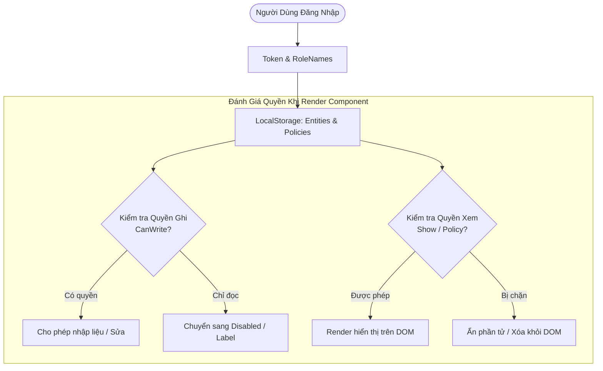

# 🛡️ Báo Cáo An Ninh & Phân Quyền: Kiểm Soát Truy Cập Động Cấp Độ Phần Tử & Trường Dữ Liệu (Field-Level RBAC)

> **Tác giả:** Alice / Securitas (`securitas__alice_`) — Security & Policy Specialist  
> **Nhiệm vụ:** Mổ xẻ hệ thống bảo mật, phân quyền động và chính sách hiển thị phần tử trong C# Core ([`PolicyEditorBL.cs`](file:///D:/Learn/UIPorge/logone/logone/Core/Fw/Authentication/PolicyEditorBL.cs), [`SecurityBL.cs`](file:///D:/Learn/UIPorge/logone/logone/Core/Components/SecurityBL.cs)), từ đó thiết lập ma trận phân quyền mịn (Fine-grained RBAC) cho **UIPorge (UIForge)**.

---

## 1. Mổ Xẻ Mô Hình Bảo Mật Động Của C# Core

Trong hệ thống C# Core, quyền hạn của người dùng không dừng lại ở mức "vào được trang hay không", mà đi sâu đến từng **Nút bấm (Button)**, từng **Cột dữ liệu (Grid Column)** và từng **Trường nhập liệu (Field)**.



### Các Khối Xử Lý Cốt Lõi:
1. **`SecurityBL.cs` & `Client.CheckHasRole`:**
   * Dò tìm vai trò trong mảng `Token.RoleNames` bằng so sánh chuỗi không phân biệt hoa thường (`StringComparison.OrdinalIgnoreCase`).
   * Phân tách rành ròi giữa `SystemRole` (Admin tối cao) và các vai trò nghiệp vụ (Sale, Accountant, Warehouse).
2. **Thuộc Tính `CanWrite` trong `EditableComponent.cs`:**
   * Mỗi thành phần nhập liệu đều mang cờ boolean `CanWrite`.
   * Nếu `CanWrite == false`, input tự động gắn thuộc tính HTML `disabled="disabled"` hoặc chuyển dạng hiển thị sang text thuần, ngăn chặn người dùng chỉnh sửa.
3. **`GridPolicy` trong `GridView.cs`:**
   * Mỗi cột trên bảng dữ liệu có thể cấu hình ẩn/hiện hoặc đổi nhãn (`ShortDesc`) dựa trên chính sách phân quyền của từng bộ phận.

---

## 2. Lỗ Hổng & Điểm Yếu Cần Khắc Phục Từ C# Core

Trong quá trình rà soát mã nguồn C# Core, Alice phát hiện 2 điểm yếu bảo mật kiến trúc cần lưu ý sâu sắc:

1. **Bảo mật chỉ nằm ở giao diện (Client-side Only Security):**
   * Trong C# Core, khi một trường bị cấm ghi (`CanWrite = false`), hệ thống chỉ ẩn hoặc disable thẻ `<input>` trên trình duyệt.
   * Nếu người dùng am hiểu kỹ thuật mở Developer Tools (F12) và gửi trực tiếp HTTP PUT/POST lên API, backend nếu không kiểm tra lại quyền tương ứng thì vẫn lưu dữ liệu!
2. **Lưu Token & Quyền dưới dạng Plain Text trong LocalStorage:**
   * Khóa `UserInfo` và danh sách quyền được lưu trực tiếp trong `LocalStorage`. Điều này tạo nguy cơ nếu ứng dụng bị tấn công Cross-Site Scripting (XSS).

---

## 3. Thiết Kế Hệ Thống Phân Quyền Mịn Cho UIPorge (Defense in Depth)

Để UIPorge trở thành một nền tảng Low-Code cấp doanh nghiệp thực thụ, cơ chế phân quyền phải được áp dụng **theo chiều sâu (2 lớp: Frontend Guard + Backend Enforcement)**.

### 3.1. Bổ Sung Thuộc Tính Phân Quyền Vào JSON Schema (`types/schema.ts`)
```typescript
export interface ComponentPermissionConfig {
  /** Danh sách vai trò được phép tương tác đầy đủ, ví dụ: ['Admin', 'Manager'] */
  allowedRoles?: string[]
  /** Danh sách vai trò chỉ được xem (Read-only), ví dụ: ['Viewer', 'Auditor'] */
  readOnlyRoles?: string[]
  /** Hành vi khi bị từ chối quyền: 'hide' (ẩn hoàn toàn) hoặc 'disable' (vô hiệu hóa) */
  deniedBehavior?: 'hide' | 'disable'
  /** Yêu cầu tính năng đặc biệt (Feature flag) */
  featureFlag?: string
}
```

### 3.2. Triển Khai `PermissionGuard` Trong Runtime Renderer (`Renderer.tsx`)
```tsx
// Wrapper bảo vệ component trong UIPorge
export const PermissionGuard: React.FC<{
  config?: ComponentPermissionConfig
  userRoles: string[]
  children: (isReadOnly: boolean) => React.ReactNode
}> = ({ config, userRoles, children }) => {
  if (!config || !config.allowedRoles || config.allowedRoles.length === 0) {
    return <>{children(false)}</>
  }

  const hasFullAccess = config.allowedRoles.some(r => userRoles.includes(r))
  if (hasFullAccess) {
    return <>{children(false)}</>
  }

  const hasReadOnly = config.readOnlyRoles?.some(r => userRoles.includes(r))
  if (hasReadOnly) {
    return <>{children(true)}</> // Render ở chế độ disabled / read-only
  }

  // Nếu không có quyền và chọn ẩn
  if (config.deniedBehavior === 'hide') {
    return null
  }

  // Mặc định vô hiệu hóa nếu chọn 'disable'
  return <>{children(true)}</>
}
```

### 3.3. Bảo Vệ Phía Backend (`backend/UIForge.API`)
* Mọi thao tác lưu dữ liệu từ API (`PagesController`, `ProjectsController`) phải giải mã JWT Claims để xác thực lại vai trò của `CurrentUser.Id`.
* Nghiêm cấm tin tưởng tuyệt đối vào payload gửi lên từ trình duyệt mà không qua validation policy.

---

*Báo cáo được hoàn thành bởi Alice (`securitas__alice_`) — sẵn sàng tích hợp các quy tắc an ninh vào hệ thống.*

