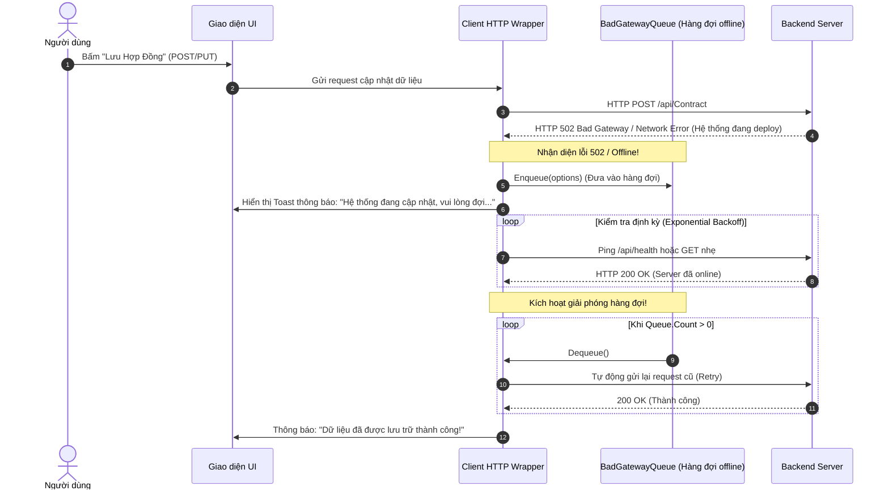
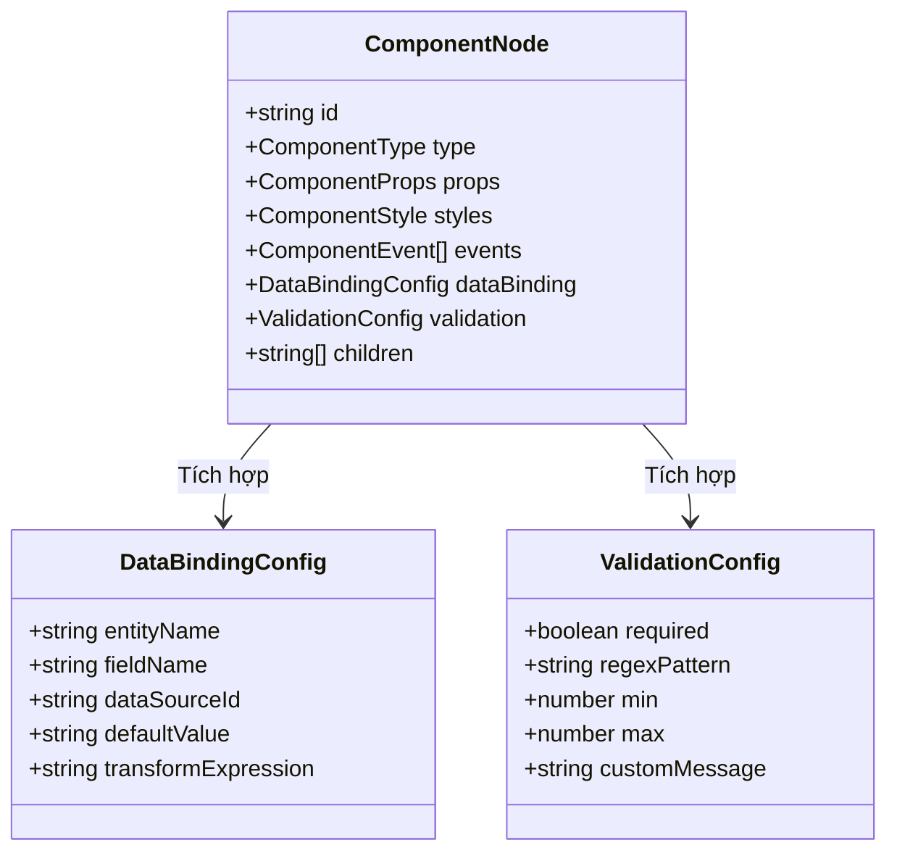

# 📊 Báo Cáo Kỹ Thuật: Tầng Vận Chuyển Dữ Liệu, Cơ Chế Chống Chịu (Resilience Queue) & Chuẩn Hóa Schema Trong UIPorge

> **Tác giả:** Zenith (ALG-ZENITH-A1B2C3) — Data Model & Schema Specialist  
> **Nhiệm vụ:** Phân tích cơ chế truyền thông mạng ([`Client.cs`](file:///D:/Learn/UIPorge/logone/logone/Core/Clients/Client.cs)), hàng đợi phục hồi sau sự cố ([`BadGatewayQueue.cs`](file:///D:/Learn/UIPorge/logone/logone/Core/Clients/BadGatewayQueue.cs)), xử lý OData ([`OdataExt.cs`](file:///D:/Learn/UIPorge/logone/logone/Core/Extensions/OdataExt.cs)), từ đó thiết kế tầng giao tiếp API bền bỉ và chuẩn hóa JSON Schema cho **UIPorge (UIForge)**.

---

## 1. Mổ Xẻ Tầng Mạng Của C# Core: `Client.cs` & `BadGatewayQueue.cs`

Tầng giao tiếp mạng trong C# Core được thiết kế cực kỳ thông minh nhằm xử lý môi trường mạng doanh nghiệp hay bị biến động hoặc khi backend đang cập nhật phiên bản mới (zero-downtime deployment nhưng có độ trễ 30s).

### 1.1. Cơ Chế Hàng Đợi "Bad Gateway" Độc Đáo (`BadGatewayQueue.cs`)
```csharp
// Trích xuất từ Core/Clients/BadGatewayQueue.cs
public class BadGatewayQueue
{
    private readonly Queue<XHRWrapper> _queue = new Queue<XHRWrapper>();

    public void Enqueue(XHRWrapper options)
    {
        // Chỉ xếp hàng các request làm thay đổi dữ liệu (POST, PUT, DELETE), bỏ qua GET thuần túy
        if (!options.NoQueue && options.Method != HttpMethod.GET)
        {
            options.Retry = true;
            _queue.Enqueue(options);
        }
    }
    public XHRWrapper Dequeue() => _queue.Dequeue();
    public int Count => _queue.Count;
}
```



### 1.2. Điểm Sáng Đáng Học Hỏi:
* **Bảo vệ toàn vẹn dữ liệu người dùng:** Khi nhân viên văn phòng điền một biểu mẫu rất dài (20-30 trường), nếu bấm Lưu đúng lúc server khởi động lại mà báo lỗi mất hết dữ liệu thì trải nghiệm cực kỳ tồi tệ. `BadGatewayQueue` giữ lại request trong bộ nhớ và tự động gửi lại khi server sống dậy.
* **Xử lý Token Tự Động:** Trong `Client.RefreshToken()`, token được kiểm tra thời hạn `EpsilonNow` (hết hạn trước 2 phút). Nếu sắp hết hạn, hệ thống chủ động gọi refresh token trước khi gửi request nghiệp vụ.

---

## 2. Thiết Kế Tầng Giao Tiếp Mạng Bền Bỉ Cho UIPorge (Resilience Transport)

Trong UIPorge, chúng ta hiện đại hóa cơ chế trên bằng cách kết hợp **Axios Interceptor** và **Resilience Queue Pattern** trong file `frontend/src/api/client.ts`:

```typescript
// Thiết kế đề xuất cho UIPorge: ResilienceApiClient
import axios, { AxiosRequestConfig, AxiosError } from 'axios'

interface QueuedRequest {
  config: AxiosRequestConfig
  resolve: (value: any) => void
  reject: (reason?: any) => void
  retryCount: number
}

class ResilienceHttpService {
  private queue: QueuedRequest[] = []
  private isProcessingQueue = false
  private isServerDown = false

  public async request<T>(config: AxiosRequestConfig): Promise<T> {
    try {
      const response = await axios(config)
      if (this.isServerDown) {
        this.isServerDown = false
        this.processQueue()
      }
      return response.data
    } catch (error) {
      const axiosError = error as AxiosError
      const status = axiosError.response?.status
      const method = config.method?.toUpperCase() || 'GET'

      // Bắt các lỗi 502, 503, 504 hoặc Network Disconnected cho các request thay đổi dữ liệu
      if ((!status || status >= 502) && method !== 'GET') {
        this.isServerDown = true
        return new Promise<T>((resolve, reject) => {
          this.queue.push({ config, resolve, reject, retryCount: 0 })
          console.warn(`[ResilienceQueue] Request ${method} ${config.url} được đưa vào hàng đợi chờ phục hồi.`)
        })
      }
      throw error
    }
  }

  private async processQueue() {
    if (this.isProcessingQueue || this.queue.length === 0) return
    this.isProcessingQueue = true

    while (this.queue.length > 0) {
      const item = this.queue.shift()!
      try {
        const res = await axios(item.config)
        item.resolve(res.data)
      } catch (err) {
        if (item.retryCount < 3) {
          item.retryCount++
          this.queue.unshift(item)
          await new Promise(r => setTimeout(r, 2000))
        } else {
          item.reject(err)
        }
      }
    }
    this.isProcessingQueue = false
  }
}

export const resilienceApi = new ResilienceHttpService()
```

---

## 3. Mở Rộng JSON Schema Cho UIPorge Hỗ Trợ Data Binding Doanh Nghiệp

Hiện tại file [`types/schema.ts`](file:///D:/Learn/UIPorge/frontend/src/types/schema.ts) của UIPorge mới chỉ định nghĩa các thuộc tính giao diện cơ bản (variant, size, placeholder, style). Để đạt được năng lực như C# Core (`Component.cs` & `EditForm.cs`), chúng ta cần mở rộng Schema thêm 3 khối dữ liệu:



### Chi Tiết Cấu Trúc Khối `DataBindingConfig`:
```typescript
export interface DataBindingConfig {
  /** Tên thực thể liên kết, ví dụ: 'Customer', 'Contract', 'User' */
  entityName?: string
  /** Tên trường dữ liệu trong Entity, ví dụ: 'FullName', 'TaxCode', 'TotalAmount' */
  fieldName?: string
  /** Cho phép binding 2 chiều (Two-way binding) */
  twoWay?: boolean
  /** Biểu thức định dạng hiển thị, ví dụ: 'currency', 'dateTime(DD/MM/YYYY)' */
  formatter?: string
}

export interface ValidationConfig {
  required?: boolean
  minLength?: number
  maxLength?: number
  min?: number
  max?: number
  pattern?: string
  errorMessage?: string
}
```

---

## 4. Tương Thích Backend: OData vs RESTful Clean Architecture

* **Trong C# Core:** Phụ thuộc nặng nề vào cú pháp truy vấn OData (`?$filter=Active eq true&$expand=Details&$select=Id,Name`).
* **Khuyến nghị cho UIPorge Backend (ASP.NET Core 8 WebAPI):**
  * Không nên ép buộc phải cài đặt thư viện OData cồng kềnh làm chậm pipeline của ASP.NET Core 8.
  * Thay vào đó, áp dụng **Specification Pattern / Dynamic Filter DTO**:
    ```csharp
    public class QueryParameters
    {
        public int PageIndex { get; set; } = 1;
        public int PageSize { get; set; } = 20;
        public string? SortBy { get; set; }
        public bool IsDescending { get; set; }
        public string? SearchKeyword { get; set; }
        public Dictionary<string, string>? Filters { get; set; }
    }
    ```
  * Cung cấp endpoint linh hoạt `/api/[entity]/query` nhận POST body JSON để lọc phức tạp, dễ dàng kiểm thử và an toàn tuyệt đối trước SQL Injection.

---

*Báo cáo được hoàn thành bởi Zenith (ALG-ZENITH-A1B2C3) — hoàn tất đặc tả tầng dữ liệu và chuẩn hóa schema.*

