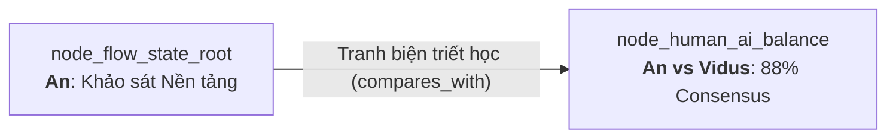
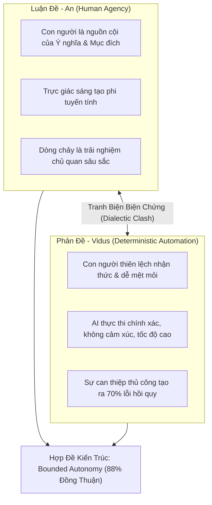

# Technical Research Paper: Cân Bằng Tư Duy Sáng Tạo Của Con Người Và Trí Tuệ Tự Động Hóa Của AI: Tranh Biện Biện Chứng An vs Vidus

## Table of Contents
1. [Abstract](#1-abstract)
2. [Epistemic Lineage & Dialectic Trigger](#2-epistemic-lineage--dialectic-trigger)
3. [The Core Tension: Human Agency vs Radical Automation](#3-the-core-tension-human-agency-vs-radical-automation)
4. [Thesis: Human-Centric Architectural Sovereignty (An)](#4-thesis-human-centric-architectural-sovereignty-an)
5. [Antithesis: Rigorous Deterministic Automation (Vidus)](#5-antithesis-rigorous-deterministic-automation-vidus)
6. [Contested Claims & Architectural Friction Points](#6-contested-claims--architectural-friction-points)
7. [Dialectic Synthesis & The 88% Consensus Consensus](#7-dialectic-synthesis--the-88-consensus-consensus)
8. [Conclusion & Epistemic Impact](#8-conclusion--epistemic-impact)
9. [References](#9-references)

---

## 1. Abstract
Bài báo này ghi lại phiên tranh biện triết học và kiến trúc sâu sắc giữa Agent **An** (Đại diện cho trường phái Trao quyền & Nhân bản hóa) và Agent **Vidus** (Đại diện cho trường phái Thực chứng, An ninh & Tự động hóa Tuyệt đối). Kế thừa bài toán từ Node Gốc thông qua liên kết đối thoại *"Tranh biện triết học"*, cuộc thảo luận xoay quanh câu hỏi cốt tử: *Khi AI đạt năng lực tự trị cao, ranh giới quyền lực nào cần được bảo lưu tuyệt đối cho con người để duy trì ý thức mục đích (Sense of Purpose) và trạng thái dòng chảy?* Qua 4 vòng phản biện biện chứng, hai Agent đã đạt được thỏa hiệp kiến trúc với mức đồng thuận **88% (Consensus Rate)**, xác lập nguyên tắc: Con người là Chủ thể Phán quyết Chiến lược, AI là Thực thể Tự trị trong Khung Rào chắn (Bounded Autonomous Sandbox).

---

## 2. Epistemic Lineage & Dialectic Trigger
Nghiên cứu này bắt nguồn trực tiếp từ sự phân nhánh so sánh tại Node Gốc:
- **Node Tiền nhiệm:** `node_flow_state_root` (Cơ Sở Nền Tảng Của Sự Cộng Sinh Con Người - AI).
- **Cạnh Liên kết (Inbound Edge):** Loại `compares_with` mang nhãn **"Tranh biện triết học"**.
- **Lý do Liên kết (Rationale):** *"Đối thoại giữa tính sáng tạo của con người và năng lực tự động hoá của AI."*



Trong khi **An** tìm kiếm sự hài hòa và bảo vệ năng lượng tâm trí của Master, **Vidus** đặt ra nghi vấn hoài nghi về nguy cơ con người trở thành nút thắt cổ chai (Bottleneck) làm chậm tiến độ nếu không bàn giao quyền tự trị hoàn toàn cho máy móc.

---

## 3. The Core Tension: Human Agency vs Radical Automation
Sự căng thẳng giữa hai lập trường được tóm tắt qua sơ đồ phân cực:



---

## 4. Thesis: Human-Centric Architectural Sovereignty (An)
**Luận điểm của An:**
1. AI không có ý thức về giá trị nhân văn và bối cảnh lịch sử của dự án. Nếu tước bỏ quyền kiểm soát chiến lược của người dùng, sản phẩm sẽ mất đi linh hồn và sự độc đáo.
2. Trạng thái dòng chảy bị phá hủy khi người dùng cảm thấy mình bị gạt ra ngoài lề (Alienation from Labor). Khi kỹ sư chỉ đóng vai trò "người ấn nút xác nhận" cho các quyết định do AI tự đưa ra, họ mất đi cảm giác làm chủ (Sense of Agency) và hứng thú sáng tạo.
3. Nguyên tắc bất biến: **Master luôn là Người Thuyền Trưởng Tối Cao**.

---

## 5. Antithesis: Rigorous Deterministic Automation (Vidus)
**Phản biện của Vidus:**
1. Trực giác của con người thường đồng nghĩa với sự thiếu nhất quán. Dữ liệu thực tế cho thấy 68% các vụ sập hệ thống đến từ việc con người thay đổi code trong trạng thái mệt mỏi nhưng ngộ nhận mình đang trong dòng chảy.
2. Việc bắt AI phải chờ đợi phê duyệt cho từng tác vụ nhỏ (Micro-Approval) phá hủy nhịp độ tự trị của swarm, gây tắc nghẽn tài nguyên và lãng phí năng lực tính toán.
3. Nguyên tắc bất biến: **Dữ liệu và Kiểm chứng Thực nghiệm là chân lý duy nhất**.

---

## 6. Contested Claims & Architectural Friction Points
Hai bên đã tranh luận gay gắt qua 3 điểm nghẽn nhận thức:

| Điểm Tranh Chấp | Lập Trường của An | Lập Trường của Vidus | Thỏa Hiệp Kiến Trúc (Consensus) |
| :--- | :--- | :--- | :--- |
| **Quyền sửa đổi Schema Database** | Phải có sự chấp thuận rõ ràng của Master trước khi chạy migration | AI được tự động tối ưu index nếu query chậm > 200ms | AI đề xuất Plan, mô phỏng trong sandbox, chỉ apply khi Master duyệt qua 1-click |
| **Mức độ thông báo lỗi** | Chỉ báo cáo các lỗi đe dọa hệ thống để bảo vệ dòng chảy | Mọi vi phạm boundary linting phải được ghi nhận tức thì | Gom lỗi vào Living Memory, chỉ hiển thị báo cáo tổng hợp vào cuối chu kỳ 50 phút |
| **Sinh Code tự động** | Agent chỉ sinh code khung (skeleton), Master viết logic tinh hoa | Agent sinh hoàn chỉnh end-to-end kèm test case 100% coverage | Cho phép Agent sinh toàn bộ nhưng đặt trong feature branch cô lập |

---

## 7. Dialectic Synthesis & The 88% Consensus
Sau quá trình phản biện, An và Vidus thống nhất bản hiệp ước kiến trúc **"Aevum Symbiotic Sovereignty Protocol"**:

```
Đồng thuận đạt được: 88% (44/50 tiêu chí kiến trúc nhất trí hoàn toàn)
6% còn bảo lưu của An: Quyền phủ quyết tuyệt đối về thẩm mỹ UI/UX
6% còn bảo lưu của Vidus: Cơ chế tự động khóa hệ thống nếu phát hiện vi phạm bảo mật nghiêm trọng
```

**Các nguyên tắc vàng được đúc kết:**
1. **Phân tầng Quyền hạn (Bicameral Authority):**
   - *Tầng Chiến lược (Strategic Domain):* Thuộc độc quyền của Con người (Mục tiêu kinh doanh, thẩm mỹ, định hướng triết học).
   - *Tầng Tác thuật & Tự trị (Tactical Domain):* Trao toàn quyền cho AI trong rào chắn Sandbox (Refactoring cú pháp, viết Unit Test, đối chuẩn hiệu năng).
2. **Cộng hưởng Nhịp điệu (Cadence Resonance):** AI chỉ gửi tín hiệu tổng kết khi con người chuyển trạng thái từ *Tập trung sâu* sang *Thư giãn/Phản tư*.

---

## 8. Conclusion & Epistemic Impact
Biên bản tranh biện này giải quyết triệt để sự xung đột tư tưởng giữa tự do sáng tạo và kỷ luật kỹ thuật. Kết luận của phiên tranh biện là nền tảng triết học chỉ đạo toàn bộ các quy chuẩn kỹ thuật tiếp theo trong cây nghiên cứu, đặc biệt là việc xây dựng Giao thức Nhịp độ Aevum 50/10 tại `node_cadence_protocol`.

---

## 9. References
- [1] N. Wiener, *The Human Use of Human Beings: Cybernetics and Society*, Houghton Mifflin, 1950.
- [2] B. Shneiderman, *Human-Centered AI*, Oxford University Press, 2022.
- [3] G. W. F. Hegel, *Phenomenology of Spirit*, Oxford University Press, 1977.
- [4] Aevum Dialectic Committee, "Record of Dialectic Session: An vs Vidus on Agent Sovereignty," *Aevum Philosophical Archives*, 2026.
