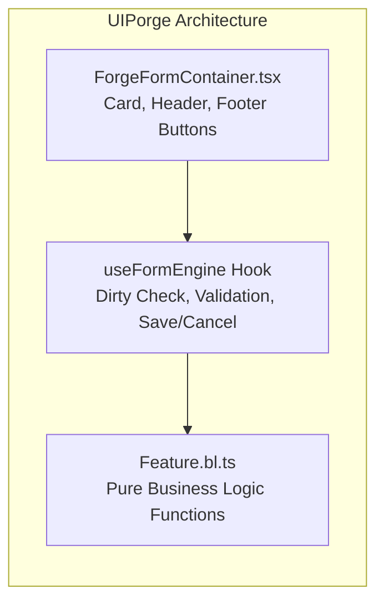

# ⚡ Báo Cáo Kỹ Thuật: Chuyển Dịch Cơ Chế Phản Ứng Dữ Liệu & Dynamic Component Engine Sang React + Zustand

> **Tác giả:** Kael (ENG-KAEL-7F4B2D) — Frontend Systems Lead  
> **Nhiệm vụ:** Phân tích mô hình phản ứng dữ liệu (`Observable`, `ObservableList`), công cụ kết xuất (`Renderer.cs`, `Html.cs`) và nhà máy sinh thành phần (`ComponentFactory.cs`) trong C# Core, từ đó xây dựng kiến trúc tương ứng cho **UIPorge (UIForge)** trên nền React 18 & Zustand.

---

## 1. Mổ Xẻ Hệ Thống Phản Ứng Dữ Liệu Gốc (C# Core MVVM)

Trong C# Core UI, cơ chế theo dõi biến động dữ liệu được tổ chức quanh 2 lớp chủ đạo trong thư mục `Core/MVVM`:

### 1.1. `Observable<T>`
```csharp
// Trích xuất từ Core/MVVM/Observable.cs
public class Observable<T>
{
    public T _data;
    public event Action<ObservableArgs<T>> Changed;
    public virtual T Data
    {
        get => Getter != null ? Getter() : _data;
        set
        {
            if (_data.Equals(value)) return;
            var oldValue = _data;
            _data = value;
            Changed?.Invoke(new ObservableArgs<T> { NewData = _data, OldData = oldValue });
            Setter?.Invoke(_data);
        }
    }
}
```
* **Cơ chế:** Khi thuộc tính `Data` được gán giá trị mới, sự kiện `Changed` được kích hoạt để thông báo cho các component lắng nghe (Subscriber) cập nhật lại thuộc tính DOM tương ứng.
* **Điểm yếu lớn:** Lập trình viên C# phải tự đăng ký (`+=`) và hủy đăng ký (`-=`) delegate. Khi component bị ẩn (`Show = false`) hoặc xóa khỏi DOM mà quên hủy đăng ký, toàn bộ cây component vẫn bị giữ trong bộ nhớ (Memory Leak nghiêm trọng do Bridge.NET runtime lưu giữ reference).

### 1.2. `ObservableList<T>`
* Kế thừa danh sách và phát ra các sự kiện chi tiết khi mảng thay đổi: `ItemAdded`, `ItemRemoved`, `Reset`.
* Thường dùng làm nguồn dữ liệu cấp cho `GridView` và `ListView`.

---

## 2. So Sánh Mô Hình Phản Ứng Dữ Liệu: C# MVVM vs UIPorge Zustand

| Đặc Tính | C# Core UI (`Observable<T>`) | UIPorge Hiện Đại (`Zustand + React 18`) |
| :--- | :--- | :--- |
| **Cơ Chế Kích Hoạt** | Imperative event dispatching (`Changed?.Invoke()`). | Reactive state subscriptions với shallow equality diffing. |
| **Quản Lý Vòng Đời** | Thủ công qua C# delegate (Dễ rò rỉ bộ nhớ). | Tự động hoàn toàn qua React Hook lifecycle (`useEffect` cleanup). |
| **Cập Nhật DOM** | Trực tiếp chọc vào `HTMLElement.TextContent`, `Element.Style`. | Declarative Re-render qua React Virtual DOM Fiber, batching tự động 120Hz. |
| **Tính Năng Undo / Redo** | Không hỗ trợ nguyên bản (phải tự viết thêm logic lưu trữ). | Tích hợp sẵn trong Zustand Store (`editorStore.ts`) với Temporal State. |

### Kiến Trúc Ánh Xạ Vào UIPorge:
Thay vì tạo hàng trăm đối tượng `Observable<T>` rời rạc, UIPorge gom toàn bộ trạng thái vào **Zustand Slices**:
1. `editorStore.ts`: Quản lý cây component (`ComponentNode[]`), danh sách trang/feature, chế độ xem (Design Canvas vs Live Preview), lịch sử hoàn tác (Undo/Redo stack).
2. `formRuntimeStore.ts` (Đề xuất mới): Quản lý dữ liệu động của form đang chạy, giá trị từng input field (`formData: Record<string, any>`), trạng thái dirty (`isDirty`), và lỗi validation (`errors: Record<string, string>`).

---

## 3. Chuyển Đổi `ComponentFactory` Sang React Dynamic Registry

### 3.1. Mô Hình Cũ trong C# Core:
Trong `ComponentFactory.cs`, hệ thống sử dụng câu lệnh `switch (ui.ComponentType)` và `Activator.CreateInstance`:
```csharp
switch (ui.ComponentType)
{
    case "Input": childComponent = new Textbox(ui); break;
    case "Dropdown": childComponent = new SearchEntry(ui); break;
    case "GridView": childComponent = new GridView(ui); break;
    // ...
}
```

### 3.2. Mô Hình Mới Cho UIPorge (`Renderer.tsx`):
UIPorge hiện tại đã có bộ khung Dispatcher trong `frontend/src/renderer/Renderer.tsx`. Chúng ta chuẩn hóa thành **Component Registry Pattern** có khả năng mở rộng không giới hạn:

```typescript
// Kiến trúc chuẩn hóa trong UIPorge Frontend
export const COMPONENT_REGISTRY: Record<ComponentType, React.FC<RendererProps>> = {
  Button: ForgeButton,
  TextBox: ForgeTextBox,
  Label: ForgeLabel,
  Container: ForgeContainer,
  Table: ForgeTable,
  Select: ForgeSelect,          // Kế thừa tư tưởng SearchEntry / Select2
  Checkbox: ForgeCheckbox,
  DatePicker: ForgeDatePicker,  // Kế thừa Datepicker.cs
  Modal: ForgeModal,            // Kế thừa PopupEditor.cs
  Tabs: ForgeTabs,              // Kế thừa TabComponent.cs
  Image: ForgeImage,            // Kế thừa ImageUploader.cs
  Divider: ForgeDivider,
  GridViewAdvanced: ForgeAdvancedGrid, // Kế thừa GridView.cs & VirtualGrid.cs
}
```

---

## 4. Học Hỏi & Tái Thiết Kế 2 Thành Phần Doanh Nghiệp Cốt Lõi

### 4.1. `GridView.cs` ➔ `ForgeAdvancedGrid` (Bảng Dữ Liệu Doanh Nghiệp)
`GridView.cs` của C# Core có gần 4.000 dòng code với rất nhiều tính năng thực chiến cực kỳ đắt giá. UIPorge cần tái hiện các năng lực sau mà không bị cồng kềnh:

```mermaid
graph TD
    subgraph C# GridView Capabilities
        A1[Sticky / Frozen Columns] 
        A2[Subtotals & Aggregates]
        A3[Dynamic Filter & Search]
        A4[Virtual Scrolling]
    end
    subgraph UIPorge ForgeAdvancedGrid
        B1[CSS Sticky Left/Right Columns]
        B2[Computed Footer Rows with reduce]
        B3[Debounced Multi-Column Search Input]
        B4[@tanstack/react-virtual or IntersectionObserver]
    end
    A1 -->|Hiện đại hóa| B1
    A2 -->|Hiện đại hóa| B2
    A3 -->|Hiện đại hóa| B3
    A4 -->|Hiện đại hóa| B4
```

* **Cột cố định (Frozen Columns):** Trong C# phải tính toán vị trí pixel thủ công qua `CellCountNoSticky = 50`. Trong UIPorge, chúng ta dùng Tailwind `sticky left-0 z-10 backdrop-blur`.
* **Phân trang & Virtualization:** Tích hợp trực tiếp dữ liệu từ API phân trang chuẩn (`page`, `pageSize`, `totalCount`).

### 4.2. `EditForm.cs` ➔ `ForgeFormContainer` & `useFormEngine`
C# Core gom toàn bộ logic form vào `EditForm.cs`. UIPorge sẽ tách bạch rõ ràng giữa **UI Container** và **Business Logic Hook**:



* **Dirty Check Tự Động:** Hook lưu giữ `initialValues` và so sánh `isDeepEqual(initialValues, currentValues)` để tự động bật/tắt trạng thái nút **Save** hoặc hiển thị cảnh báo khi người dùng muốn rời trang mà chưa lưu dữ liệu.
* **Standard Button Bar:** Container tự động render thanh công cụ với các nút tiêu chuẩn: `Lưu (Save)`, `Hủy (Cancel)`, `Gửi duyệt (Send)`, `In (Print)` dựa theo thuộc tính cấu hình trong JSON Schema.

---

## 5. Kết Luận & Khuyến Nghị Kỹ Thuật

1. **Loại bỏ hoàn toàn DOM Mutation trực tiếp**: Thay thế toàn bộ cú pháp `Html.Take(...)` bằng React Controlled Components.
2. **Khai thác sức mạnh của TypeScript Types**: Mở rộng `types/schema.ts` với các trường dữ liệu phong phú hơn để hỗ trợ Data Binding và Form Metadata tương đương `Component.cs` của C#.
3. **Phát triển theo cấu trúc Component Độc Lập**: Mỗi component trong thư mục `renderer/components/` phải có story/test riêng, tự quản lý render đẹp mắt trên cả Desktop lẫn Mobile.

---

*Báo cáo được hoàn thành bởi Kael (ENG-KAEL-7F4B2D) — sẵn sàng phối hợp cùng Zenith để kết nối tầng dữ liệu.*

