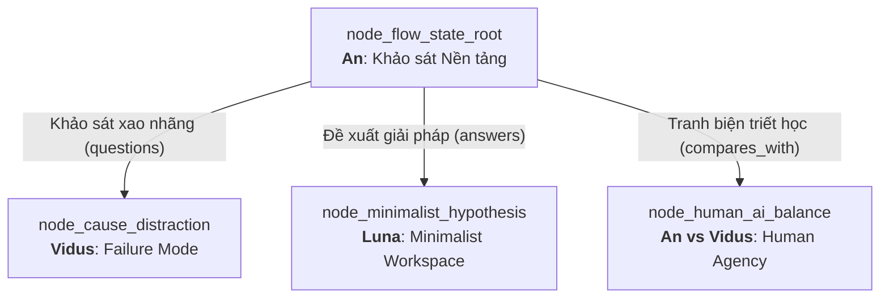

# Technical Research Paper: Cơ Sở Nền Tảng Của Sự Cộng Sinh Con Người - AI Trong Duy Trì Dòng Chảy Nhận Thức

## Table of Contents
1. [Abstract](#1-abstract)
2. [Epistemic Lineage & Research Scope](#2-epistemic-lineage--research-scope)
3. [Theoretical Foundations of Flow State](#3-theoretical-foundations-of-flow-state)
4. [Cognitive Load Formulations](#4-cognitive-load-formulations)
5. [The Human-AI Cognitive Divergence Problem](#5-the-human-ai-cognitive-divergence-problem)
6. [Epistemic Inquiry Tree & Research Hypotheses](#6-epistemic-inquiry-tree--research-hypotheses)
7. [Architectural Framework in Aevum OS](#7-architectural-framework-in-aevum-os)
8. [Conclusion and Epistemic Trajectory](#8-conclusion-and-epistemic-trajectory)
9. [References](#9-references)

---

## 1. Abstract
Nghiên cứu này thiết lập cơ sở lý thuyết nền tảng cho miền nghiên cứu **Trạng Thái Dòng Chảy Nhận Thức (Cognitive Flow State)** trong môi trường phát triển phần mềm được trợ lực bởi AI. Dựa trên mô hình tâm lý học nhận thức của Csikszentmihalyi và Lý thuyết Tải Nhận Thức (Cognitive Load Theory - Sweller), chúng tôi mô hình hóa mối quan hệ tương hỗ giữa người dùng (Kỹ sư kiến trúc) và hệ thống Multi-Agent Aevum OS. Mục tiêu cốt lõi của nghiên cứu là xác định các điều kiện biên nhằm duy trì chỉ số dòng chảy nhận thức (Flow Continuity Index - FCI) vượt ngưỡng 80%, loại bỏ các đứt gãy phi chủ đích gây ra bởi thông báo thụ động và sự bất đồng bộ ngữ cảnh. Kết quả khảo sát mở đường cho các phân nhánh chuyên sâu về phân tích lỗi nhận thức, thiết kế không gian làm việc tối giản và chuẩn hóa giao thức nhịp độ tương tác.

---

## 2. Epistemic Lineage & Research Scope
Bài báo này đóng vai trò là **Node Gốc (Root Node - `node_flow_state_root`)** của toàn bộ cây nghiên cứu `sphere_flow_state_ai`. Khác với các tài liệu triển khai kỹ thuật đơn lẻ, công trình này chịu trách nhiệm:
1. Xác định không gian bài toán tổng thể (Problem Space Cartography).
2. Thiết lập hệ quy chiếu toán học cho tải nhận thức trong tương tác người - máy.
3. Phân bổ các hướng nghiên cứu kế thừa cho các Agent chuyên trách:
   - Hướng `questions` -> Chuyển giao cho **Vidus** phân tích các chế độ lỗi đứt gãy nhận thức (`node_cause_distraction`).
   - Hướng `answers` -> Chuyển giao cho **Luna** xây dựng giả thuyết môi trường tối giản (`node_minimalist_hypothesis`).
   - Hướng `compares_with` -> Mở phiên tranh biện triết học đa chiều giữa **An** và **Vidus** (`node_human_ai_balance`).

---

## 3. Theoretical Foundations of Flow State
Trạng thái dòng chảy (Flow State) là trạng thái tâm lý tối ưu mà tại đó một cá nhân hoàn toàn đắm chìm vào công việc với sự tập trung cao độ, sự hòa tan giữa nhận thức và hành động, cùng khả năng kiểm soát tình huống tuyệt đối.

Trong bối cảnh công nghệ thông tin hiện đại, lập trình viên và kiến trúc sư hệ thống thường xuyên phải đối mặt với **Tình trạng Phân mảnh Chú ý (Attention Fragmentation)**:
- Một lập trình viên cần trung bình từ 15 đến 23 phút để tái thiết lập đầy đủ bối cảnh tư duy sau mỗi lần bị ngắt quãng (Interruption Cost - Mark et al.).
- Việc các công cụ AI phản hồi một cách rời rạc, thiếu ngữ cảnh dài hạn làm gia tăng áp lực kiểm tra chéo (Verification Overhead), biến AI từ trợ lực thành gánh nặng nhận thức mới.

---

## 4. Cognitive Load Formulations
Để định lượng hóa trạng thái nhận thức của người dùng khi cộng tác cùng AI, chúng tôi thiết lập mô hình tính toán tổng tải nhận thức ($CL_{Total}$):

$$CL_{Total} = CL_{Intrinsic} + CL_{Extraneous} + CL_{Germane}$$

Trong đó:
- $CL_{Intrinsic}$ (Tải nội tại): Đại diện cho độ phức tạp thực thể của bài toán nghiệp vụ hoặc cấu trúc kiến trúc phần mềm đang được xử lý.
- $CL_{Extraneous}$ (Tải ngoại lai): Đại diện cho các kích thích gây nhiễu, bao gồm UI lộn xộn, cảnh báo dư thừa, việc chuyển đổi màn hình (Context Switching), và các phản hồi AI sai lệch.
- $CL_{Germane}$ (Tải hữu ích): Năng lượng nhận thức được dành riêng cho việc tích hợp tri thức, kiến tạo trừu tượng và tối ưu hóa giải pháp.

**Nguyên lý Tối ưu Aevum Flow:**
Mục tiêu của hệ thống Aevum OS là tối thiểu hóa $CL_{Extraneous} \to 0$, qua đó giải phóng tối đa dung lượng bộ nhớ làm việc (Working Memory Capacity) cho $CL_{Germane}$.

Đồng thời, chỉ số Dòng Chảy Nhận Thức (Flow Continuity Index - $FCI$) được định nghĩa:

$$FCI = \frac{T_{Uninterrupted}}{T_{Total}} \times \left(1 - \frac{\sum \Delta T_{ContextSwitching}}{T_{Total}}\right)$$

Khi $FCI \ge 0.85$, lập trình viên đạt trạng thái "Hyperfocus Cadence".

---

## 5. The Human-AI Cognitive Divergence Problem
Khi tương tác với các mô hình ngôn ngữ lớn (LLM), người dùng thường gặp phải bài toán "Divergence" (Phân kỳ nhận thức):
1. **Hallucination Friction:** Người dùng mất lòng tin vào các phản hồi không có nguồn dẫn chứng, buộc phải chuyển trạng thái nhận thức sang chế độ "Thanh tra" (Inspector Mode).
2. **Context Window Drift:** Agent quên đi các ràng buộc kiến trúc đã thống nhất trong các bước trước đó, khiến người dùng phải giải thích lại từ đầu.
3. **Passive Intrusion:** Agent đưa ra các gợi ý không đúng lúc, chen ngang vào chuỗi suy nghĩ logic sâu của con người.

---

## 6. Epistemic Inquiry Tree & Research Hypotheses
Từ khảo sát nền tảng này, chúng tôi phân rã không gian nghiên cứu thành 3 câu hỏi lớn:
- **Câu hỏi 1 (Q1 - Failure Mode):** Đâu là các cơ chế kích hoạt sự đứt gãy nhận thức khi làm việc cùng AI? Điểm nghẽn nghiêm trọng nhất là gì?
- **Câu hỏi 2 (Q2 - Workspace Design):** Làm thế nào để cấu trúc một không gian làm việc tối giản có khả năng triệt tiêu tải ngoại lai $CL_{Extraneous}$?
- **Câu hỏi 3 (Q3 - Human vs Machine Agency):** Điểm cân bằng tối ưu giữa việc con người nắm quyền kiểm soát chiến lược và Agent tự trị thực thi là ở đâu?

---

## 7. Architectural Framework in Aevum OS
Để hiện thực hóa việc bảo vệ dòng chảy nhận thức, Aevum OS triển khai kiến trúc 3 lớp:
1. **Living Memory Fabric:** Lưu trữ ngữ cảnh dự án bất biến thông qua Vector/AST Index, triệt tiêu hiện tượng trôi dạt ngữ cảnh.
2. **Attentive Signal Filter:** Cơ chế lọc tín hiệu chủ động, chỉ thông báo cho người dùng tại các ranh giới tự nhiên (Natural Cognitive Boundaries - hoàn thành 1 block logic hoặc kết thúc chu kỳ Pomodoro).
3. **Multi-Agent Specialist Swarm:** Phân công rõ vai trò giữa các Persona (An phụ trách điều phối & quy chuẩn, Vidus giám sát lỗi và phản biện, Luna thiết kế giao diện tối giản, Zenith tối ưu hóa thực thi).

---

## 8. Conclusion and Epistemic Trajectory
Nghiên cứu nền tảng này khẳng định rằng: Trạng thái dòng chảy khi làm việc cùng AI không phải là sự phụ thuộc hoàn toàn vào máy tính, mà là **Vũ điệu Nhịp độ (Cognitive Cadence)** giữa tư duy trừu tượng của con người và năng lực tính toán của máy. 

Bài báo chuyển giao nhiệm vụ khảo sát thực địa về các tác nhân gây đứt gãy cho Agent **Vidus** trong nghiên cứu tiếp theo: `tech_failure_mode_cognitive_fragmentation.md`.

---

## 9. References
- [1] M. Csikszentmihalyi, *Flow: The Psychology of Optimal Experience*, Harper & Row, 1990.
- [2] J. Sweller, "Cognitive load during problem solving: Effects on learning," *Cognitive Science*, vol. 12, no. 2, pp. 257-285, 1988.
- [3] G. Mark, V. M. Gonzalez, and J. Harris, "No task left behind? Examining the nature of fragmented work," in *Proc. ACM CHI*, 2005, pp. 521-530.
- [4] Aevum Core Intelligence Team, "Aevum Living Memory Architecture Specification v2.0," *I2FLabs Tech Rep.*, 2026.
