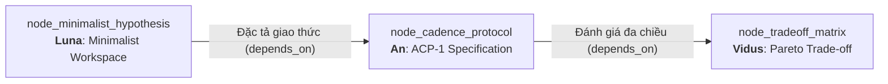
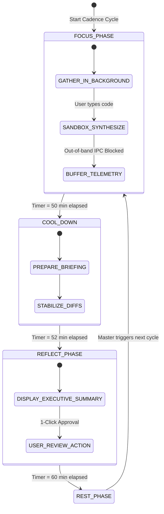

# Technical Research Paper: Quy Chuẩn Kỹ Thuật Giao Thức Nhịp Độ Tương Tác Aevum Cadence Protocol 50/10 (ACP-1)

## Table of Contents
1. [Abstract](#1-abstract)
2. [Epistemic Lineage & Architectural Dependency](#2-epistemic-lineage--architectural-dependency)
3. [Terminology & RFC 2119 Conformance](#3-terminology--rfc-2119-conformance)
4. [Protocol State Machine Architecture](#4-protocol-state-machine-architecture)
5. [Signal Flags & In-Memory Bitmask](#5-signal-flags--in-memory-bitmask)
6. [Data Schema & IPC Contracts](#6-data-schema--ipc-contracts)
7. [Security & Boundary Enforcements](#7-security--boundary-enforcements)
8. [Conclusion & Downstream Handoff](#8-conclusion--downstream-handoff)
9. [References](#9-references)

---

## 1. Abstract
Tài liệu này đặc tả quy chuẩn kỹ thuật chính thức cho **Giao Thức Nhịp Độ Tương Tác Aevum (Aevum Cadence Protocol - ACP-1)** phiên bản 1.0.0. Kế thừa trực tiếp từ giả thuyết không gian tối giản của **Luna** (`node_minimalist_hypothesis`) và đối chuẩn định lượng của **Zenith** (`node_cognitive_benchmark`), giao thức này chuẩn hóa chu kỳ tương tác nhịp độ 50/10 giữa con người và swarm Agent. ACP-1 thiết lập một máy trạng thái hữu hạn (Deterministic Finite State Machine), định nghĩa các ràng buộc truyền tin liên tiến trình (IPC), và quy định cơ chế khóa ngắt quãng nhằm duy trì tính toàn vẹn của trạng thái dòng chảy nhận thức.

---

## 2. Epistemic Lineage & Architectural Dependency
Bản đặc tả này đại diện cho bước chuyển hóa từ *Lý thuyết & Thực nghiệm* sang *Quy chuẩn Thực thi Hệ thống*:
- **Node Tiền nhiệm:** `node_minimalist_hypothesis` (Luna: Thiết Kế Môi Trường Tối Giản).
- **Cạnh Liên kết (Inbound Edge):** Loại `depends_on` mang nhãn **"Đặc tả giao thức"**.
- **Lý do Liên kết (Rationale):** *"Chuẩn hóa thiết kế tối giản thành quy trình nhịp độ 50/10 cụ thể."*



Khi **Luna** đề xuất hạ tải ngoại lai $CL_{Extraneous}$ và **Zenith** chứng minh nhịp 50/10 giúp nâng dòng chảy lên 2.45 lần, **An** tiến hành quy chuẩn hóa toàn bộ các phát hiện này thành tài liệu RFC để toàn bộ runtime của Aevum OS có thể tuân thủ nghiêm ngặt.

---

## 3. Terminology & RFC 2119 Conformance
Các từ khóa "MUST", "MUST NOT", "REQUIRED", "SHALL", "RECOMMENDED", "MAY" trong tài liệu này được diễn giải theo chuẩn **IETF RFC 2119**.

- **Deep Focus Window (Cửa sổ Tập trung Sâu):** Khoảng thời gian liên tục 50 phút. Trong thời gian này, Agent **MUST NOT** gửi bất kỳ thông báo thị giác hoặc âm thanh nào ngắt ngang người dùng.
- **Cognitive Harvest Window (Cửa sổ Thu hoạch Nhận thức):** Khoảng thời gian 10 phút. Agent **MUST** trình bày bản tóm tắt tri thức ngắn gọn (Executive Briefing) và các diff code đã chuẩn bị sẵn.
- **Emergency Circuit Breaker:** Cơ chế phá vỡ khẩn cấp khi xảy ra lỗi nghiêm trọng (Fatal Build Crash hoặc Lỗ hổng bảo mật zero-day).

---

## 4. Protocol State Machine Architecture
ACP-1 vận hành dựa trên máy trạng thái 4 pha tuần hoàn:



1. **FOCUS_PHASE (00:00 - 50:00):** Agent chỉ được phép chạy background worker. Tất cả output được ghi vào buffer ẩn.
2. **COOL_DOWN (50:00 - 52:00):** Giai đoạn 2 phút giảm nhiệt nhận thức. Hệ thống tự động lưu file, chạy linting kiểm tra cú pháp và kết xuất Markdown summary.
3. **REFLECT_PHASE (52:00 - 60:00):** Mở giao diện tổng kết. Lập trình viên xem xét các đề xuất và phê duyệt bằng một thao tác duy nhất.
4. **REST_PHASE:** Nghỉ ngơi hoàn toàn hoặc chuyển sang chu kỳ kế tiếp.

---

## 5. Signal Flags & In-Memory Bitmask
Trạng thái ACP-1 được mã hóa thành bitmask 8-bit trong Shared Memory:

```typescript
export enum CadenceSignalFlags {
    NONE                  = 0b00000000,
    IN_FOCUS_SESSION      = 0b00000001, // 1: Đang trong chu kỳ 50 phút
    BLOCK_OUTBOUND_IPC    = 0b00000010, // 2: Cấm mọi popup / toast
    BACKGROUND_SANDBOX_RUN= 0b00000100, // 4: Cho phép Agent test ngầm
    CIRCUIT_BREAKER_TRIP  = 0b00001000, // 8: Cắt khẩn cấp do lỗi nghiêm trọng
    REFLECT_PENDING       = 0b00010000, // 16: Báo cáo đang chờ duyệt
    AUTONOMOUS_RESOLVE    = 0b00100000  // 32: Cho phép AI tự sửa lỗi cú pháp
}
```

---

## 6. Data Schema & IPC Contracts
Cấu trúc gói tin đồng bộ phiên ACP-1 giữa Main Process và Renderer:

```typescript
export interface CadenceSessionContract {
    sessionId: string;
    protocolVersion: '1.0.0';
    activePersona: 'an' | 'luna' | 'vidus' | 'zenith';
    currentPhase: 'focus' | 'cool_down' | 'reflect' | 'rest';
    phaseTimeRemainingSeconds: number;
    flowContinuityScore: number;
    bufferedInsightsCount: number;
    pendingArtifacts: Array<{
        path: string;
        type: 'diff' | 'paper' | 'plan';
        summary: string;
    }>;
}
```

---

## 7. Security & Boundary Enforcements
- Mọi Agent vi phạm gửi thông báo trong `FOCUS_PHASE` sẽ bị hệ thống **Audit Boundary** tự động ngắt kết nối IPC trong 300 giây.
- Dữ liệu thu thập trong `REFLECT_PHASE` phải được ký số bởi Persona tương ứng trước khi lưu trữ vào Living Memory.

---

## 8. Conclusion & Downstream Handoff
Quy chuẩn ACP-1 v1.0.0 hoàn thiện khung rào chắn kỹ thuật cần thiết để duy trì dòng chảy nhận thức. Tuy nhiên, việc áp dụng giao thức nghiêm ngặt này đòi hỏi các đánh đổi về độ phản hồi tức thời. Do đó, bản đặc tả này được bàn giao cho Agent **Vidus** tại `node_tradeoff_matrix` (`tech_tradeoff_flow_state_decision_matrix.md`) để phân tích ma trận đánh đổi đa chiều.

---

## 9. References
- [1] S. Bradner, "Key words for use in RFCs to Indicate Requirement Levels," *IETF RFC 2119*, 1997.
- [2] Aevum Engineering Group, "Aevum Cadence Protocol Specification v1.0," *I2FLabs Technical Standard*, 2026.
