# 🌳 Cây Kế Hoạch Toàn Diện Chuyển Đổi Kế Tiếp UIPorge (Stage 3, 4, 5)

> **Điều phối viên (Squad Lead):** An (`ENG-AN-7B9F1D`)  
> **Dự án:** UIPorge Visual Web Application Framework  
> **Aevos Research Domain:** `sphere_1794153714348_uiporge_next_phases_migration_`

---

## 🗺️ Bản Đồ Cây Tri Thức & Kế Hoạch (Research Plan Tree)

```mermaid
graph TD
    ROOT["🌳 UIPORGE NEXT PHASES MIGRATION TREE\n(sphere_uiporge_next_phases)"]
    
    %% Stage 3 Branch
    ROOT --> S3["📊 Giai Đoạn 3: GridPolicy & Enterprise Data Grid\n(node_1794153717992) - Lead: Kael"]
    S3 --> S3_1["3.1 Header Context Menu\n(node_1794153728446) - Ảnh 5\nHide/Show, Freeze, Options, Clone, Delete"]
    S3 --> S3_2["3.2 Column Properties Modal\n(node_1794153731484) - Ảnh 6\nFieldName, ComponentType, Format, Precision"]
    S3 --> S3_3["3.3 Summary Footer Row\n(node_1794153735051) - Ảnh 4\nTự động SUM/COUNT/AVG Packages, CBM, VGM"]
    S3 --> S3_4["3.4 Frozen Sticky Columns & Inline Cell Editing\n(node_1794153738192)\nGhim cột trái/phải, sửa trực tiếp trên cell"]

    %% Stage 4 Branch
    ROOT --> S4["🔗 Giai Đoạn 4: Data Binding, Cascading & Validation\n(node_1794153721421) - Lead: Zenith"]
    S4 --> S4_1["4.1 Master-Detail Relation Engine\n(node_1794153741922) - Ảnh 4\nĐồng bộ Form chính với 3 bảng con qua JobNo"]
    S4 --> S4_2["4.2 Cascading Dropdowns & Auto-populate\n(node_1794153745247)\nPOL -> POD, S.Lines -> Vendor/Agent"]
    S4 --> S4_3["4.3 Enterprise Validation Rules Engine\n(node_1794153748277) - Ảnh 1\nRequired, Pattern Regex, Unique API Check"]

    %% Stage 5 Branch
    ROOT --> S5["🛡️ Giai Đoạn 5: Dynamic Policy & Field-Level RBAC\n(node_1794153724617) - Lead: Alice"]
    S5 --> S5_1["5.1 Field-Level RBAC UI & Dynamic PermissionGuard\n(node_1794153751507)\nTab Quyền Hạn, AllowedRoles, ReadOnly, Hidden"]
    S5 --> S5_2["5.2 Backend Policy Enforcement & Claim-Based API\n(node_1794153754784)\nDynamicPolicyFilter trên ASP.NET Core 8"]

    %% Class styling
    classDef rootStyle fill:#1e1b4b,stroke:#818cf8,stroke-width:3px,color:#fff;
    classDef s3Style fill:#064e3b,stroke:#34d399,stroke-width:2px,color:#fff;
    classDef s4Style fill:#1e3a8a,stroke:#60a5fa,stroke-width:2px,color:#fff;
    classDef s5Style fill:#701a75,stroke:#f472b6,stroke-width:2px,color:#fff;
    
    class ROOT rootStyle;
    class S3,S3_1,S3_2,S3_3,S3_4 s3Style;
    class S4,S4_1,S4_2,S4_3 s4Style;
    class S5,S5_1,S5_2 s5Style;
```

---

## 📑 Danh Sách Tài Liệu Nghiên Cứu Chi Tiết

1. [`plan_stage3_gridpolicy_and_column_manager.md`](file:///D:/Learn/UIPorge/.aevum/research/plan_stage3_gridpolicy_and_column_manager.md): Nghiên cứu kỹ thuật & kế hoạch giai đoạn 3.
2. [`plan_stage4_databinding_cascading_and_validation.md`](file:///D:/Learn/UIPorge/.aevum/research/plan_stage4_databinding_cascading_and_validation.md): Nghiên cứu kỹ thuật & kế hoạch giai đoạn 4.
3. [`plan_stage5_dynamic_rbac_and_security_policy.md`](file:///D:/Learn/UIPorge/.aevum/research/plan_stage5_dynamic_rbac_and_security_policy.md): Nghiên cứu kỹ thuật & kế hoạch giai đoạn 5.

---

## ⏱️ Trình Tự Thực Thi Khuyến Nghị (Execution Pipeline)

- **Bước 1**: Master phê duyệt bản kế hoạch tổng thể.
- **Bước 2**: Thực thi **Giai Đoạn 3** (Lưới nâng cao & Column Manager chuẩn Ảnh 5 & 6) ➔ Kiểm thử trực tiếp & bàn giao.
- **Bước 3**: Thực thi **Giai Đoạn 4** (Cascading Dropdowns & Validation Rules) ➔ Kiểm thử trực tiếp & bàn giao.
- **Bước 4**: Thực thi **Giai Đoạn 5** (Dynamic RBAC & Backend Security Guard) ➔ Hoàn thiện hệ sinh thái UIPorge.

