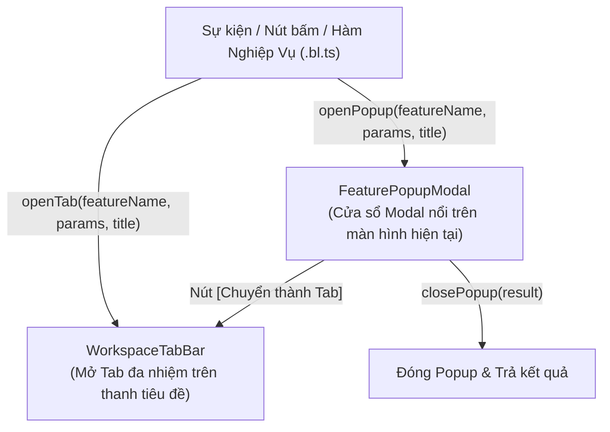
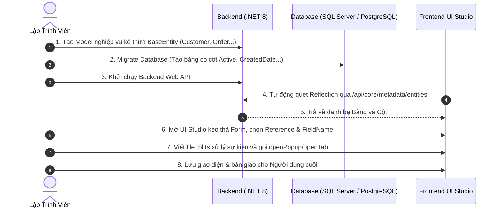

# 📘 SỔ TAY TÍNH NĂNG & TÀI LIỆU HƯỚNG DẪN LÕI UIFORGE CORE
### (UIForge Core Specification, Feature Catalog & Developer Manual)

> **Bộ khung nền tảng**: UIForge Visual Enterprise Framework  
> **Gói thư viện Frontend**: `@uiforge/core` (npm package)  
> **Gói thư viện Backend**: `UIForge.Core` (NuGet package dành cho .NET 8)  
> **Phiên bản tài liệu**: v2.5.0-Enterprise  
> **Tác giả / Squad Lead**: An (`ENG-AN-7B9F1D`)  

---

## MỤC LỤC
1. [Nguyên Tắc Cốt Lõi & Kiến Trúc Tổng Quan](#1-nguyên-tắc-cốt-lõi--kiến-trúc-tổng-quan)
2. [Quy Chuẩn Cơ Sở Dữ Liệu & BaseEntity](#2-quy-chuẩn-cơ-sở-dữ-liệu--baseentity)
3. [Danh Mục Các Component Trực Quan (UI Component Catalog)](#3-danh-mục-các-component-trực-quan-ui-component-catalog)
4. [Động Cơ Bảng Dữ Liệu Doanh Nghiệp GridPolicy (ForgeTable)](#4-động-cơ-bảng-dữ-liệu-doanh-nghiệp-gridpolicy-forgetable)
5. [Động Cơ Điều Hướng Màn Hình (Navigation Engine: Tab & Popup)](#5-động-cơ-điều-hướng-màn-hình-navigation-engine-tab--popup)
6. [Động Cơ Dữ Liệu & Tự Động Điền (Data Engine & Dynamic Populate)](#6-động-cơ-dữ-liệu--tự-động-điền-data-engine--dynamic-populate)
7. [Hộp Thoại Cấu Hình Thuộc Tính Component (Component Properties Modal)](#7-hộp-thoại-cấu-hình-thuộc-tính-component-component-properties-modal)
8. [Hướng Dẫn Triển Khai Dự Án Mới Từ Đầu (Step-by-Step Project Setup)](#8-hướng-dẫn-triển-khai-dự-án-mới-từ-đầu-step-by-step-project-setup)

---

## 1. NGUYÊN TẮC CỐT LÕI & KIẾN TRÚC TỔNG QUAN

UIForge là một **Visual UI Builder & Rapid Application Development (RAD) Framework** tổng quát dành cho mọi doanh nghiệp và mọi lĩnh vực ngành nghề (sản xuất, bán lẻ, kho vận, tài chính, nhân sự, giáo dục...).

### 🎯 3 Quy Tắc Bất Biến (Golden Rules)
1. **Phân tách 100% giữa Framework Core và Logic Nghiệp vụ (Domain Decoupling)**:
   - Toàn bộ thư viện Frontend `@uiforge/core` và Backend NuGet `UIForge.Core` là độc lập hoàn toàn.
   - Tuyệt đối không nhúng cứng bất kỳ tên trường (`fld_job_no`, `sLines`, `containerNo`, `POL`, `POD`...) hay logic nghiệp vụ của bất kỳ ngành nghề nào vào các component lõi.
   - Các ứng dụng mẫu (như Logistics FCL Import) được cô lập vào thư mục fixture riêng để kiểm thử tính năng của Core.
2. **Đồng Bộ Model Tự Động Giữa Backend và Frontend**:
   - Backend cung cấp endpoint `GET /api/core/metadata/entities`.
   - Khi doanh nghiệp thêm bảng hoặc sửa cột trong C# Backend, Frontend Designer tự động nhận biết danh mục bảng (`Reference`) và trường dữ liệu (`FieldName`) ngay lập tức mà không cần viết lại mã TypeScript.
3. **Mô Hình Khách Hàng - Máy Chủ Độc Lập**:
   - Frontend Studio chạy độc lập (Vite/React).
   - Backend Web API chạy độc lập (.NET 8 Web API).
   - Giao tiếp thuần qua chuẩn REST API và OData Query Parameters.

---

## 2. QUY CHUẨN CƠ SỞ DỮ LIỆU & BASEENTITY

Mọi bảng/thực thể nghiệp vụ trong cơ sở dữ liệu của doanh nghiệp khi tích hợp vào UIForge **BẮT BUỘC PHẢI** kế thừa từ lớp `BaseEntity`:

```csharp
namespace UIForge.API.Models.Entities
{
    public abstract class BaseEntity
    {
        public int Id { get; set; }
        public bool Active { get; set; } = true;
        public DateTime CreatedDate { get; set; } = DateTime.UtcNow;
        public string? CreatedBy { get; set; }
        public DateTime? UpdatedDate { get; set; }
        public string? UpdatedBy { get; set; }
    }
}
```

### Chi tiết các thuộc tính chuẩn:
| Tên trường | Kiểu dữ liệu | Ý nghĩa | Quy tắc hoạt động |
| :--- | :--- | :--- | :--- |
| `Id` | `int` / `long` | Khóa chính duy nhất | Tự động tăng (Identity / Auto-increment) |
| `Active` | `bool` | Cờ trạng thái hoạt động | Dùng cho **Xóa mềm (Soft Delete)**. Mọi truy vấn mặc định trong hệ thống đều tự động gán `Active eq true` |
| `CreatedDate` | `DateTime` | Thời điểm tạo bản ghi | Ghi nhận tự động theo chuẩn UTC lúc tạo |
| `CreatedBy` | `string?` | Người tạo bản ghi | Tự động trích xuất từ JWT Claims của tài khoản đăng nhập |
| `UpdatedDate` | `DateTime?` | Thời điểm cập nhật cuối | Ghi nhận UTC mỗi khi cập nhật hoặc xóa mềm |
| `UpdatedBy` | `string?` | Người cập nhật cuối | Ghi nhận tài khoản chỉnh sửa |

### API Xóa Mềm Tiêu Chuẩn:
```http
DELETE /api/core/data/{entityName}/{id}
```
*Hệ thống không xóa vật lý bản ghi trong DB mà gán `Active = false`, lưu lại `UpdatedDate` và `UpdatedBy`.*

---

## 3. DANH MỤC CÁC COMPONENT TRỰC QUAN (UI COMPONENT CATALOG)

### 3.1. `ForgeTextBox` (Ô nhập văn bản một dòng)
- **Mục đích**: Nhập chuỗi ký tự ngắn, mã hiệu, tên, số chứng từ, địa chỉ.
- **Thuộc tính Props**:
  - `label`: Tiêu đề hiển thị bên trái của ô nhập.
  - `showLabel`: Ẩn/hiện tiêu đề (`true` / `false`).
  - `labelPosition`: Vị trí nhãn (`'left'` chuẩn ERP hoặc `'top'`).
  - `labelWidth`: Độ rộng vùng nhãn (mặc định `'100px'`).
  - `colSpan`: Số cột chiếm dụng trên lưới 12 cột (`1` đến `12`).
  - `placeholder`: Gợi ý nội dung mờ.
  - `disabled`: Vô hiệu hóa ô nhập.
  - `readOnly`: Chỉ cho phép xem, không cho sửa.
  - `required`: Đánh dấu bắt buộc nhập (hiển thị dấu sao đỏ `*`).
- **Data Binding**:
  - `dataBinding.entityName`: Tên thực thể liên kết (VD: `Transaction`).
  - `dataBinding.fieldName`: Tên trường liên kết (VD: `JobNo`, `MblNo`).
  - `dataBinding.twoWay`: Bật đồng bộ 2 chiều (`true`).

### 3.2. `ForgeSelect` (Hộp chọn danh mục / Dropdown)
- **Mục đích**: Lựa chọn 1 mục từ danh mục tham chiếu (Cảng biển, Hãng tàu, Khách hàng, Loại tiền...).
- **Thuộc tính Props**:
  - Các thuộc tính nhãn & layout: `label`, `showLabel`, `labelPosition`, `labelWidth`, `colSpan`.
  - `reference`: Tên bảng tham chiếu trong Database (VD: `'Terminal'`, `'Vendor'`).
  - `idField`: Tên trường làm giá trị (`value`), mặc định `'id'` hoặc `'code'`.
  - `textField`: Tên trường làm nhãn hiển thị, mặc định `'fullName'` hoặc `'name'`.
  - `query`: Chuỗi lọc OData (VD: `'Active eq true'`).
  - `populateField`: Chuỗi quy tắc tự động điền sang các trường khác (xem chi tiết tại Mục 6).
  - `options`: Mảng tùy chọn tĩnh dự phòng nếu không dùng Reference.

### 3.3. `ForgeNumber` (Ô nhập dữ liệu số)
- **Mục đích**: Nhập số lượng, đơn giá, trọng lượng (GW), thể tích (CBM), tổng tiền.
- **Thuộc tính Props**:
  - `precision`: Số chữ số phần thập phân (`0` cho số nguyên, `2` hoặc `3` cho số thực).
  - `thousandsSeparator`: Tự động định dạng dấu phẩy hàng nghìn (`1,000,000`).
  - Căn lề số: Tự động căn phải (`text-right`) chuẩn kế toán.

### 3.4. `ForgeDatePicker` (Ô chọn ngày tháng)
- **Mục đích**: Chọn ngày phát hành, ngày khởi hành (ETD/ATD), ngày đến (ETA/ATA), ngày hết hạn.
- **Thuộc tính Props**:
  - `placeholder`: Định dạng ngày (`'DD/MM/YYYY'`).
  - Biểu tượng lịch tích hợp ở góc phải.

### 3.5. `ForgeTextarea` (Ô nhập văn bản nhiều dòng)
- **Mục đích**: Nhập ghi chú, mô tả hàng hóa, địa chỉ chi tiết, lý do hủy đơn.
- **Thuộc tính Props**:
  - `rows`: Số dòng hiển thị mặc định (mặc định `2` hoặc `3`).

### 3.6. `ForgeCheckbox` (Hộp kiểm logic Có/Không)
- **Mục đích**: Đánh dấu trạng thái Boolean (Đã kiểm tra, Hải quan, Đã xuất hóa đơn, Đang hoạt động).

### 3.7. `ForgeContainer` (Khung bao bố cục & Quản lý Tab)
- **Mục đích**: Nhóm các component con lại thành hàng ngang, cột dọc hoặc khối Tab.
- **Thuộc tính Props**:
  - `layoutMode`: `'flex'` hoặc `'grid'`.
  - `flexConfig.direction`: `'row'` hoặc `'column'`.
  - `flexConfig.wrap`: Tự động xuống dòng khi tràn (`'wrap'` / `'nowrap'`).
  - `flexConfig.gap`: Khoảng cách giữa các phần tử (`'8px'`, `'12px'`, `'16px'`).
  - `tab`: Đánh dấu Container là một Tab (`true`). Khi các Container có cùng thuộc tính `tab: true`, UIForge tự động xếp thành thanh Tab ngang chuyển đổi mượt mà.

### 3.8. `ForgeSection` (Khối bố cục thẻ có tiêu đề và lưới 12 cột)
- **Mục đích**: Nhóm các trường dữ liệu theo phân vùng chức năng (VD: `GENERAL - FCL IMPORT`, `ATTACHMENT`, `MASTER COST`), hỗ trợ thu gọn/mở rộng (`collapsible`).

### 3.9. `ForgeTabStack` (Ngăn xếp các thẻ màn hình theo cụm)
- **Mục đích**: Nhóm các Section có cùng `tabGroup` thành một thanh Tab ngang trực quan (như `MAIN INFORMATION`, `MASTER COST`, `PROFIT`...).
- **Thuộc tính Props**:
  - `tabGroup`: Tên định danh của nhóm Tab (VD: `fcl_import_tabs`).
  - `defaultTab`: Tên Tab mở mặc định khi tải màn hình.

### 3.10. `ForgeRecordSelector` (Bộ chọn danh sách bản ghi con / Master-Detail Selector)
- **Mục đích**: Hiển thị danh sách các bản ghi con (Sub-records / Lô hàng / House B/L / Order Lines) thuộc về một bản ghi cha (Master Job / Booking / Invoice), cho phép chuyển đổi qua lại giữa các bản ghi con và tạo mới nhanh chóng.
- **Minh họa giao diện**:
  ```text
  Lô hàng:  [ FCLT-26020005 ]  [ FCLT-26020006 ]  [ FCLT-26020007 ]  [ + Tạo mới ]
  ```
- **Thuộc tính Props**:
  - `label`: Nhãn tiêu đề (mặc định `'Lô hàng:'` hoặc tùy chỉnh như `'Chi tiết:'`, `'Sub-items:'`).
  - `reference`: Tên thực thể con (VD: `'Transaction'`, `'ShipmentItem'`).
  - `displayField`: Trường dữ liệu hiển thị trên Badge (mặc định `'code'` hoặc `'id'`).
  - `records`: Mảng các bản ghi con `[{ id: '1', code: 'FCLT-26020005' }, ...]`.
  - `activeId`: ID của bản ghi con đang được chọn và kích hoạt trên Form.
  - `canAdd`: Bật/tắt nút `[+ Tạo mới]` (`true` / `false`).
  - `onSelectRecord`: Sự kiện kích hoạt khi người dùng nhấn vào một Badge, tự động nạp dữ liệu của bản ghi đó vào Form chi tiết.
  - `onAddNew`: Sự kiện kích hoạt khi nhấn `[+ Tạo mới]`, tự động sinh mã mới và thiết lập form rỗng để người dùng nhập liệu.

---

## 4. ĐỘNG CƠ BẢNG DỮ LIỆU DOANH NGHIỆP GRIDPOLICY (FORGETABLE)

`ForgeTable` là thành phần lưới dữ liệu cao cấp (Enterprise Data Grid) tái hiện 100% sức mạnh của `GridView.cs` trong Core C# cũ.

### 4.1. Cấu trúc Cột `TableColumn`:
```ts
export interface TableColumn {
  key: string                  // Khóa trường dữ liệu (FieldName)
  title: string                // Tiêu đề cột trên Header
  width?: string               // Độ rộng cột (VD: '160px', '220px')
  minWidth?: string            // Độ rộng tối thiểu khi co giãn
  maxWidth?: string            // Độ rộng tối đa
  align?: 'left' | 'center' | 'right' // Căn lề nội dung
  frozen?: boolean             // Ghim cố định cột ở bên trái (Sticky Left)
  sticky?: 'left' | 'none'     // Đồng bộ với frozen
  sortable?: boolean           // Cho phép bấm header để sắp xếp tăng/giảm
  editable?: boolean           // Cho phép nhấp vào ô để chỉnh sửa trực tiếp
  componentType?: 'TextBox' | 'Number' | 'DatePicker' | 'Select' | 'Checkbox' // Loại ô nhập liệu
  aggregate?: 'sum' | 'count' | 'avg' // Hàm tổng hợp chân bảng
  summarySuffix?: string       // Hậu tố tổng hợp (VD: ' KGS', ' CBM')
  precision?: number           // Số chữ số thập phân nếu là cột Number
  formatCell?: string          // Định dạng ô (VD: '{ShortName}', '{Name}')
  order?: number               // Thứ tự sắp xếp cột
  active?: boolean             // Trạng thái hiển thị cột
}
```

### 4.2. Các Tính Năng Cao Cấp Của Lưới Dữ Liệu:
1. **Chính Sách Ghim Cột Cố Định (Sticky / Frozen Policy)**:
   - Các cột được đánh dấu `frozen: true` **luôn luôn được gom về đầu bảng** theo đúng quy định của Core C#.
   - Hệ thống tự động tính toán khoảng cách `leftOffset` chính xác đến từng pixel (`calculateLeftOffsets`), đảm bảo không có khoảng hở và không bị đè chồng.
   - Cột ghim có nền đặc `#0f172a`, hiệu ứng bóng đổ (`shadow`) và đường phân cách khi cuộn ngang.
2. **Kéo Thả Đổi Thứ Tự Cột Trực Tiếp (Drag & Drop Column Reordering)**:
   - Người dùng có thể kéo thả header cột để thay đổi vị trí.
   - Nhóm cột Frozen chỉ đổi vị trí trong nhóm Frozen; nhóm cột thường chỉ đổi vị trí trong nhóm thường.
3. **Chỉnh Sửa Dữ Liệu Tức Thì (Interactive Cell Components)**:
   - Mỗi ô trong bảng không chỉ là thẻ `<td>` thụ động mà là một control tương tác (`GridCellComponent`): ô văn bản, ô số định dạng, ô chọn ngày tháng có icon, ô dropdown chọn danh mục, ô checkbox.
4. **Hàng Tổng Hợp Tự Động (Aggregate Summary Row)**:
   - Hàng chân bảng (`<tfoot>`) tự động tính toán tổng số tiền, tổng trọng lượng (SUM), đếm số bản ghi (COUNT) theo thời gian thực khi người dùng chỉnh sửa dữ liệu trên bảng.
5. **Menu Chuột Phải Thao Tác Dòng (Row Context Menu)**:
   - Chuột phải vào bất kỳ dòng nào mở menu tác vụ chuyên nghiệp:
     - 📋 **Sao chép dòng** (*Duplicate Row*): Tự động nhân bản dòng dữ liệu với ID mới.
     - ➕ **Chèn dòng mới bên dưới** (*Insert Row Below*): Tạo dòng trống kế tiếp.
     - ⬆️ **Chuyển dòng lên trên** (*Move Row Up*).
     - ⬇️ **Chuyển dòng xuống dưới** (*Move Row Down*).
     - 🗑️ **Xóa dòng này** (*Delete Row*).
6. **Nguyên Tắc Bất Biến Về Điều Hướng**:
   - GridView **tuyệt đối không được phép tự động can thiệp click hay double-click** để mở màn hình khác. Mọi hành vi mở màn hình phải do lập trình viên chủ động định nghĩa qua API điều hướng của Framework.

---

## 5. ĐỘNG CƠ ĐIỀU HƯỚNG MÀN HÌNH (NAVIGATION ENGINE: TAB & POPUP)

Framework cung cấp 2 chế độ mở màn hình tương đương với `PopupEditor` và `TabEditor` trong Core C# cũ:



### 5.1. Bảng API Lập Trình Viên (Dành Cho File Nghiệp Vụ `.bl.ts`):
Các hàm được xuất khẩu trực tiếp từ `@/core/engines/navigationEngine`:

```ts
import { openPopup, openTab, closePopup } from '@/core/engines/navigationEngine'
```

| Tên Hàm | Tham số | Ý nghĩa | Tham chiếu Core cũ |
| :--- | :--- | :--- | :--- |
| `openPopup` | `(featureName, params, title)` | Mở một màn hình dạng Modal Dialog nổi đè lên trên màn hình hiện tại | `this.OpenPopup(...)` trong `ComponentGroupDetailBL.cs` |
| `openTab` | `(featureName, params, title)` | Mở một màn hình dạng Tab làm việc độc lập trên thanh `WorkspaceTabBar` | `this.OpenTab(...)` trong `UserListBL.cs` |
| `closePopup` | `(result?: any)` | Đóng Modal hiện tại và gửi kết quả về cho màn hình gọi | `this.Close()` |

### 5.2. Quản Trị Danh Mục Màn Hình Phụ Thuộc:
- Màn hình thông thường: Hiển thị trên thanh điều hướng bên trái (`LeftNavbar`).
- Màn hình chi tiết / chỉnh sửa (như `TransactionDetail`): Có thuộc tính `showInNav: false` hoặc `type: 'Popup'`.
- Các màn hình này **sẽ không xuất hiện trên menu trái** làm rối người dùng, mà chỉ xuất hiện khi được gọi thông qua `openPopup` hoặc `openTab`.

---

## 6. ĐỘNG CƠ DỮ LIỆU & TỰ ĐỘNG ĐIỀN (DATA ENGINE & DYNAMIC POPULATE)

Động cơ `dataEngine.ts` chịu trách nhiệm đồng bộ dữ liệu hai chiều (Two-Way Binding) và thực thi cơ chế tự động điền dữ liệu (*Populate*).

### 6.1. Cú Pháp Quy Tắc Chuỗi Populate Field:
Quy tắc Populate Field trong UIForge tuân thủ 100% định dạng của Core C# cũ:

$$\text{"TargetField = SourceField, TargetField2 = SourceField2"}$$

#### Ví dụ Cấu Hình:
```text
fld_vendor = vendorName, fld_agent = agentName
hoặc:
Transaction.Vendor = Terminal.VendorName, Transaction.Agent = Terminal.AgentName
```

### 6.2. Cơ Chế Khớp Trường Thông Minh:
Khi người dùng chọn một mục trong dropdown (ví dụ chọn Cảng biển `TIEN SA TERMINAL`):
1. Động cơ tự động phân tích chuỗi quy tắc thành danh sách các cặp `{ targetField, sourceField }`.
2. Tự động loại bỏ tiền tố tên Entity (`Terminal.VendorName` $\rightarrow$ `VendorName`).
3. Tìm kiếm giá trị trong bản ghi được chọn theo `sourceField` (không phân biệt hoa/thường).
4. Cập nhật đồng thời cho `targetField` và `fld_{targetField}`, đảm bảo bất kể lập trình viên đặt ID theo chuẩn nào thì giao diện cũng tự động điền dữ liệu tức thì.

---

## 7. HỘP THOẠI CẤU HÌNH THUỘC TÍNH COMPONENT (COMPONENT PROPERTIES MODAL)

Hộp thoại cấu hình component [`ComponentPropertiesModal.tsx`](file:///D:/Learn/UIPorge/frontend/src/editor/ComponentPropertiesModal.tsx) được kích hoạt bằng nút icon **Sliders** trên thanh công cụ của `PropertyPanel`, tái hiện 100% giao diện và toàn bộ hệ thống metadata của `ComponentBL.cs` & `Component.cs` trong Core cũ.

### 7.1. Cấu Trúc Bố Cục Chuẩn Core:
1. **Thanh Tiêu Đề (Header Bar)**:
   - Tiêu đề `Component properties`, hiển thị ID của Component đang cấu hình (`#45095`).
   - Các nút hành động: `[💾 Lưu]` (nút màu xanh ngọc/emerald), `[🛡️ Phân quyền]` (nút outline), `[✕ Đóng]`.
2. **Hệ Thống Tab Chức Năng**:
   - `THÔNG TIN CHUNG` (Tab chính chứa toàn bộ thiết lập Metadata).
   - `QUYỀN HẠN` (Ma trận phân quyền RBAC: Xem, Sửa, Ẩn, Khóa theo Role: Admin, Operator, Accountant, Customer).
   - `REPORT` (Cấu hình ánh xạ cột Excel và mẫu định dạng in ấn).

### 7.2. Danh Mục Toàn Bộ 45 Trường Dữ Liệu Khối `COMMON`:
Lưới 3 cột nhập liệu chuẩn xác theo nguyên mẫu Core C#:
| Tên trường | Ý nghĩa & Quy chuẩn hoạt động |
| :--- | :--- |
| `Id` | Khóa định danh của Component trong cây Metadata (chỉ đọc) |
| `Group` | Phân nhóm bố cục giao diện (VD: `General`, `MasterCost`, `Attachment`) |
| `Reference` | Bảng tham chiếu trong Database (nạp từ Metadata Reflection, VD: `Terminal`, `Vendor`, `Transaction`) |
| `Component` | Loại điều khiển trực quan (`Dropdown`, `TextBox`, `Number`, `DatePicker`, `Table`, `RecordSelector`...) |
| `ParentId` | Khóa ngoại trỏ đến Component cha trong cây DOM hoặc phân cấp nhóm |
| `RefName` | Tên bí danh của bảng tham chiếu phục vụ truy vấn OData |
| `FieldName` | Tên cột trường dữ liệu thực tế trong Database doanh nghiệp (VD: `PolId`, `MblNo`) |
| `Order` | Thứ tự sắp xếp hiển thị trên giao diện người dùng |
| `Column` | Số cột chiếm dụng trên lưới 12 cột (tương đương `colSpan`: 4 = 1/3 hàng, 6 = 1/2 hàng, 12 = cả hàng) |
| `Label` | Tiêu đề văn bản hiển thị trước ô nhập (VD: `POL:`, `Job No.:`) |
| `Events` | Cấu hình sự kiện dạng JSON (VD: `{"change":"AutoPOL"}` kích hoạt hàm `AutoPOL` trong `.bl.ts`) |
| `Style` | CSS tùy biến cấp ngoài của Component |
| `Child style` | CSS tùy biến cho thẻ con bên trong |
| `Validation` | Chuỗi định nghĩa quy tắc kiểm tra tính hợp lệ dữ liệu (VD: `[{"Rule":"required"}]`) |
| `Select Field` | Danh sách cột chọn lọc bổ sung |
| `Plain text` | Văn bản thuần túy hiển thị |
| `Css class` | Tên lớp CSS dùng chung cho giao diện |
| `Sql Select` | Câu lệnh SELECT SQL tùy biến khi truy vấn dữ liệu |
| `Offset` | Khoảng cách dịch chuyển cột trên lưới |
| `GroupFormat` | Định dạng hiển thị nhóm dữ liệu |
| `Format Sumary` | Định dạng cho dòng tổng hợp cuối |
| `OrderBy Sumary`| Tiêu chí sắp xếp bản ghi khi tổng hợp |
| `Group event` | Sự kiện kích hoạt cấp độ nhóm |
| `Icon` | Biểu tượng icon hiển thị kèm theo |
| `System` | Cờ đánh dấu Component thuộc quyền hệ thống |
| `Ref class` | Đường dẫn namespace lớp C#/TypeScript xử lý (VD: `TMS.UI.Business.Catalogue.TerminalEditor`) |
| `HotKey` | Phím tắt bàn phím kích hoạt nhanh Component (VD: `Ctrl+S`, `F2`) |
| `DateTime field`| Định dạng hiển thị thời gian (`DD/MM/YYYY HH:mm`) |
| `Add Start` | Giá trị mặc định ban đầu khi thêm mới |
| `Add End` | Giá trị mặc định kết thúc khi thêm mới |
| `BodyRow Height`| Chiều cao hàng dữ liệu trong danh sách |
| `SqlWhere` | Điều kiện lọc SQL bổ sung ở tầng Backend |
| `FooterHeight` | Chiều cao vùng chân trang |
| `JoinTable` | Tên bảng kết nối phục vụ truy vấn JOIN dữ liệu đa bảng |
| `IdField` | Khóa chính của bảng tham chiếu (mặc định `Id` hoặc `Code`) |
| `HeaderHeight` | Chiều cao thanh tiêu đề của bảng |
| `Populate field`| Chuỗi quy tắc tự động điền dữ liệu (VD: `Transaction.Vendor = Terminal.VendorId`) |
| `Precision` | Số chữ số thập phân cho trường số thực |
| `GroupBy` | Tên trường nhóm dữ liệu |
| `DisabledExp` | Biểu thức điều kiện JavaScript để vô hiệu hóa ô nhập |
| `ShowExp` | Biểu thức điều kiện JavaScript để hiển thị hoặc ẩn ô nhập |
| `Row` | Vị trí chỉ số dòng cụ thể trên giao diện |
| `Template` | Chuỗi định dạng hiển thị mẫu tùy biến |
| `Template (Khóa)`| Mẫu định dạng hệ thống được khóa bảo vệ |
| `Default` | Giá trị khởi tạo mặc định khi thêm mới bản ghi |

### 7.3. Danh Mục Toàn Bộ 26 Cờ Hiển Thị Khối `DISPLAY`:
Hệ thống cờ trạng thái bố trí thành 2 cột độc lập có checkbox tick xanh chuẩn Core:
- **Cột 1**: `Realtime`, `Label` (bật mặc định), `Hidden`, `FilterLocal`, `SqlSearch`, `Cache`, `Move Tab`, `Focus`, `FocusSearch`, `No Load`, `Collapsible`, `HotKey`, `History`.
- **Cột 2**: `Top`, `HideAnd`, `Disabled`, `Visibility` (bật mặc định), `Active` (bật mặc định), `Upper Case`, `Virtual`, `Private`, `Render Index`, `Add`, `Search`, `Sumary`, `DateTime Field`.

### 7.4. Hệ Thống 5 Khối Soạn Thảo Code / Truy Vấn:
Mỗi khối có số dòng `1` ở lề trái và hộp soạn thảo cú pháp chuyên nghiệp:
1. **`DATASOURCE`**: Biểu thức trả về chuỗi truy vấn OData có tham số nội suy (VD: `return "?$filter=Active eq true and TerminalType/any(a:a/TypeId in ({${1}})) &$orderby=Id desc"`).
2. **`FORMATENTITY`**: Hàm mũi tên JavaScript tùy biến nội dung hiển thị của bản ghi khi liên kết (VD: `(x, y) => { return (x.PortCode !== null && x.PortCode !== undefined && x.PortCode !== "") ? (x.PortCode + ' - ' + x.Name) : x.Name; }`).
3. **`MIGRATION`**: Đoạn mã xử lý di chuyển hoặc chuyển đổi cấu trúc dữ liệu khi nâng cấp phiên bản.
4. **`FORMATDATA`**: Chuỗi nội suy trường hiển thị (VD: `{ShortName}` hoặc `{FullName}`).
5. **`QUERY`**: Câu truy vấn OData hoặc SQL thô tùy chỉnh.

---

## 8. HƯỚNG DẪN TRIỂN KHAI DỰ ÁN MỚI TỪ ĐẦU (STEP-BY-STEP PROJECT SETUP)

Khi bắt đầu một dự án mới cho bất kỳ doanh nghiệp nào (Logistic, Bán lẻ, Y tế, Tài chính...), quy trình triển khai chuẩn như sau:



### Bước 1: Khai báo Model trong Backend (.NET)
Tạo file Model trong thư mục `Entities/`, kế thừa `BaseEntity`:
```csharp
public class CustomerEntity : BaseEntity
{
    public string CustomerCode { get; set; } = string.Empty;
    public string CustomerName { get; set; } = string.Empty;
    public string TaxCode { get; set; } = string.Empty;
    public string Address { get; set; } = string.Empty;
    public string PhoneNumber { get; set; } = string.Empty;
}
```

### Bước 2: Khởi chạy Backend API
Backend tự động đưa `CustomerEntity` vào danh bạ Metadata thông qua Controller `DynamicMetadataController`.

### Bước 3: Thiết kế Giao diện trên UI Studio
1. Mở trình duyệt tại `http://localhost:3000`.
2. Tạo màn hình mới `Quản lý Khách hàng`.
3. Kéo thả `ForgeTable`, chọn `Reference: Customer`. Các cột của bảng `Customer` sẽ tự động được hiển thị.
4. Kéo thả các ô `ForgeTextBox` và `ForgeSelect` vào Form, liên kết tương ứng với các trường của `Customer`.

### Bước 4: Viết File Nghiệp Vụ (`customer.bl.ts`)
```ts
import { openPopup, openTab } from '@/core/engines/navigationEngine'

export function onEditCustomer(context?: any) {
  const customer = context?.row || {}
  openPopup('CustomerDetailEditor', customer, `Chỉnh sửa: ${customer.CustomerName}`)
}
```

---

> 📌 **Tài liệu được bảo trì và cập nhật liên tục cùng sự tiến hóa của UIForge Core Engine.**
