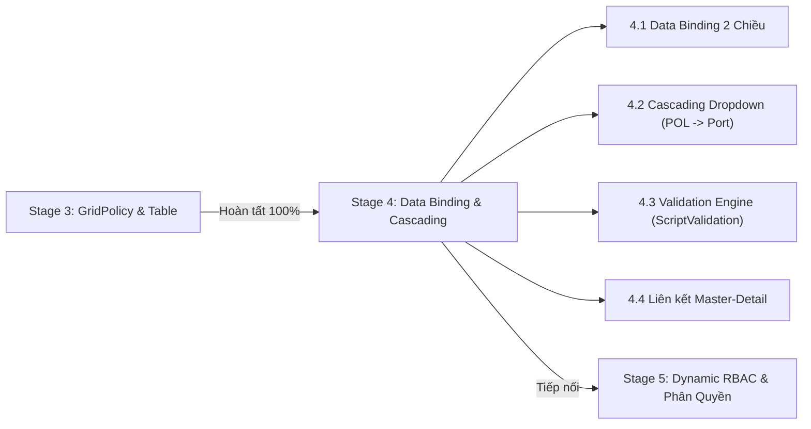

# 📘 Tài Liệu Kỹ Thuật: Component ForgeTable & Hệ Thống GridPolicy Enterprise Data Grid

> **Dự án:** UIPorge Visual Web Application Framework  
> **Tác giả:** Đội ngũ Core Engineering (Lead: An & Kael)  
> **Kế thừa & Chuyển đổi từ:** C# Core (`logone/Core/Components/GridView.cs` & `Core.API/Models/GridPolicy.cs`)  
> **Phiên bản:** 2.0 (Giai đoạn 3 Hoàn thiện)  
> **Ngày cập nhật:** 09/11/2026  

---

## 📑 Mục Lục
1. [Tổng Quan (Overview)](#1-tổng-quan-overview)
2. [Kiến Trúc & Phân Bố Tập Tin (Architecture & File Structure)](#2-kiến-trúc--phân-bố-tập-tin)
3. [Bảng Tra Cứu Toàn Bộ Thuộc Tính (GridPolicy Properties Reference)](#3-bảng-tra-cứu-toàn-bộ-thuộc-tính)
4. [Các Cơ Chế Hoạt Động Cốt Lõi (Core Mechanisms)](#4-các-cơ-chế-hoạt-động-cốt-lõi)
   - [4.1. Cơ chế Kéo Thả (Drag & Drop) Đổi Thứ Tự Cột](#41-cơ-chế-kéo-thả-drag--drop-đổi-thứ-tự-cột)
   - [4.2. Thuật Toán Cột Ghim (Frozen Sticky Left)](#42-thuật-toán-cột-ghim-frozen-sticky-left)
   - [4.3. Ô Tương Tác Sống Động (Live Interactive Cell Components)](#43-ô-tương-tác-sống-động-live-interactive-cell-components)
   - [4.4. Hệ Thống Context Menu & Portal Cách Ly](#44-hệ-thống-context-menu--portal-cách-ly)
   - [4.5. Hàng Tổng Kết Chân Bảng (Summary Row)](#45-hàng-tổng-kết-chân-bảng-summary-row)
5. [Hướng Dẫn Sử Dụng Cho Lập Trình Viên (Developer Usage Guide)](#5-hướng-dẫn-sử-dụng-cho-lập-trình-viên)
6. [Kế Hoạch Triển Khai Giai Đoạn Tiếp Theo (Next Phase: Stage 4)](#6-kế-hoạch-triển-khai-giai-đoạn-tiếp-theo)

---

## 1. Tổng Quan (Overview)

`ForgeTable` là thành phần lưới dữ liệu cấp doanh nghiệp (Enterprise Data Grid) trung tâm của framework UIPorge. Component được thiết kế nhằm thay thế và hiện đại hóa toàn diện hệ thống `GridView.cs` cũ từ nền tảng C# Bridge.NET sang TypeScript/React hiện đại mà vẫn giữ nguyên vẹn 100% mô hình cấu hình thuộc tính **GridPolicy**.

### Các đặc tính nổi bật:
- 🚀 **Hiệu năng cao:** Render mượt mà dữ liệu lớn, tính toán `left` offset vị trí cố định dạng pixel thực tế.
- 🎯 **Mỗi ô là một component thực thụ:** Không render text chết; ô tự động hóa thành `TextBox`, `Select`, `DatePicker`, `Number`, `Checkbox`, `Button` cho phép nhập liệu trực tiếp tại chỗ.
- 🔀 **Kéo thả linh hoạt (Drag & Drop):** Hỗ trợ kéo thả cột đổi thứ tự trực tiếp trên Header bảng và trong danh sách quản lý cột Property Panel.
- 📌 **Ghim cố định (Frozen Columns):** Tự động đẩy cột ghim lên đầu bảng, phân tách bằng đường viền xanh ngọc lục bảo và hiệu ứng đổ bóng.
- 📋 **Menu chuột phải 2 cấp:** Context Menu riêng cho Header (cấu hình cột) và Context Menu riêng cho Row (sao chép, chèn, xóa dòng).
- 🧮 **Chân bảng tổng cộng thông minh (Summary Footer):** Tự động quét và tổng hợp dữ liệu `sum`, `avg`, `count` theo thời gian thực.

---

## 2. Kiến Trúc & Phân Bố Tập Tin

Toàn bộ hệ thống bảng dữ liệu được module hóa trong thư mục `frontend/src/renderer/components/grid/`:

| Tập tin | Vai trò chính |
| :--- | :--- |
| **`ForgeTable.tsx`** | Component chính của bảng: quản lý state dòng, toolbar tìm kiếm, lọc nhanh `FilterLocal`, header, body, footer, và xử lý sự kiện kéo thả. |
| **`grid/GridCellComponent.tsx`** | Component chuyên trách render từng ô `<td>`: quyết định hiển thị Input, Dropdown, DatePicker hay Label chỉ đọc dựa trên chính sách `GridPolicy`. |
| **`grid/gridPolicyUtils.ts`** | Thư viện thuật toán: sắp xếp cột theo công thức C# Core, chuẩn hóa `order` (1, 2, 3...), di chuyển cột `moveColumn`, tính khoảng cách ghim `calculateLeftOffsets`. |
| **`grid/ColumnPropertiesModal.tsx`** | Modal cấu hình chi tiết 3 cột (COMMON, DISPLAY 2, DISPLAY) và 2 tab chân trang (THÔNG TIN KHÁC, PHÂN QUYỀN) tái hiện 21 checkboxes của Core C#. |
| **`grid/HeaderContextMenu.tsx`** | Menu ngữ cảnh bật lên khi chuột phải vào tiêu đề cột: Ghim, Ẩn/Hiện, Mở Modal cấu hình, Nhân bản cột, Xóa cột. |
| **`grid/RowContextMenu.tsx`** | Menu ngữ cảnh bật lên khi chuột phải vào bất kỳ dòng nào: Sao chép dòng, Chèn dòng bên dưới, Đổi thứ tự dòng, Xóa dòng. |
| **`grid/SummaryRow.tsx`** | Hàng tổng cộng chân bảng: tự động tính toán tổng các cột số liệu kèm hậu tố đơn vị (vd: `PALLETS`, `CBM`). |
| **`types/gridPolicy.ts`** | Khai báo toàn bộ cấu trúc interface TypeScript ánh xạ 1:1 từ model C# `Core.API/Models/GridPolicy.cs`. |

---

## 3. Bảng Tra Cứu Toàn Bộ Thuộc Tính

Dưới đây là bảng đặc tả toàn bộ các trường trong interface `GridColumnPolicy` (hoặc `TableColumn`):

### 3.1. Nhóm Thuộc Tính Định Danh & Thứ Tự (Common)

| Thuộc tính UIPorge | Trường Core C# | Kiểu dữ liệu | Mặc định | Tác dụng & Hành vi thực tế |
| :--- | :--- | :---: | :---: | :--- |
| `key` | `FieldName` | `string` | Bắt buộc | Tên trường ánh xạ vào dữ liệu đối tượng dòng (`row[key]`), tương đương tên cột Database. |
| `title` | `ShortDesc` | `string` | Bắt buộc | Tiêu đề hiển thị trên thanh Header của bảng. |
| `order` | `Order` | `number` | `idx + 1` | Thứ tự xuất hiện của cột từ trái sang phải (số nhỏ xếp trước). Khi kéo thả cột hoặc nhập số, thứ tự toàn bảng tự động chuẩn hóa liên tục `1, 2, 3...` |
| `code` | `Code` | `string` | `GPxxxxxx` | Mã định danh GridPolicy quy chuẩn hệ thống (vd: `GP000080`). |
| `feature` | `Feature` | `string` | `''` | Mã phân hệ tính năng chứa bảng (vd: `F0013000`). |
| `dataSource` | `DataSource` | `string` | `''` | Đường dẫn OData hoặc API truy vấn dữ liệu tham chiếu danh mục. |

### 3.2. Nhóm Thuộc Tính Kích Thước & Trình Bày (Display 2)

| Thuộc tính UIPorge | Trường Core C# | Kiểu dữ liệu | Mặc định | Tác dụng & Hành vi thực tế |
| :--- | :--- | :---: | :---: | :--- |
| `width` | `Width` | `string` | `'140px'` | Độ rộng mặc định của cột (vd: `'160px'`, `'110px'`). |
| `minWidth` | `MinWidth` | `string` | `width` | Độ rộng tối thiểu, bảo vệ cột không bị ép co méo khi bảng nhiều cột. |
| `maxWidth` | `MaxWidth` | `string` | `undefined` | Độ rộng trần tối đa khi co giãn. |
| `align` | `TextAlign` | `'left' \| 'center' \| 'right'` | `'left'` | Căn lề tiêu đề cột và nội dung ô (chữ căn trái, mã căn giữa, số liệu căn phải). |
| `formatCell` | `FormatCell` | `string` | `'{0}'` | Chuỗi mẫu định dạng dữ liệu (vd: `{0} KGS`, `{Code} - {Name}`). |

### 3.3. Nhóm Thuộc Tính Điều Khiển Component Ô (Display)

| Thuộc tính UIPorge | Trường Core C# | Kiểu dữ liệu | Mặc định | Tác dụng & Hành vi thực tế |
| :--- | :--- | :---: | :---: | :--- |
| `componentType` | `ComponentType` | `ColumnComponentType` | `'TextBox'` | Loại control được render trực tiếp trong ô: <br>• `'TextBox'`: Ô nhập text trực tiếp.<br>• `'Select'` / `'Dropdown'`: Menu thả chọn danh mục.<br>• `'DatePicker'`: Ô nhập ngày tháng kèm icon lịch `📅`.<br>• `'Number'`: Ô nhập số có căn phải và bước nhảy.<br>• `'Checkbox'`: Hộp kiểm boolean.<br>• `'Button'`: Nút bấm kích hoạt hành động.<br>• `'Link'`: Đường dẫn mở chứng từ.<br>• `'Textarea'`: Ô nhập văn bản nhiều dòng.<br>• `'Label'`: Nhãn chữ tĩnh chỉ đọc. |
| `precision` | `Precision` | `number` | `0` | Số chữ số thập phân cho ô số liệu (vd: `0` cho số nguyên, `2` cho số khối CBM `25.00`). |
| `options` | `LocalData` | `SelectOption[]` | `[]` | Danh sách mục chọn cho dropdown `[{ value: '20GP', label: '20GP' }]`. |
| `events` | `Events` | `string` | `''` | Cấu hình sự kiện JSON ánh xạ vào BL (vd: `{"change": "CheckPackageType"}`). |
| `cssClass` | `ClassName` | `string` | `''` | Class Tailwind hoặc CSS tùy biến gán thêm vào ô. |

### 3.4. Nhóm Thuộc Tính Cờ Logic (Thông Tin Khác - Checkboxes)

| Thuộc tính UIPorge | Trường Core C# | Kiểu dữ liệu | Mặc định | Tác dụng & Hành vi thực tế |
| :--- | :--- | :---: | :---: | :--- |
| `frozen` / `sticky` | `Frozen` | `boolean` | `false` | **Cố định cột**: Tự động đưa cột lên đầu bảng (bên trái), cuộn ngang bảng cột sẽ neo chặt mà không bị che khuất. |
| `editable` | `Editable` | `boolean` | `true` | **Cho phép sửa**: Khi `true`, ô hiển thị component để user nhập liệu trực tiếp. Khi `false`, ô chuyển sang chế độ text chỉ đọc. |
| `disabled` | `Disabled` | `boolean` | `false` | **Vô hiệu hóa**: Khóa không cho phép thao tác hay chỉnh sửa trên ô (`disabled={true}`). |
| `hidden` | `Hidden` | `boolean` | `false` | **Ẩn cột**: Không render cột trên giao diện bảng; có thể hiện lại bằng chuột phải. |
| `sortable` | `Sortable` | `boolean` | `true` | **Cho phép sắp xếp**: Click vào tiêu đề để sắp xếp tăng/giảm theo cột này. |
| `aggregate` | `Summary` | `'sum' \| 'avg' \| 'count' \| 'none'` | `'none'` | **Tính tổng chân bảng**: Tự động cộng tổng (`sum`), tính trung bình (`avg`), hoặc đếm số dòng (`count`) tại hàng Footer. |
| `summarySuffix` | — | `string` | `''` | Hậu tố đính kèm sau giá trị tổng cộng (vd: `' PALLETS'`, `' CBM'`). |
| `upperCase` | `UpperCase` | `boolean` | `false` | **Tự động viết hoa**: Mọi ký tự nhập vào ô tự động viết hoa (chuẩn số Container, mã Cảng). |

---

## 4. Các Cơ Chế Hoạt Động Cốt Lõi

### 4.1. Cơ chế Kéo Thả (Drag & Drop) Đổi Thứ Tự Cột
- Kế thừa chuẩn HTML5 Drag and Drop native, không dùng thư viện ngoài giúp tối ưu tốc độ và không gây giật lag.
- Khi người dùng giữ chuột vào tiêu đề cột kéo sang trái/phải:
  1. `handleColDragOver` tính toán tọa độ chuột so với trục giữa của cột đích (`e.clientX < rect.left + rect.width / 2`).
  2. Hiển thị đường vạch chỉ báo màu xanh ngọc sáng rực (`border-l-4 border-l-emerald-400 bg-emerald-500/20` hoặc `border-r-4`) báo trước vị trí chuẩn bị thả.
  3. Khi thả chuột (`onDrop`), hàm [`moveColumn`](file:///D:/Learn/UIPorge/frontend/src/renderer/components/grid/gridPolicyUtils.ts#L45) hoán đổi vị trí trong mảng, tự động gán lại `order: 1, 2, 3...` và lưu bền vững vào `useEditorStore`.
  4. Nếu kéo một cột thường vào vùng cột ghim, cột tự động chuyển thành ghim (`frozen: true`). Ngược lại, nếu kéo cột ghim ra ngoài vùng ghim, cột tự động nhả ghim (`frozen: false`).

### 4.2. Thuật Toán Cột Ghim (Frozen Sticky Left)
Kế thừa chuẩn xác từ công thức Core C# (`GridView.cs` dòng 2569):
$$\text{Header} = \text{columns}.\text{OrderByDescending}(x \Rightarrow x.\text{Frozen}).\text{ThenBy}(x \Rightarrow x.\text{Order})$$
- Cột có `frozen = true` luôn được xếp trước các cột không ghim.
- Hàm [`calculateLeftOffsets`](file:///D:/Learn/UIPorge/frontend/src/renderer/components/grid/gridPolicyUtils.ts#L80) tính toán khoảng cách `left` tích lũy chính xác từng pixel:
  $$\text{left}[i] = \text{STT\_WIDTH} (55\text{px}) + \sum_{k=0}^{i-1} \text{width}[k]$$
- Cột ghim cuối cùng (`lastFrozenKey`) được phủ thêm đường viền ngọc và bóng đổ nổi bật (`border-r-2 border-emerald-500/60 shadow-[4px_0_12px_rgba(0,0,0,0.6)]`) để phân tách rõ ràng với các cột cuộn bên phải.

### 4.3. Ô Tương Tác Sống Động (Live Interactive Cell Components)
- Mặc định mọi cột đều có `isEditable = (col.editable ?? true) && !col.disabled && col.componentType !== 'Label'`.
- Khi render, ô có viền `border-slate-700/70`, nền `bg-slate-900/70`, placeholder gợi ý và vòng sáng xanh ngọc khi focus (`focus:border-emerald-400 focus:ring-1`).
- Nếu dữ liệu ban đầu chứa ký tự gạch ngang giả lập (`'—'` hoặc `'-'`), hệ thống tự động làm sạch về rỗng `""` để người dùng không phải xóa ký tự trước khi gõ.
- Thay đổi trên từng ô được lưu tức thời vào dòng dữ liệu thông qua định danh duy nhất `row.id`.

### 4.4. Hệ Thống Context Menu & Portal Cách Ly
- Cả `HeaderContextMenu`, `RowContextMenu` và `ColumnPropertiesModal` đều được đưa ra khỏi cây DOM Canvas bằng **`createPortal(..., document.body)`** với các tầng `z-[999998]` và `z-[999999]`.
- Điều này giải quyết dứt điểm lỗi stacking context trong CSS, đảm bảo menu và modal không bao giờ bị các phần tử `position: sticky` của bảng đè lên.

---

## 5. Hướng Dẫn Sử Dụng Cho Lập Trình Viên

### 5.1. Khai Báo Bảng Mới Trong Template / Canvas Tree
Để khai báo một bảng dữ liệu chuẩn ERP trong hệ thống UIPorge, khai báo một node có `type: 'Table'` như sau:

```typescript
{
  id: 'grid_shipping_info',
  type: 'Table',
  props: {
    label: 'SHIPPING INFORMATION',
    columns: [
      { 
        key: 'pol', 
        title: 'POL', 
        width: '160px', 
        sticky: 'left', 
        frozen: true, 
        sortable: true, 
        editable: true, 
        componentType: 'TextBox', 
        order: 1 
      },
      { 
        key: 'etd', 
        title: 'ETD', 
        width: '120px', 
        componentType: 'DatePicker', 
        sortable: true, 
        editable: true, 
        order: 2 
      },
      { 
        key: 'packageType', 
        title: 'PACKAGE TYPE', 
        width: '130px', 
        componentType: 'Select', 
        options: [
          { value: 'PALLETS', label: 'PALLETS' },
          { value: 'CARTONS', label: 'CARTONS' }
        ],
        editable: true, 
        order: 3 
      },
      { 
        key: 'gw', 
        title: 'GW (KGS)', 
        width: '120px', 
        align: 'right', 
        componentType: 'Number', 
        precision: 0, 
        aggregate: 'sum', 
        summarySuffix: ' KGS',
        editable: true, 
        order: 4 
      }
    ],
    data: [
      { id: 1, pol: 'SHANGHAI / CNSGH', etd: '26/01/2026', packageType: 'PALLETS', gw: 1085 },
      { id: 2, pol: 'BUSAN / KRPUS', etd: '28/01/2026', packageType: 'CARTONS', gw: 3450 }
    ]
  },
  style: { width: '100%', marginBottom: '16px' }
}
```

### 5.2. Các Phím Tắt & Thao Tác Chuẩn Trên Bảng
- **Chuột trái vào Tiêu đề:** Sắp xếp tăng/giảm cột (`Sort`).
- **Kéo thả Tiêu đề:** Di chuyển hoán đổi thứ tự cột linh hoạt.
- **Chuột phải vào Tiêu đề:** Mở Menu tùy chọn cột (Ghim cột, Ẩn/Hiện, Mở Modal cấu hình đầy đủ).
- **Chuột phải vào Dòng dữ liệu / STT:** Mở Menu thao tác dòng (Sao chép, Chèn dòng mới, Xóa dòng).
- **Click vào ô:** Nhập liệu hoặc chọn ngày/danh mục trực tiếp.
- **Nút "Lọc Cột" trên Toolbar:** Bật/tắt thanh tìm kiếm nhanh riêng biệt dưới từng cột (`FilterLocal`).

---

## 6. Kế Hoạch Triển Khai Giai Đoạn Tiếp Theo

Sau khi hoàn tất nghiệm thu toàn diện Giai đoạn 3 (GridPolicy & Enterprise Data Grid), hệ thống sẵn sàng chuyển giao sang **GIAI ĐOẠN 4: Data Binding, Cascading Dropdowns & Validation**:



### Các nhiệm vụ trọng tâm của Giai đoạn 4:
1. **Data Binding 2 Chiều Giữa Form & Grid:**
   - Liên kết dữ liệu giữa các ô trên form Header (`Job No.`, `M-B/L No.`) với các dòng trong bảng `ForgeTable`.
   - Lưu trữ và đồng bộ hóa tự động xuống SQL Server thông qua ASP.NET Core API.
2. **Cascading Dropdowns (Dropdown phụ thuộc):**
   - Chọn `Country` $\rightarrow$ Dropdown `Port (POL/POD)` tự động lọc theo danh mục cảng của quốc gia đó (kế thừa `CascadeField` và `RefClass`).
3. **Bộ Quy Tắc Kiểm Tra Tính Hợp Lệ (Validation Engine):**
   - Kế thừa `ScriptValidation` từ Core C# (kiểm tra ngày `ETD <= ETA`, số container đúng định dạng 4 chữ cái + 7 chữ số).
4. **Mô Hình Dữ Liệu Master-Detail (Lô Hàng - Chi Tiết Container):**
   - Chọn dòng trên bảng Shipping Information $\rightarrow$ Bảng Container Information bên dưới tự động nạp các container tương ứng của lô hàng đó.

---
*Tài liệu được biên soạn và bảo chứng bởi Đội ngũ Kiến trúc Hệ thống UIPorge.*
