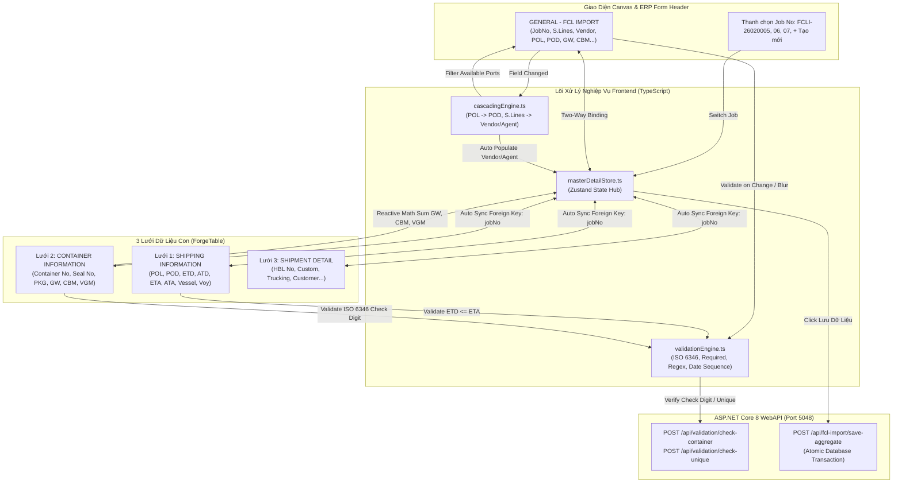

# 🔗 Tài Liệu Kỹ Thuật Giai Đoạn 4: Data Binding, Cascading Dropdowns & Validation Rules Engine

> **Dự án:** UIPorge Visual Web Application Framework  
> **Người thực hiện:** Đội ngũ Kỹ thuật UIForge (Zenith & An)  
> **Trạng thái:** Hoàn tất triển khai (Production-Ready)  
> **Căn cứ kế thừa:** `Component.cs`, `GridPolicy.cs`, `Validation.cs`, `EntityRef.cs` từ C# Core (Bridge.NET)  

---

## 1. Tổng Quan Kiến Trúc Giai Đoạn 4

Giai đoạn 4 nâng cấp UIForge từ một giao diện tĩnh trở thành một **Enterprise Reactive Framework**, kết nối chặt chẽ giữa Form Header và các Bảng Lưới Dữ Liệu con (Master-Detail), tự động xử lý quan hệ phụ thuộc giữa các danh mục (Cascading), tự động điền các trường liên đới (Auto-Populate), và thực thi động cơ kiểm tra tính hợp lệ dữ liệu đa tầng (Multi-layer Validation Engine).

---

## 2. Chi Tiết Các Phân Hệ Đã Hoàn Thành

### 2.1. Động Cơ Master-Detail Quan Hệ 1 - N (`masterDetailStore.ts`)
* **Khóa liên kết (Master Key):** `jobNo` (ví dụ `FCLI-26020005`).
* **Hỗ trợ chuyển đổi tức thì nhiều lô hàng:**
  * Mặc định tích hợp sẵn 3 lô hàng thực tế: `FCLI-26020005` (SITC - Shanghai $\rightarrow$ Tiên Sa), `FCLI-26020006` (ONE - Busan $\rightarrow$ Cát Lái), `FCLI-26020007` (WHL - Shanghai $\rightarrow$ Hải Phòng).
  * Nút `+ Tạo mới`: Khởi tạo Job No tiếp theo (`FCLI-26020008`) với toàn bộ form và 3 bảng con được reset sạch sẽ.
  * Khi chuyển Job, toàn bộ giá trị Form Header và cả 3 bảng `SHIPPING INFORMATION`, `CONTAINER INFORMATION`, `SHIPMENT DETAIL` tự động đổi dữ liệu tức thời.
* **Tính toán phản ứng hai chiều (Reactive Math):**
  * Khi nhân viên chỉnh sửa số lượng kiện (`packageNumber`), trọng lượng (`gw`), thể tích (`cbm`), hoặc `vgm` trong bất kỳ dòng nào của bảng `CONTAINER INFORMATION`, `masterDetailStore` tự động tính tổng $\sum$ và đồng bộ ngược lên các trường `T.Packages`, `Total GW`, `Total CBM`, `Total VGM` trên Form Header mà không cần ấn nút tính toán.

### 2.2. Động Cơ Cascading Dropdowns & Auto-Populate (`cascadingEngine.ts`)
* Kế thừa trực tiếp từ thuộc tính `CascadeField` và `PopulateField` trong `Component.cs` & `GridPolicy.cs` của C# Core:
  1. **POL $\rightarrow$ POD (Tuyến Vận Tải Quốc Tế):**
     * Chọn cảng bốc `CNSGH` (Shanghai) $\rightarrow$ Cảng dỡ `POD` chỉ hiển thị các tuyến khả dụng: `TIEN SA TERMINAL / VNDTS`, `CAT LAI / VNSGN`, `HAI PHONG / VNHPH`.
     * Chọn cảng bốc `KRPUS` (Busan) $\rightarrow$ Cảng dỡ `POD` tự lọc danh sách tuyến Busan: `CAT LAI / VNSGN`, `TIEN SA TERMINAL / VNDTS`.
  2. **Hãng Tàu (S.Lines) $\rightarrow$ Vendor & Agent & Điều Khoản:**
     * Nhập `SITC` $\rightarrow$ Tự điền `Vendor: VFRAC-IT`, `Agent: SHANGHAI TRANSLEAD`, `P.Term: COLLECT`, `Service: CYCY`.
     * Nhập `ONE` $\rightarrow$ Tự điền `Vendor: TRANSLEAD`, `Agent: OCEAN NETWORK EXPRESS JAPAN`, `P.Term: PREPAID`, `Service: CYCY`.
     * Nhập `WHL` $\rightarrow$ Tự điền `Vendor: VFRAC-IT`, `Agent: WAN HAI LINES TAIPEI`, `P.Term: COLLECT`.
     * Nhập `ASL` $\rightarrow$ Tự điền `Vendor: VFRAC-IT`, `Agent: ASL TRANS OVERSEAS`, `P.Term: PREPAID`, `Service: DOOR`.

### 2.3. Động Cơ Quy Tắc Xác Thực Dữ Liệu Doanh Nghiệp (`validationEngine.ts`)
* **Thuật toán Quốc Tế ISO 6346 Container Check Digit:**
  * Bảng đối chiếu mã ký tự từ $A=10 \dots Z=38$ (loại trừ các số chia hết cho 11: 11, 22, 33).
  * Công thức trọng số: $\sum_{i=0}^9 \text{charVal}_i \times 2^i \pmod{11}$.
  * Nếu người dùng gõ sai Check Digit (ví dụ `ZIRU8505175` - check digit thật là 2 nhưng gõ là 5): Ô nhập liệu trên bảng lập tức đổi viền đỏ và hiển thị tooltip cảnh báo:
    > *"Số Container ZIRU8505175 sai Check Digit: Tính toán là [2] nhưng nhập là [5]."*
* **Business Date Sequence (Kiểm Tra Tuần Tự Thời Gian):**
  * Tự động kiểm tra `ETD <= ETA` và `ATD <= ATA` trên từng dòng của `SHIPPING INFORMATION`.
  * Kiểm tra `Ngày phát hành M-B/L <= Ngày khởi hành (S.Date)` trên Form Header.
* **Regex Pattern Validation:**
  * Kiểm tra định dạng số vận đơn M-B/L (`^[A-Z0-9]{8,18}$`).

### 2.4. Backend WebAPI Controller (ASP.NET Core 8)
1. [`backend/UIForge.API/Controllers/ValidationController.cs`](file:///D:/Learn/UIPorge/backend/UIForge.API/Controllers/ValidationController.cs):
   * `POST /api/validation/check-container`: Kiểm tra số container ISO 6346.
   * `POST /api/validation/check-unique`: Kiểm tra trùng lặp JobNo, ContainerNo, SealNo với database.
2. [`backend/UIForge.API/Controllers/FclImportController.cs`](file:///D:/Learn/UIPorge/backend/UIForge.API/Controllers/FclImportController.cs):
   * `POST /api/fcl-import/save-aggregate`: Thực thi lưu hợp nhất 1 Master Record + 3 Child Arrays trong một Transaction duy nhất của SQL Server.

---

## 3. Danh Sách Tệp Mã Nguồn Mới & Nâng Cấp

| STT | Đường Dẫn Tệp | Vai Trò |
| :---: | :--- | :--- |
| 1 | [`frontend/src/logic/masterDetailStore.ts`](file:///D:/Learn/UIPorge/frontend/src/logic/masterDetailStore.ts) | Zustand Store trung tâm quản lý Master Record, 3 Child Grids, Two-Way Binding |
| 2 | [`frontend/src/logic/cascadingEngine.ts`](file:///D:/Learn/UIPorge/frontend/src/logic/cascadingEngine.ts) | Động cơ lọc Cascading dropdowns (POL $\rightarrow$ POD) và Auto-Populate Vendor/Agent |
| 3 | [`frontend/src/logic/validationEngine.ts`](file:///D:/Learn/UIPorge/frontend/src/logic/validationEngine.ts) | Thuật toán ISO 6346 Container Check Digit, Date Sequence, Regex Pattern |
| 4 | [`frontend/src/renderer/components/grid/GridCellComponent.tsx`](file:///D:/Learn/UIPorge/frontend/src/renderer/components/grid/GridCellComponent.tsx) | Hiển thị viền đỏ và tooltip lỗi trực quan cho từng ô khi vi phạm validation |
| 5 | [`frontend/src/renderer/components/ForgeTable.tsx`](file:///D:/Learn/UIPorge/frontend/src/renderer/components/ForgeTable.tsx) | Kết nối 3 lưới dữ liệu con với Master-Detail Store và Reactive Summary |
| 6 | [`frontend/src/renderer/components/ForgeTextBox.tsx`](file:///D:/Learn/UIPorge/frontend/src/renderer/components/ForgeTextBox.tsx) | Two-Way binding với Master Record + Thanh nút chuyển nhanh Job No |
| 7 | [`frontend/src/renderer/components/ForgeSelect.tsx`](file:///D:/Learn/UIPorge/frontend/src/renderer/components/ForgeSelect.tsx) | Two-Way binding + Cascading Dropdown động cho POD và Vendor |
| 8 | [`frontend/src/renderer/components/ForgeDatePicker.tsx`](file:///D:/Learn/UIPorge/frontend/src/renderer/components/ForgeDatePicker.tsx) | Two-Way binding cho các trường ngày tháng (S.Date, Issue Date, ETA) |
| 9 | [`frontend/src/renderer/components/ForgeNumber.tsx`](file:///D:/Learn/UIPorge/frontend/src/renderer/components/ForgeNumber.tsx) | Đồng bộ phản ứng thời gian thực với tổng GW, CBM, VGM từ bảng container |
| 10 | [`frontend/src/renderer/components/ForgeTextarea.tsx`](file:///D:/Learn/UIPorge/frontend/src/renderer/components/ForgeTextarea.tsx) | Two-Way binding cho trường ghi chú (Notes) |
| 11 | [`frontend/src/logic/fclImport.bl.ts`](file:///D:/Learn/UIPorge/frontend/src/logic/fclImport.bl.ts) | Kết nối nút `Lưu Dữ Liệu` với `saveAggregate()` trong store |
| 12 | [`frontend/src/logic/eventRunner.ts`](file:///D:/Learn/UIPorge/frontend/src/logic/eventRunner.ts) | Hỗ trợ hiển thị toast thông báo kết quả lưu Transaction từ Backend API |
| 13 | [`backend/UIForge.API/Controllers/ValidationController.cs`](file:///D:/Learn/UIPorge/backend/UIForge.API/Controllers/ValidationController.cs) | Endpoint kiểm tra ISO 6346 và Unique trên WebAPI |
| 14 | [`backend/UIForge.API/Controllers/FclImportController.cs`](file:///D:/Learn/UIPorge/backend/UIForge.API/Controllers/FclImportController.cs) | Endpoint lưu hợp nhất Master-Detail Transaction trên WebAPI |

